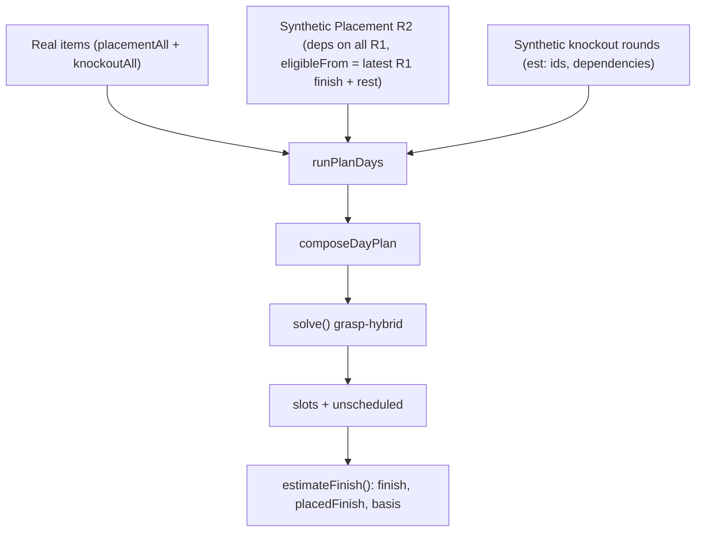

# Always answer "when does this tournament finish?"

## Why this plan was revised

The scheduling engine was replaced while this plan sat unimplemented. The design is unchanged
(floor + forecast, one pure estimator, shared UI wording); every finding and file reference is
re-grounded in the current code. The deltas that drove the revision:

- The legacy `src/lib/tournament/scheduler-grasp.ts` and `src/lib/tournament/scheduler.ts` are now
  dead code (no live importer) and are slated for deletion by the sport-agnostic core plan. The
  estimator must build on the new core, never on them.
- Production already runs on the sport-agnostic core: `runStageForDay` builds a
  `SchedulingProblem` through `composeDayPlan` (`src/lib/tournament/scheduling/composition.ts`)
  and runs `solve()` (`src/lib/scheduling/solvers/index.ts`). Default strategy is `grasp-hybrid`
  (`DEFAULT_SOLVER_ID`), one run, seed `20260912`.
- Names changed: `dependsOn` -> `ScheduleMatch.dependencies`, `earliestStart` -> `eligibleFrom`,
  `playerIds` -> `participantIds`, `playersKnown` -> `participantsKnown`, `GraspSchedulableMatch`
  -> `ComposedMatch` / `ScheduleMatch`.
- Every solver now honours `dependencies`, so the estimator no longer needs to force GRASP for its
  knockout forecast.
- Revision 2 (this version) additionally: includes inevitable uncreated **Placement Round 2**
  workload, verifies the **`is_bye` = round 1 only** invariant before touching knockout
  arithmetic, and states the **multi-event participant-identity** limitation explicitly.

## Goal and guardrails

The question the UI must always be able to answer is **"when is this tournament expected to
finish?"** Three rules frame every decision below:

- **The real planner is unchanged.** Production still places only matches that exist, and a real
  Build still creates rounds only as results arrive. No synthetic match is ever created or
  persisted for the estimate.
- **The floor and the forecast are separate numbers.** `placedFinish` stays the exact maximum end
  over actually placed slots. A new `finish` forecasts the whole tournament and includes
  (a) placed matches, (b) existing but unplaced/blocked matches, (c) inevitable uncreated
  Placement Round 2 matches, and (d) inevitable uncreated knockout matches.
- **The forecast is structural, not probabilistic.** It assumes perfect flow and does not know
  that one real person may play several events (see the limitation section).

## Current engine, verified

All findings are read from the current modules; they are the reason the design below assumes
nothing.

- **Production path.** `planPlacementSchedule` runs the day loop inline
  (`src/lib/tournament/placement-schedule.ts:785-978`) and calls the private `runStageForDay`
  (`:569-619`), which builds the problem with `composeDayPlan` and delegates to `solve()`. The
  placement pass forwards `graspOptions`; the knockout pass passes none.
- **Default strategy.** `DEFAULT_SOLVER_ID = "grasp-hybrid"`, `DEFAULT_HYBRID_RUNS = 1`,
  `DEFAULT_SEED = 20260912` (`src/lib/scheduling/solvers/types.ts:29-38`). `defaultSchedulingPolicy`
  maps `DayOneSchedulerOptions` onto it (`src/lib/tournament/scheduling/policy.ts:39-63`).
- **Precedence is `dependencies`.** `dependenciesSatisfied`
  (`src/lib/scheduling/solvers/shared.ts:31-43`) refuses a start until every dependency has a known
  end at or before it. `knownEndOf` (`:15-29`) resolves fixed matches, solved assignments and
  anchors, and a dependency with no known end blocks outright. `lowerBoundOf` (`:56-69`) adds each
  dependency's end to the lower bound.
- **`dependencies` carries no rest gap.** `lowerBoundOf` takes only the dependency end. Round-to-
  round rest must come from a shared participant, enforced by `relateToDecided`
  (`src/lib/scheduling/domain.ts:363-376`) via `requiredRestBetween` (`:309-314`), in both
  directions.
- **Real knockout rows are ordered by `eligibleFrom`, not `dependencies`.** `tierItems`
  (`placement-schedule.ts:410-486`) derives `eligibleFrom` from each parent's
  `ended_at`/`reported_time` (`:436-443`, `:466`) and sets no `dependencies`. Placement items do set
  `dependencies` from `prerequisite_ids` (`:393`). Estimator copies must therefore add
  `dependencies` (precedence) while sharing placeholders (rest).
- **Decided occupancies.** A decided occupancy with an optional resource is a `ParticipantAnchor`
  (`domain.ts:65-75`); its end counts toward the reporting family (`knownFinish`) but it is not a
  match to place. Fixed matches and anchors are exempt from `hardEnd` and `floor`
  (`src/lib/scheduling/constraints.ts:483-531`).
- **The last court-bearing day is unbounded.** `hardEnd` is suppressed for `lastFilledDayId`
  (`placement-schedule.ts:812-814`), which is exactly where an overrun belongs.

## Placement Round 2: inevitable uncreated workload

The two-round placement format guarantees Round 2, so it must be in the forecast even when no
Round 2 row exists yet. The count comes from the **format invariant**, not from persisted rows.

- **Every entrant plays exactly two placement matches.** `src/lib/tournament/placement.ts:5-7`.
  Total placement matches therefore equals `N`, the number of non-excluded entrants, for `N >= 3`.
- **Round 1 is generated wholesale.** `pairPlacementRoundOne` emits `floor(N/2)` matches; for odd
  `N` the middle seed is held and produces no row at all (`placement.ts:137-155`). Round 1 always
  exists in full before any Round 2 row can.
- **Round 2 is the remainder.** `expectedR2 = N - floor(N/2) = ceil(N/2)` for `N >= 3`.
- **Small fields stop early.** `requiredPlacementMatches` returns 0 for `N <= 1` and 1 for `N === 2`
  (`placement.ts:37-42`); `N === 2` plays one match and no crossover (`TWO_ENTRANT_TIERS`,
  `placement.ts:48-54`), so its Round 2 is empty. So:

```ts
const expectedPlacementTotal = n <= 1 ? 0 : n === 2 ? 1 : n;
const expectedR2 = n <= 2 ? 0 : Math.ceil(n / 2);
```

- **Round 2 only exists after Round 1 is decided.** `buildPlacementRoundTwo` throws if any Round 1
  match is undecided (`placement.ts:205-212`), and the gate (`placementGate`,
  `placement.ts:590-620`; SQL `placement_required_matches`,
  `supabase/migrations/20260917010000_placement_stage_rpcs.sql:40-52`) requires every active
  entrant to have `required` decided matches first. This is why Round 1 can be depended on in
  full.
- **Missing Round 2** = `max(0, expectedR2 - existingPlayableR2)`, counted into
  `uncreatedMatches`. Existing Round 2 rows are placement matches with `stage === "round2"` and a
  non-void status. There are no byes in the placement stage (`placement.ts:9-15`), so no no-play
  adjustment is needed.

`N` is the count of `PlacementEntrant` rows with `excluded !== true`, matching the gate's own
`NOT excluded` rule.

### The R1 -> R2 feeder mapping is not structurally knowable

The **count** of Round 2 is knowable before results; the **pairing** is not. `buildPlacementRoundTwo`
(`src/lib/tournament/placement.ts:200-343`) cannot even run until every Round 1 match is decided —
it throws otherwise (`placement.ts:205-212`) — and every Round 2 participant is then derived from
outcomes:

- The held entrant's two make-up opponents are the seed-nearest members of the *winners* and
  *losers* sets (`takeNearestSeed`, `placement.ts:243-247`). Which entrants are in those sets is a
  function of who won each Round 1 match, so the opponent is outcome-dependent.
- The remaining matches pair winners among themselves and losers among themselves via
  `halfSplitPairing` (`placement.ts:277-315`), again over outcome-dependent sets.
- The crossover is chosen from whichever winner and loser are left over, and steps aside to avoid a
  rematch (`chooseCrossover`, `placement.ts:279-290`).
- `N === 2` plays no Round 2 at all (`placement.ts:48-54`, and the `fieldSize === 2` branch in
  `computePlacementOutcomes`).

So there is no honest static map from an R2 slot to one or two R1 matches. **Do not invent a
corresponding R1 match and do not build a per-R1 bridge placeholder.** The structural v1 forecast
instead brackets the whole stage: no synthetic Round 2 match may start before
`latestRound1Finish + placementRest`, enforced by the all-R1 dependency gate plus an
`eligibleFrom` bound derived from the estimator's own Round 1 placements (see below).

## `is_bye` semantics, verified before touching knockout arithmetic

The question is whether no-play rows can appear after round 1. They cannot. **`is_bye` is a
round-1-only property in this data model:**

- **TypeScript generation.** `buildTierBracket` sets `isBye` only in the round-1 loop, and a bye
  carries its winner immediately (`src/lib/tournament/tier-draw.ts:104-127`). `nextTierRound`
  always emits `isBye: false` (`tier-draw.ts:159-166`).
- **SQL creation.** `apply_tier_draws` writes `is_bye` only from the round-1 payload and rejects
  any round-1 non-bye row missing an entrant
  (`supabase/migrations/20260917010000_placement_stage_rpcs.sql:608-639`). `advance_tier_draw_locked`
  creates every later round with a hard-coded `false` for `is_bye` and `'scheduled'` status,
  pairing `a.winner_id, b.winner_id` (`:710-723`), and only runs when every slot of the current
  round has a winner (`:680-688`).
- **No walkover/void path for tier rows.** A search for `tier_draw_matches` with `walkover`/`void`
  finds none. `reset_tier_draw_result` restores `'bye'` for byes and `'scheduled'` otherwise
  (`:1050-1057`), and `start_tier_draw_match` refuses byes (`:960-969`).
- **A bye round still advances fully.** A bye carries a winner, so a round containing byes is
  complete without play, and the next round is created with the full `bracketSize / 2 ** round`
  slots, both sides decided.
- **Withdrawals and walkovers do not create later-round no-play rows.** Withdrawal waives an
  entrant at the placement level (`placement.ts:590-620`); a later-round walkover/report is a
  decided match with two entrants and a winner, i.e. real existing work.

**Consequence: keep the current formula and do not subtract byes from later rounds.**

```ts
const expected = round === 1 ? bracketSize / 2 - byes : bracketSize / 2 ** round;
const synthetic = Math.max(0, expected - existingPlayableInRound);
```

`byes = bracketSize - entrantCount` (`tier-draw.ts:134`; `tier_draws` has no `byes` column,
`src/integrations/supabase/types.ts:930-940`). `existingPlayableInRound` counts rows that are
actually playable, excluding `is_bye` and `status === "void"` — the same filter `tierItems` uses
(`placement-schedule.ts:430-431`). Because later rounds cannot contain byes or no-play rows, this
cannot produce a false synthetic match.

Must handle, and be tested for:

- bracket sizes **2 / 4 / 8 / 16 / 32** (round count `log2(bracketSize)`);
- **byes** subtracted in round 1 only; a round-1 bye must not reduce a later round's count;
- **partially created later rounds** (e.g. 16: R1 8/8, R2 2/4, R3 0/2, R4 0/1 -> 2 + 2 + 1 = 5);
- **a one-entrant / champion-only draw** (`bracketSize <= 1` or `champion_id` set -> zero rounds);
- bye sanity: 8 bracket, 6 entrants, 2 byes -> R1 2 + R2 2 + R3 1 = 5 = entrants - 1.

## Synthetic items, feeder precedence and rest

For each knockout draw, index existing rows by `(round, slot)` and walk rounds 1..R:

1. If a real row exists at `(round, slot)`, use its id as the feeder for the next round and keep
   its real `parent_a_id`/`parent_b_id` relationship.
2. Otherwise create a synthetic `ComposedMatch` (id namespaced, e.g. `est:<drawId>:<round>:<slot>`)
   whose **`dependencies` are the two feeders for that slot**, i.e. the ids at
   `(round-1, 2*slot-1)` and `(round-1, 2*slot)`, real or synthetic. Precedence is enforced solely
   by `dependencies`.
3. **Real knockout items are copied** and given a `dependencies` derived from
   `parent_a_id`/`parent_b_id` when the parent is in the batch. The originals are never mutated;
   without this, a real later-round match could be placed before a real earlier-round match because
   production ordering lives in `eligibleFrom`, not `dependencies`.
4. Synthetic `participantIds`: round-one synthetics get fresh placeholder pairs; a later synthetic
   **shares one placeholder with each feeder**, so `relateToDecided` adds the round-to-round rest
   gap. Shared placeholders are never the precedence mechanism.
5. `participantsKnown` stays `undefined` (never `false`, which is itself disqualifying), and
   `eligibleFrom` is left unset on synthetics so the run's own constraints decide the clock.

For the **placement stage**, only Round 2 can be uncreated, and Round 1 always fully exists.
Because the R1 -> R2 pairing is outcome-dependent, the estimator uses no correspondence:

- Synthetic Round 2 items (id `est:<categoryId>:r2:<i>`) get **`dependencies` = every existing
  placement Round 1 item id in their category** — the real generation gate, so no Round 2 match can
  start before every Round 1 match has ended.
- The Round 1 -> Round 2 **rest gap** is carried as a stage-level bound, not a per-match one: every
  synthetic Round 2 item gets `eligibleFrom = latestRound1Finish + placementRest`, where
  `latestRound1Finish` is the latest end among the category's Round 1 items as placed by the
  estimator's own sweep. Combined with the dependency gate this yields
  `start(R2) >= max(latestRound1Finish, every R1 end) + placementRest`, which is exactly the
  requested bound. It never asserts which R1 match fed which R2 slot.
- Synthetic Round 2 items get **fresh placeholder pairs** (unique per item), so they never serialize
  against each other and never imply a feeder relationship. `participantsKnown` stays `undefined`;
  `eligibleFrom` is the only timing hint.
- The sweep is run once with real items to obtain `latestRound1Finish`, then re-run with the
  synthetic Round 2 items carrying the bound. This is consistent because a synthetic Round 2 match
  cannot occupy a resource before the latest Round 1 end (the gate), and its placeholders are
  disjoint, so Round 1's own placement — hence `latestRound1Finish` — is unchanged by adding them.
  Document this invariance argument in the module.

Synthetic placement Round 2 and synthetic knockout items are read for timing and then discarded.
They never enter `slots`, payloads, `diff` or `blocked`, and are never persisted.

## Multi-event participant identity: an explicit limitation

Placeholder participants model feeder precedence and rest correctly along one synthetic bracket
path, but they are structural, not identity-aware. The estimator does **not** know that the same
real person may appear across different events (`MS`, `MD`, `XD`, ...) and therefore cannot see
that their rest windows contend across those events.

- **Consequence, scoped to participant contention:** ignoring cross-event identity is optimistic
  *specifically* about participant contention. Ignoring it can only make the estimate too early, so
  the forecast is a **structural estimate**, not a guarantee.
- **Do not overclaim.** This is not a statement that the real tournament cannot finish earlier for
  other reasons. For example, matches can finish faster than their configured slot, or run ahead at
  the desk, which would make the real finish earlier than the estimate. The estimate assumes each
  slot takes its configured duration.
- **Where to state it:** the `finish-estimate.ts` module docstring and the shared UI wording (the
  estimate is labelled as an estimate, with no claim about cross-event player availability).
- **Not in this change:** no Monte Carlo simulation, no probabilistic modelling, and no cross-event
  identity inference or player-identity graph.

## Deliverable: one pure/read-only module

New `src/lib/tournament/finish-estimate.ts`. It must not mutate slots, payloads, `blocked`, draw
rows, or any database state, and must make no network/RPC calls.

### Result shape

```ts
export interface FinishEstimate {
  /** Projected end of the whole tournament, or null when no finish can be named. */
  finish: string | null;
  /** Max end over actually placed slots. The floor; never below it. */
  placedFinish: string | null;
  /** Existing matches that have players but no slot (real work still to place). */
  unplacedMatches: number;
  /** Inevitable matches that do not exist as rows yet: Placement R2 + knockout rounds. */
  uncreatedMatches: number;
  /** Wall-clock minutes past the final close, only when the work fits by extending. */
  deficitMinutes: number | null;
  basis: "placed" | "projected" | "overflow";
  /** Optional, for wording only: remaining = unplacedMatches + uncreatedMatches. */
  remainingMatches?: number;
  /** Optional, for wording only: configured day count, for "Cannot finish in N days". */
  days?: number;
}
```

`deficitMinutes` is **wall-clock extension of the final day only**. Never put total
match/court-minutes in it: when only unscheduled workload is known, report the match count
(`unplacedMatches` + `uncreatedMatches`) instead, labelled as matches.

## Reuse rather than duplication

- The estimator consumes the planner's **own** items and todo sets (`placementAll`, `knockoutAll`,
  `placementTodo`, `knockoutTodo`, fixed set, days, courts, breaks, options) and the placement
  entrant list. It does not rebuild them, and it surfaces unplaced work from the planner's leftovers
  rather than recomputing it.
- It runs the same real constraints — court availability, match duration, participant/rest rules,
  feeder dependencies, tournament-day windows, breaks — by reusing `runStageForDay` /
  `composeDayPlan` and the same `solve()` the planner uses. Because all three solvers honour
  `dependencies`, no GRASP-specific branch is needed.
- Preferred wiring: extract the per-day loop out of `planPlacementSchedule` into an internal
  `runPlanDays(...)` used by both callers. Production passes only real items (behavior unchanged);
  the estimator passes real + synthetic items. The existing planner test suite is the guard that
  production behavior is unchanged.
- If that extraction cannot be shown to be behavior-preserving, do **not** force it: implement the
  smallest estimator-only day sweep that calls `composeDayPlan` directly, and leave the production
  loop untouched.
- Use a fixed `seed` and a bounded run count so the same state does not report a different finish
  on every render.



## Three bases and overflow, honestly

- **`"placed"`** — nothing forecast. `finish === placedFinish`. Reads `Finishes 01:30`.
- **`"projected"`** — forecast work exists and all of it fits inside the windows. Reads
  `Estimated finish ~01:45 · 7 matches still to place` (remaining = unplaced + uncreated).
- **`"overflow"`** — work exists that the configured windows cannot contain. The official close is
  never presented as the finish. Two rendered cases:
  - everything can be placed but only past the final close -> report the **wall-clock extension**:
    `Needs ~40 min beyond the tournament window` and
    `Estimated finish ~02:10 if courts remain available` (`deficitMinutes` set).
  - something still cannot be placed even with the final day extended -> do **not** name a finish;
    report the **match count**: `Cannot finish in 2 days · 4 matches still need capacity`
    (`finish === null`, `deficitMinutes === null`).

## One shared UI component

Add a single `<FinishEstimate estimate={...} />` (plus its formatter) that owns every wording rule
above, and use it in all three surfaces:

- `/placement-schedule` summary bar (replaces the bare `Finishes ...` chip at
  `src/routes/placement-schedule.tsx:778-788` and the `projectedFinishDeltaMinutes` span),
- the rebuild preview's "Projected finish" block (`placement-schedule.tsx:1199-1220`),
- the Desk / dashboard finish KPI (`src/routes/index.tsx:398-403`, fed by `desk.ts`).

The three surfaces must not independently invent wording. `StatTile`
(`src/components/app-shell.tsx:162-190`) is the existing tile primitive to build on. The wording
must present the number as a **structural estimate** and must not imply it accounts for a player
appearing in several events. The legacy `/schedule` route (`src/routes/schedule.tsx:528-536`,
`:643-660`) shares `ScheduleSummary`; keep its current meaning and do not reword it.

## Rebuild comparison: forecast against forecast

- Add the estimate to `PlacementSchedulePlan` beside `summary`; keep `lastFinishMs` as
  `placedFinish`.
- Compute `currentProjectedFinish` and `projectedFinishDeltaMinutes` from the **same estimator and
  the same semantics** on both sides: the current DB state's forecast vs the rebuilt plan's
  forecast. Never compare a forecast on one side with `placedFinish` on the other, and stop using
  `projectedFinishFromRemainingMatches` (`src/lib/tournament/schedule-diff.ts:39-59`), which only
  counts existing `scheduled`/`in-progress` rows and skips unplaced ones.
- The shared `ScheduleSummary` (`src/lib/tournament/actions.ts:366-380`) is also used by the legacy
  `planDay`; add fields additively so the legacy path keeps its current meaning, and have the
  placement route read the estimate instead.

## Desk KPI

- `buildDeskMatches` (`src/lib/tournament/desk-matches.ts:78-174`) only flattens existing rows and
  drops byes, so uncreated Placement R2, uncreated knockout rounds and byes are invisible.
- `projectedFinishFromRemaining` (`src/lib/tournament/desk.ts:251-272`) skips any row with no
  `scheduled` time, so an unplaced match cannot move the projected finish. It is a floor, not a
  forecast.
- Compute the tournament-wide remainder — existing unplaced matches plus uncreated Placement R2
  (from placement entrants) and uncreated knockout rounds (from `tierDraws` `bracket_size`,
  `entrant_count`, `champion_id` and `tierMatches`), all already fetched at
  `src/routes/index.tsx:159-162` — and feed it into `getOperationalKpis` / `finishStatusLabel` so
  the on-target/behind label stops comparing a floor against the target.
- `buildDeskMatches` is shared with the score desk (`src/routes/matches.tsx:196`); change
  additively and keep its existing fields intact.

## Changes by file

- **New** `src/lib/tournament/finish-estimate.ts` — `roundWorkload`, `placementRoundTwoWorkload`,
  the synthetic-item builders, and `estimateFinish()`; pure, read-only, no persistence, with the
  multi-event limitation in its docstring.
- `src/lib/tournament/placement-schedule.ts` — extract/parameterize the day loop
  (`runPlanDays`), call the estimator with the planner's items and todo sets, surface the estimate
  on `PlacementSchedulePlan`, and make the rebuild delta forecast-vs-forecast.
- **New** shared `FinishEstimate` component (alongside the existing tournament components; use
  `StatTile`).
- `src/routes/placement-schedule.tsx` — render the shared component in the summary bar and rebuild
  preview.
- `src/lib/tournament/desk.ts` and `src/lib/tournament/desk-matches.ts` — count the remainder so
  the KPI is not a floor; expose it additively.
- `src/routes/index.tsx` — pass the remainder and `tierDraws`/`tierMatches` into the KPI call.
- `src/lib/tournament/schedule-diff.ts` — retire the `projectedFinishFromRemainingMatches` usage
  (or keep it for the legacy path only) now that forecast-vs-forecast replaces it.
- **New** `src/lib/tournament/finish-estimate.test.ts`.

## Out of scope

- The legacy round-robin `/schedule` page and `planDay` — untouched except additively, unless
  compilation or shared types require it.
- Creating or persisting future rounds, including Placement Round 2. A real Build still creates
  rounds only as results arrive; synthesized items are estimator-only.
- Any change to the schedulers or the planner's placement decisions.
- Monte Carlo simulation, probabilistic finish modelling, or cross-event player-identity inference.
- Importing or reviving `src/lib/tournament/scheduler.ts` / `scheduler-grasp.ts`; they are dead and
  slated for deletion.

## Risks

- **Optimism, disclosed in the UI.** The forecast assumes perfect flow: no overruns, no
  re-shuffles, no desk intervention, no cross-event player contention. The copy must say it is an
  estimate.
- **Ordering source differs from production for real knockouts.** Production orders existing
  knockout rows by `eligibleFrom` (from finished parents); the estimate adds `dependencies`. Both
  now use the same `grasp-hybrid` solver, but the estimate can still differ from a real knockout
  build. Documented in the module.
- **Placement Round 2 generation gate.** Synthetic Round 2 depends on every Round 1 item, which is
  the real gate; if a category's Round 1 rows were ever incomplete this could over-constrain, so the
  estimator clamps to existing rows and never invents Round 1.
- **Placement Round 2 has no knowable feeder map.** The R1 -> R2 pairing is outcome-dependent
  (`buildPlacementRoundTwo`), so the estimate deliberately uses no correspondence and no bridge
  placeholder. It applies a stage-level bound instead (`latest R1 finish + placement rest` plus the
  all-R1 dependency gate), derived from a first-pass Round 1 placement. The residual risk is only
  that the bound is a structural lower bound, never an invented edge.
- **Two-pass Round 1 invariance.** The bound is recomputed from the estimator's own Round 1
  placements. A synthetic Round 2 cannot occupy a resource before the latest Round 1 end and its
  placeholders are disjoint, so Round 1's placement is unchanged by adding them; document this.
- **Adding `dependencies` to real knockout copies.** This is estimator-only and must never touch
  the item objects production uses.
- **Refactoring the shared day loop.** Largest risk; mitigated by the existing planner suite and by
  passing no synthetic items on the production path, with the standalone fallback above.
- **Heuristic non-determinism.** Pass a fixed seed and bounded run count.
- **Dead-code drift.** Do not build the estimator on the legacy scheduler modules that the
  sport-agnostic plan is deleting.

## Tests (at least)

Placement Round 2:

- Round 2 not yet created but included in the forecast (e.g. `N = 5` -> `ceil(5/2) = 3` synthetic);
- partially created Round 2 (some real R2 rows -> synthetic = expected - existing);
- no double-counting once real Round 2 rows exist (`existingR2 === expectedR2` -> 0 synthetic);
- Precedence: no synthetic Round 2 match is placed before every Round 1 match has ended;
- Rest: no synthetic Round 2 match starts before `latestRound1Finish + placementRest` (the
  stage-level bound), and the bound is not tied to any specific R1 match;
- No correspondence: synthetic Round 2 items share no participant with any R1 item and do not
  serialize against each other (two synthetic R2 matches may overlap);
- `N <= 2` yields zero synthetic Round 2.

Knockout arithmetic and byes:

- bracket sizes 2 / 4 / 8 / 16 / 32;
- byes subtracted in round 1 only, and a round-1 bye does **not** reduce a later round's count
  (regression for the verified `is_bye` invariant);
- a partially-created later round is counted from rows, not rounds;
- a one-entrant / champion-only draw yields zero rounds and zero synthetic;
- bye sanity: 8 bracket, 6 entrants, 2 byes -> 5 total playable matches.

Estimator behavior:

- zero placed matches: the estimate still exists;
- everything placed: `basis === "placed"` and `finish` equals `placedFinish`;
- an existing blocked/unplaced match is counted and forecast;
- future uncreated rounds are counted;
- overflow, both rendered cases;
- `placedFinish <= finish` whenever a clock-time forecast exists;
- `expected real + synthetic` equals the complete playable workload;
- read-only: `estimateFinish` does not mutate its inputs, and no `est:` id appears in `slots`,
  `placementSlotPayload`, `knockoutSlotPayload`, `diff` or `blocked`.

Reuse the self-contained fixtures in `src/lib/tournament/placement-schedule.test.ts`
(`tournament`/`DAY`/`court`/`team`/`entrant`/`tierDraw`/`tierMatch`, plus `fourTeams`, `plan`,
`queueDay`, `scheduleQueue`) and, where useful, `src/lib/scheduling/fixtures.test-helpers.ts`.
Assert the `is_bye` invariant directly against `buildTierBracket` / `nextTierRound` fixtures.

## Verification and final report

- `npx tsc --noEmit`; full `npx vitest run`; ESLint on changed files.
- Live check on `/placement-schedule` and `/`, plus a deliberately reproduced blocked/overflow
  case — the current live tournament (66 matches, 2 days, nothing blocked) exercises only the
  clean path.
- Final report must include: exactly how missing Placement Round 2 is derived (the `ceil(N/2)`
  invariant and the `N <= 2` special cases) and why no R1 feeder map is used (the pairing is
  outcome-dependent in `buildPlacementRoundTwo`); what the codebase actually guarantees about
  `is_bye` (round 1 only, with the TS and SQL citations); how later-round no-play cases are handled
  (they cannot occur, so the formula is unchanged); the exact cross-event participant-identity
  limitation (optimistic only about participant contention, and not a claim that the real finish
  cannot be earlier for other reasons such as shorter actual match durations; no Monte Carlo or
  identity inference added); files changed; tests added; full test/typecheck/lint status; and an
  explicit statement that no production scheduling behavior changed.
