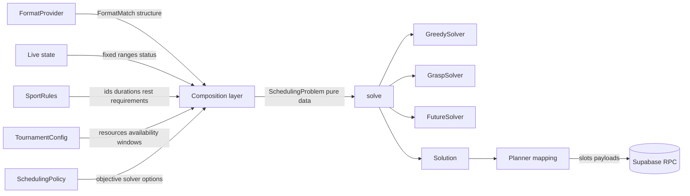

# Sport-agnostic competition scheduling core

## Goal

Make the scheduling engine operate only on generic concepts, with four clean seams:

- **Format provider** turns a tournament format into structural match definitions (matches, participant slots, dependency edges, grouping keys, timing buckets). Sport-agnostic.
- **Sport rules** supply sport semantics: participant resolution, durations, rest, resource capability requirements.
- **Tournament/venue configuration** supplies the actual resources with their capabilities and availability, global unavailable windows, and the planning horizon.
- **Scheduling policy** supplies the ordered objective criteria, solver selection and solver/search options.

Solvers are interchangeable strategies (`greedy`, `grasp`, future) implementing one `Solver` interface over one pure `SchedulingProblem`.

## What "correct" means now

The current scheduler is a demo, so byte-identical output is **no longer a requirement**, and no quirk is carried forward just because the demo did it that way. Correctness is defined by the following invariants, which every solver must satisfy on every fixture:

- **No loss, no duplication** — every match in the problem appears exactly once, either as an assignment or in `unscheduled`.
- **Resource validity** — an assignment names a resource that exists, satisfies the match's capability requirements and candidate list, and the match fits wholly inside that resource's availability intersected with the global open windows.
- **No resource double-booking** — no two assignments overlap on the same resource.
- **No participant double-booking** — a participant never appears in two overlapping assignments.
- **Decided occupancies are bidirectional** — for every assignment `c` and every decided occupancy `d` (fixed match, anchor, or another assignment in the same run) sharing participant `p`, `relateToDecided(c.start, c, d, p)` must be `after` or `before`, never `conflict`. Neither direction holding is a violation, not a silently allowed overlap. Greedy's gap search, GRASP's eligibility and event logic, and `validateSolution` all use this one helper, so the three cannot disagree about rest in either direction.
- **Dependency order** — a match never starts before every dependency has ended.
- **Floor** — no non-fixed match starts before the scheduling floor, and no match starts before its own `eligibleFrom`.
- **Hard end** — when `hardEnd` is non-null, no non-fixed assignment has `end > hardEnd`. The exact feasibility condition is `start + durationMinutes <= hardEnd`, so `start === hardEnd` is legal when the duration is zero; the boundary is inclusive, and the GRASP event cutoff discards an event only when `eventTime > hardEnd`. A match that cannot fit before it is unscheduled rather than placed past it. When `hardEnd` is null, a run may overrun `planningEnd` without limit.
- **Lateness and incompleteness are separate signals** — reporting lateness is `knownOverrun = knownOverrunMinutes > 0` with `knownOverrunMinutes = max(0, knownFinish - planningEnd)`; optimization lateness is `decisionAfterCutoff`, from `decisionFinish`. Neither folds in `unscheduled.length`. A hard end can leave a day on time but incomplete; a soft planning end can leave it late but complete. `knownFinish` covers assignments, fixed matches and anchors; `decisionFinish` covers non-fixed solver assignments only, so the two lateness numbers are intentionally different concepts and are no longer asserted equal.
- **Fixed matches are exempt from `hardEnd` and from the floor.** A fixed match's time is history, not a decision: a real match can legitimately have overrun the wall it was planned inside. `hardEnd` and `floor` constrain what the solver chooses, so they apply to non-fixed assignments only. A fixed match beyond `hardEnd` is therefore **valid input**, not a construction error, and `validateProblem` does not reject it and `validateSolution` does not report `hard-end` for it. Both functions state this the same way, so the exemption cannot drift.
- **Decided occupancies constrain both directions but only reporting counts them** — an assignment must be `after` or `before` an anchor within the required rest, and when the anchor names a resource, must not overlap it there. Anchors are never validated against `hardEnd`, for the same reason fixed matches are not, but an anchor's `end` **does** count toward `knownFinish`, `knownOverrunMinutes`, `knownOverrun` and `knownActiveSpanUtilization`, because it is real occupancy on the same day. It never counts toward `decisionFinish` or any other optimization metric.
- **Fixed immutability and mandatoriness** — a fixed match in the problem is **mandatory**: it has exactly one assignment with the exact start, exact end and exact resource it was given. It may never be moved, and it may never appear in `unscheduled`. This is why an occupancy with no resource is never modelled as a fixed match: it would force the contract to admit a missing resource. It is an anchor instead, and anchors are constraints rather than members, so they appear in neither `assignments` nor `unscheduled`. A fixed match or anchor that does not belong to the day being solved is filtered out by the composition layer before the problem is constructed; the fixed invariant is not weakened to accommodate it.
- **Determinism** — the same problem, options and seed produce the same solution.
- **Input-order independence** — shuffling the `matches` or `resources` arrays does not change the solution, because every scan and tie goes through the canonical comparators.

Also preserved:

- **Stage semantics** — the stage barrier, one run per stage per day, spill across days.
- **Day policy** — every day but the last filled day is a wall (the planner passes that day's `planningEnd` as `hardEnd`); the last filled day may overrun (the planner passes `hardEnd = null`, so nothing bounds it). This is the only place the planner uses `hardEnd`, and it is why the field must remain nullable.
- **Planner outputs** — `planDay` and `planPlacementSchedule` keep their result shapes, because the UI consumes them.

## Deliberately dropped legacy behavior

Summarised here; the full record with the reasoning is in the [Decision record](#decision-record) at the end. Nothing in this list is reproduced, and no test asserts any of it.

- The `NO_COURT = 0` sentinel and the `courtId: ""` convention.
- Two different `utilization` definitions, and one finish time serving two purposes.
- Two different `floor` derivations, and uniform duration per GRASP run.
- Greedy's `poolId ?? ""` group sort key, and `localeCompare` id tie-breaks.
- The unread `kind: "group" | "knockout"` field, and dead `courtByNumber` last-wins behavior.
- Validation messages coupled to legacy wording and push order.
- The ~75-run default and RCL size baked into behavior tests, and the weighted-sum objective.

## Ownership boundaries

- **TournamentFormat (format)** — which matches exist and how they relate structurally: participant slot refs, dependency edges, grouping and completion keys, timing bucket names, soft `phase`/`sequence`/`softOrder`. No durations, resources, status or participants.
- **SportRules (sport)** — participant refs to participant ids, duration per timing bucket, rest per timing bucket, resource capability requirements. No concrete resources, no objective weights, no solver choice.
- **TournamentConfig (venue/tournament)** — concrete resources with `order` and capabilities, per-resource availability, global unavailable windows, horizon start, planning end, hard end, floor, timezone.
- **SchedulingPolicy (policy)** — ordered objective criteria, default solver plus per-timing-bucket overrides, solver and search options. No sport or format knowledge.
- **Live state (tournament adapter)** — status to fixed mapping, fixed time ranges, carried anchors, the day/stage loop, diff, payloads and desk wording. Deliberately not part of the contract.



## Generic domain types

`src/lib/scheduling/domain.ts`:

```ts
export interface TimeWindow {
  start: number;
  end: number;
}

export interface ScheduleResource {
  id: string;
  label?: string;
  /** Sort and display order. */
  order: number;
  /**
   * Capability tags, e.g. "surface:wood", "streaming", "accessible". A match may
   * only use a resource whose capabilities are a superset of the match's requirements.
   */
  capabilities?: readonly string[];
  /**
   * Resource-specific open windows. Absent or empty means open across the whole
   * horizon. A match must fit wholly inside one window; it is never split.
   */
  availability?: readonly TimeWindow[];
  metadata?: Readonly<Record<string, string>>;
}

/** Anything carrying per-participant rest rules. Both matches and anchors satisfy it. */
export interface RestConstraint {
  /** Rest imposed on participants afterwards. Missing means 0. */
  restAfterMinutes?: number;
  /** Rest required for participants beforehand. Missing means 0. */
  restBeforeMinutes?: number;
  /** Per-participant overrides, keyed by participant id. Missing entries mean 0. */
  restOverrides?: Readonly<Record<string, { afterMinutes?: number; beforeMinutes?: number }>>;
}

/**
 * A fixed, already-decided occupancy that constrains the solve without being a match
 * to place. Its resource is optional on purpose: a reported match that was never laid
 * out on a court has no resource, but its participants still earned their rest. Using
 * an anchor keeps the fixed-match contract strict (a fixed match always has a
 * resource) instead of reintroducing a "no court" sentinel inside a match.
 *
 * An anchor's `end` counts toward the reporting family (`knownFinish`,
 * `knownOverrunMinutes`, `knownOverrun`, `knownActiveSpanUtilization`): it is a real,
 * already played match on the same day, so a day whose last anchor ends at 23:00
 * finished at 23:00 even if the solver placed nothing after it. It counts toward no
 * optimization metric, because a decided time is not the solver's doing.
 */
export interface ParticipantAnchor extends RestConstraint {
  id: string;
  participantIds: readonly string[];
  start: number;
  end: number;
  /**
   * When present, the anchor also holds this resource for `[start, end)`, exactly as a
   * fixed match would. When absent, the anchor constrains participants only and
   * occupies no resource.
   */
  resourceId?: string;
}

export interface ScheduleMatch extends RestConstraint {
  id: string;
  /** Opaque participant ids, already resolved by the sport. */
  participantIds: readonly string[];
  participantsKnown?: boolean;
  /** Feeder match ids; each must have ended before this match may start. */
  dependencies?: readonly string[];
  /** How long this match occupies its resource. */
  durationMinutes: number;
  /** Earliest wall-clock start, e.g. from a finished dependency. */
  eligibleFrom?: number;
  fixed?: boolean;
  start?: number;
  end?: number;
  /**
   * Declared resource, meaningful **only** when `fixed: true`, where it is required, must name
   * a resource in the problem, and must satisfy `resourceRequirements`. For a non-fixed match
   * the solver chooses the resource, so this must be absent; the chosen resource is reported on
   * `Assignment.resourceId` / `Assignment.resourceOrder`, never here.
   */
  resourceId?: string;
  /** Declared resource sort order, paired with a fixed `resourceId`. Outputs live on `Assignment`. */
  resourceOrder?: number;
  /** Explicit allow-list of resource ids. Absent means any compatible resource. */
  resourceCandidates?: readonly string[];
  /** Capability tags the chosen resource must provide. */
  resourceRequirements?: readonly string[];
  /** Fragmentation and remaining-count key. */
  groupKey: string;
  /** Completion unit for pressure. Falls back to groupKey. */
  completionKey?: string;
  /** Soft phase. */
  phase?: number;
  /** Intra-group ordering. */
  sequence?: number;
  /** Soft cross-group preference. */
  softOrder?: number;
}

export interface SchedulingProblem {
  matches: readonly ScheduleMatch[];
  resources: readonly ScheduleResource[];
  /**
   * Already-decided occupancies that constrain the solve but are not matches to place.
   * Use for a reported or in-progress match whose start and end are known but which
   * has no resource of its own (it was never laid out on one). The anchor still
   * constrains its participants' rest, which is the whole reason it exists; because
   * it is not a match, the mandatory fixed-resource contract is not weakened.
   * Anchors are seeded into feasibility state before the first sweep and are never
   * returned in `assignments` or `unscheduled`.
   */
  anchors?: readonly ParticipantAnchor[];
  horizonStart: number;
  /**
   * Soft target. `planningEnd` is what both lateness numbers measure against: finishing
   * after it costs `decisionAfterCutoff` (optimization) and `knownOverrunMinutes`
   * (reporting), but it is not a hard boundary and the run may cross it.
   */
  planningEnd: number;
  /**
   * Absolute boundary. When non-null, no non-fixed assignment may have `end > hardEnd`,
   * and any match that cannot fit before it is left unscheduled. `null` (or omitted)
   * means the run may overrun without limit past `planningEnd`, which is what a
   * tournament's final day wants. This is the only hard time boundary in the problem;
   * `planningEnd` never blocks an assignment.
   */
  hardEnd?: number | null;
  floor: number;
  /** Global unavailable windows, applied to every resource. */
  unavailable?: readonly TimeWindow[];
  /** Ordered criteria, highest priority first. Defaults to DEFAULT_OBJECTIVE_ORDER. */
  objective?: readonly ObjectiveCriterion[];
}

export interface Assignment {
  matchId: string;
  resourceId: string;
  resourceOrder: number;
  start: number;
  end: number;
  groupKey: string;
}

export type ViolationKind =
  | "unknown-assignment-match"
  | "unknown-unscheduled-match"
  | "bad-resource"
  | "before-floor"
  | "appearance-count"
  | "resource-overlap"
  | "participant-overlap"
  | "rest-gap"
  | "fixed-moved"
  | "fixed-unscheduled"
  | "hard-end"
  | "dependency";

export interface Violation {
  kind: ViolationKind;
  matchId?: string;
  resourceId?: string;
  resourceOrder?: number;
  participantId?: string;
  /** The other party in an overlap, rest gap or dependency: a match id or an anchor id. */
  otherId?: string;
  restMinutes?: number;
  requiredMinutes?: number;
  appearanceCount?: number;
}

export interface Solution {
  assignments: readonly Assignment[];
  /**
   * Matches the solver could not place. This is the incompleteness signal and it stands on
   * its own: it is folded into neither lateness number. A plan can be incomplete without
   * being late, and late without being incomplete, and those are different desk conversations.
   */
  unscheduled: readonly string[];

  // ---- Reporting / known-state family. Desk-facing; includes decided history. ----
  /**
   * max end over fixed matches, anchors and solver-created assignments; `null` when the day
   * holds nothing at all. This is how late the day actually ran, so decided history counts.
   */
  knownFinish: number | null;
  /** `knownFinish === null ? 0 : Math.max(0, knownFinish - planningEnd)`. Reporting lateness. */
  knownOverrunMinutes: number;
  /** `knownOverrunMinutes > 0`. Incompleteness never sets it; see `unscheduled`. */
  knownOverrun: boolean;
  /** Merged occupancy (all sources) over `(knownFinish - horizonStart) * resourceCount`; 0 when empty. */
  knownActiveSpanUtilization: number;
  /** Merged occupancy (all sources) over `(planningEnd - horizonStart) * resourceCount`. */
  windowUtilization: number;

  // ---- Optimization / solver-controlled family. These score a run. ----
  /**
   * max end over non-fixed solver-created assignments; `null` when the solver placed nothing.
   * Decided history is deliberately excluded: a late anchor must not change what the solver
   * is judged on.
   */
  decisionFinish: number | null;
  /** `decisionFinish === null ? 0 : Math.max(0, decisionFinish - planningEnd)`. Optimization lateness. */
  decisionAfterCutoff: number;
  /** Resource-minutes in the decision span not occupied by a solver assignment or by decided history. */
  decisionResourceIdle: number;
  /** `1 - decisionResourceIdle / (decisionSpanMinutes * resourceCount)`, or 0 when the span is empty. */
  decisionActiveSpanUtilization: number;

  diagnostics: SolverDiagnostics;
}

/**
 * Generic per-run diagnostics. Sport- and format-agnostic: every field is derived from the
 * problem and the solution, never from badminton concepts. The tournament adapter maps this
 * into the existing desk-facing `GraspDiagnostics` shape, so the UI keeps reading
 * `summary.diagnostics?.deadlockReason` unchanged.
 */
export interface SolverDiagnostics {
  /** Which strategy produced this solution, e.g. "greedy" or "grasp". */
  solverId: string;
  /** Runs attempted, and the seed of the winning run. */
  runs: number;
  seed: number;
  /** Mirrors of the optimization family, so the diagnostics panel needs no recomputation. */
  makespanMinutes: number;
  resourceIdleMinutes: number;
  matchesAfterCutoff: number;
  /** Participant wait diagnostics. `minimumObservedRestMinutes` is null when a participant has one match. */
  minimumObservedRestMinutes: number | null;
  maximumParticipantExcessWaitMinutes: number;
  averageParticipantExcessWaitMinutes: number;
  /**
   * Merged occupancy over the still-open remainder of the planning window; `null` when the
   * solver finished at or after `planningEnd`, i.e. no window remains. The desk shows this as
   * `summary.remainingUtilization`, so it is required and not optional.
   */
  remainingWindowUtilization: number | null;
  fragmentation: number;
  softOrderDeviation: number;
  /**
   * The winning run's lexicographic tuple, in `objective` order. Replaces the old single
   * weighted `winningScore`; a tuple has no scalar equivalent, and nothing in the UI reads it.
   */
  winningScore: readonly number[];
  /** Deterministic explanation when the run stopped early; `null` on a completed run. */
  deadlockReason: string | null;
  /** Present only when `SolverRunOptions.debugTrace` is set. No UI reads it. */
  trace?: readonly SolverTraceEntry[];
}

export interface SolverTraceEntry {
  time: number;
  event: string;
  matchId?: string;
  resourceId?: string;
}
```

**One name per concept: the legacy names are renamed, not duplicated.** None of the four old names may appear anywhere in the new code, and no test may reference them (guarded by the grep check in the test plan).

- `projectedFinish` becomes `knownFinish`
- `overrun` becomes `knownOverrun`
- `overrunMinutes` becomes `knownOverrunMinutes`
- `activeSpanUtilization` becomes `knownActiveSpanUtilization`

`decisionFinish`, `decisionAfterCutoff`, `decisionResourceIdle` and `decisionActiveSpanUtilization` are new and exist only in the optimization family.

Rest, duration and requirements are per match, not per run, so different stages, events and future sports need no solver branches. Requirements and availability are satisfied trivially when absent.

**Problem preflight.** Invalid *input* is distinct from an unschedulable *outcome*, so it is reported before any solver runs and never degrades into an unscheduled match.

```ts
export type ProblemIssueKind =
  | "duplicate-match-id"
  | "duplicate-resource-id"
  | "fixed-missing-start"
  | "fixed-missing-end"
  | "fixed-missing-resource"
  | "fixed-unknown-resource"
  | "fixed-invalid-range"
  | "fixed-resource-conflict"
  | "fixed-capability-violation"
  | "unknown-dependency"
  | "self-dependency"
  | "anchor-invalid-range"
  | "anchor-unknown-resource"
  | "anchor-conflict"
  | "hard-end-before-planning-end";

export interface ProblemIssue {
  kind: ProblemIssueKind;
  matchId?: string;
  resourceId?: string;
  otherId?: string;
}

/** Returns every issue found. An empty array means the problem is well formed. */
export function validateProblem(problem: SchedulingProblem): ProblemIssue[];

/** Deterministically ordered by `kind` then `matchId` then `otherId`, so messages are stable. */
export class ProblemValidationError extends Error {
  readonly issues: readonly ProblemIssue[];
  constructor(issues: readonly ProblemIssue[]);
}

/** Runs `validateProblem` and throws `ProblemValidationError` when it finds anything. */
export function assertValidProblem(problem: SchedulingProblem): void;
```

`validateProblem` is pure and runs before any solver. The rules:

- Match ids, anchor ids and resource ids are unique within the problem.
- Every `dependencies` entry names a match in the problem, and no match depends on itself.
- A match with `fixed: true` **must** have `start`, `end` and `resourceId`, and `end > start`. A fixed match missing any of those is a construction error, not something the solver may drop or move.
- A fixed match's `resourceId` must name a resource in the problem, and that resource must satisfy the match's `resourceRequirements`.
- Fixed matches must not conflict with each other: two fixed matches may not overlap on the same resource, and two fixed matches sharing a participant must satisfy `relateToDecided` in one of the two directions rather than `conflict`. Both intervals are already decided, so a pair that fits neither direction is an impossible pairing, not something the solver could order. Non-fixed-vs-fixed is not checked here, because that is the solver's job.
- Each anchor must have `end > start`, and when `resourceId` is present it must name a resource in the problem. Anchors must not conflict with each other or with fixed matches, on resource occupancy or on participant intervals, using the same bidirectional rule: a fixed match at 15:00 and an anchor at 15:30 sharing a participant are fine as long as the required rest holds in whichever direction they sit, while a partial overlap is a conflict. This is the same helper `validateSolution` uses, so preflight and post-solve cannot disagree.
- `hardEnd`, when non-null, must be `>= planningEnd`; a `hardEnd` before the planning end is a configuration error.

**Fixed matches and anchors are deliberately not checked against `hardEnd`** here, and `validateSolution` does not report `hard-end` for either. Both are already-decided history, so a wall that postdates them cannot invalidate them. The exemption is stated once in the invariant list and implemented identically in both validators; `hard-end` only ever fires for a non-fixed assignment. A fixed match or anchor outside the solve horizon is filtered by the composition layer before the problem is built, which is the supported way to keep history out of a day it does not belong to.

`solve()` calls `assertValidProblem` before running any solver strategy. A failure throws a `ProblemValidationError` carrying the issues, so bad input surfaces at the boundary with a precise cause instead of silently producing a plan with a phantom `unscheduled` entry. `validateProblem` is deliberately separate from `validateSolution`: the first judges the problem, the second judges a solver's output.

The score is a **lexicographic tuple**, not a weighted sum. Objective criteria are ordered highest priority first, and two solutions are compared criterion by criterion; the first difference decides, and the seed breaks a complete tie. This makes the priority hierarchy true by construction rather than approximately true, which is what the math below shows the weighted sum failed to do.

```ts
export type ObjectiveCriterion =
  | "unscheduled"
  | "afterCutoff"
  | "makespan"
  | "resourceIdle"
  | "excessWait"
  | "fragmentation"
  | "softOrderDeviation";

/** Ordered highest priority first. Lower is better for every criterion. */
export const DEFAULT_OBJECTIVE_ORDER: readonly ObjectiveCriterion[] = [
  "unscheduled",
  "afterCutoff",
  "makespan",
  "resourceIdle",
  "excessWait",
  "fragmentation",
  "softOrderDeviation",
];

export interface SolutionMetrics {
  /** `Solution.unscheduled.length`. Incompleteness. Separate from both lateness numbers. */
  unscheduled: number;
  /** Optimization lateness: exactly `Solution.decisionAfterCutoff`. Never the reporting lateness. */
  afterCutoff: number;
  /** `Solution.decisionFinish - horizonStart`, or 0 when the solver placed nothing. */
  makespan: number;
  /** Exactly `Solution.decisionResourceIdle`. */
  resourceIdle: number;
  /**
   * Total participant excess wait, in minutes, over solver-created assignments only. For each
   * participant, sort their assignments by start and sum `max(0, next.start - previous.end -
   * requiredRestBetween(previous, next, participant))` over consecutive pairs; a participant
   * with fewer than two assignments contributes 0. This is the `totalExcessWait` term the
   * legacy objective used (legacy `playerWaitMetrics`), not the max or the average — those two
   * are diagnostics and live in `SolverDiagnostics`.
   */
  excessWait: number;
  /**
   * Group fragmentation, ported from legacy `categoryFragmentation(slots, gapMs)`: group the
   * assignments by `completionKeyOf(match)`, sort each group by start, start a new block
   * whenever `start - blockEnd > gap`, and sum `max(0, blocks - 1)` over all groups. `gap` is
   * `SolverRunOptions.fragmentationGapMinutes`.
   */
  fragmentation: number;
  /**
   * Soft-order deviation, redefined post-hoc so that every solver is scored on the same
   * footing. Legacy accumulated this during construction (`categoryOrderDeviationMagnitude`),
   * which is not a property of a finished schedule and which greedy never computed at all.
   * Post-hoc form: within each `groupKey`, take the assignments in start order and count
   * inversions against `sequence`, i.e. pairs `(i, j)` with `i` starting before `j` but
   * `sequenceOf(i) > sequenceOf(j)`. A match with no `sequence` contributes 0. The legacy
   * constructive number is not reproduced anywhere and is not asserted by any test.
   */
  softOrderDeviation: number;
}

/** -1 when a wins, 1 when b wins, 0 when every criterion ties. */
export function compareMetrics(
  a: SolutionMetrics,
  b: SolutionMetrics,
  order: readonly ObjectiveCriterion[] = DEFAULT_OBJECTIVE_ORDER,
): number {
  for (const criterion of order) {
    const delta = a[criterion] - b[criterion];
    if (delta !== 0) return delta < 0 ? -1 : 1;
  }
  return 0;
}

/**
 * The one bridge from a Solution to the optimization tuple, and the only thing `compareMetrics`
 * reads. It takes the problem because `makespan` needs `horizonStart` and `excessWait` /
 * `fragmentation` / `softOrderDeviation` need match durations, rest and `groupKey`; none of
 * those are recoverable from a `Solution` alone. `objective` resolves to
 * DEFAULT_OBJECTIVE_ORDER when the problem does not set it. Pure, and never reads
 * `solution.diagnostics`, so a solver cannot inflate its own score.
 */
export function metricsOf(problem: SchedulingProblem, solution: Solution): SolutionMetrics;
```

A complete tie falls through to the lower seed, so run selection stays deterministic. `capacity` is not a criterion: a solution that violates a hard constraint or fails `validateSolution` is rejected outright rather than scored.

**Comparison is a lexicographic tuple, never a weighted sum.** Strict priority holds by construction, so no coefficient exists to tune and none may be reintroduced. The raw metric numbers are still produced for diagnostics and display. The old constants' four-of-six priority failures are recorded in the Decision record rather than re-derived here.

Note: `afterCutoff` and `makespan` are both monotone in `decisionFinish` and differ by a constant within one problem (one `planningEnd`), so ordering by `afterCutoff` then `makespan` is equivalent to ordering by `makespan` alone within a run. Both are kept because policy is allowed to reorder them and because `afterCutoff` is the desk-facing concept. `afterCutoff` is **not** the reporting lateness and is deliberately no longer equal to it: it is `Solution.decisionAfterCutoff`, derived from the solver-controlled `decisionFinish`, whereas `Solution.knownOverrunMinutes` is derived from the anchor- and fixed-inclusive `knownFinish`. The two coincide only when no decided occupancy outlasts the last solver assignment. `unscheduled` stays a separate criterion precisely because a shortfall is not lateness, and the tuple orders `unscheduled` above `afterCutoff` so finishing the card outranks finishing early.

## Shared semantics, defined once

**Completion key.** `completionKeyOf(match) = match.completionKey ?? match.groupKey`. Used by the pressure term everywhere. One resolver, no second expression.

**Canonical ordering.** Two comparators are defined once in the core and used everywhere a tie or a scan order must be deterministic. No `localeCompare`, no reliance on collection insertion order.

```ts
/** Code-unit order, locale-independent. Differs from localeCompare for integer-like ids. */
export function compareIds(a: string, b: string): number {
  return a < b ? -1 : a > b ? 1 : 0;
}

/** order ascending, then canonical id comparator. */
export function compareResources(a: ScheduleResource, b: ScheduleResource): number {
  return a.order - b.order || compareIds(a.id, b.id);
}
```

`compareResources` is the ordering for candidate enumeration, for choosing among resources that become available at the same event timestamp, for solution and violation ordering, and for any diagnostic list. Duplicate `order` values are resolved by the id comparator, never by array position or last-wins map behavior.

**Rest.** Rest is per match, in both directions, each defaulting to 0. The required rest between a participant's consecutive matches is the stricter of the two.

```ts
export function restAfterOf(constraint: RestConstraint, participantId: string): number {
  return constraint.restOverrides?.[participantId]?.afterMinutes ?? constraint.restAfterMinutes ?? 0;
}

export function restBeforeOf(constraint: RestConstraint, participantId: string): number {
  return constraint.restOverrides?.[participantId]?.beforeMinutes ?? constraint.restBeforeMinutes ?? 0;
}

/** The rest that must separate `previous` from `next` for one participant. */
export function requiredRestBetween(
  previous: RestConstraint,
  next: RestConstraint,
  participantId: string,
): number {
  return Math.max(
    restAfterOf(previous, participantId),
    restBeforeOf(next, participantId),
  );
}
```

`requiredRestBetween` is the only rest rule in the core, applied **in both directions** of the interval rule below (with the arguments swapped) by greedy's gap search, GRASP's eligibility and event set, the excess-wait metric and `validateSolution`. It is typed over `RestConstraint`, so a match and an anchor compose through the same rule without a special case. Badminton sets `restAfterMinutes` on every match from the stage rest and leaves `restBeforeMinutes` unset, so the rule reduces to `max(stageRest, 0) = stageRest` and current behavior is preserved. A sport that models a warm-up or kit-change interval before a match sets `restBeforeMinutes` instead, and both constraints compose without a solver branch.

**Decided occupancies are bidirectional constraints, not one-way predecessors.** A fixed match or an anchor is a decided interval — it is not something a candidate must always come after. For a candidate `c`, a decided occupancy `d`, and a participant `p` they share, feasibility requires **either**:

```ts
after  : c.start >= d.end + requiredRestBetween(d, c, p)
before : c.end   + requiredRestBetween(c, d, p) <= d.start
```

If neither holds, an assignment cannot be placed without conflicting with a decided time, so the candidate must be scheduled on a different resource or reported unscheduled. Collapsing this into a single check rejects valid work: a fixed 15:00 final leaves the whole morning free, which is the normal tournament case. It also is not a blanket "fit around" rule — the server interval still has to fit on the chosen resource, and rest on both sides is enforced with the arguments in the right order: `after` uses `max(restAfterOf(decided), restBeforeOf(candidate))`, while `before` uses `max(restAfterOf(candidate), restBeforeOf(decided))`. Both boundaries are inclusive: touching exactly at the rest boundary on either side is legal. Equivalently, the forbidden set of **start** times for a candidate of duration `durationMinutes` is the interval:

```ts
forbiddenStartInterval(c, d, p) = {
  lo: d.start - c.durationMinutes - requiredRestBetween(c, d, p),   // before-boundary, inclusive
  hi: d.end                          + requiredRestBetween(d, c, p), // after-boundary, inclusive
}
```

`c` is placeable at `start` when `start <= lo` (before, touching allowed) or `start >= hi` (after, touching allowed); `lo < start < hi` is a conflict. The interval is empty when `lo >= hi`, in which case no start conflicts with `d`. One canonical helper implements this and is the single gate used by greedy, GRASP and `validateSolution`:

```ts
export type IntervalRelation = "after" | "before" | "conflict";

/** Classifies a candidate start against one decided occupancy for one shared participant. */
export function relateToDecided(
  candidateStart: number,
  candidate: { durationMinutes: number },
  decided: { start: number; end: number },
  participantId: string,
): IntervalRelation;
```

**The participant gate is the relation itself, and there is no scalar.** Eligibility is `relateToDecided(...) !== "conflict"` against every decided occupancy of every participant of the candidate, plus every assignment already made in the same run. **No per-participant free-time scalar may be introduced**, neither to reject candidates nor to seed the clock: a scalar cannot express a candidate's own `restBeforeMinutes`, and it cannot express the `before` direction, so it would both deadlock and refuse a legal start earlier than any `after`-unlock. The relation is the only gate. (The scalar this replaces, and why each of its two failure modes mattered, is recorded in the Decision record.)

**Decided occupancy state is indexed once, per participant and per resource.** Before the first pass, fixed matches and anchors are indexed into `decidedByParticipant[p]` (canonically sorted intervals, read by `relateToDecided`) and `decidedByResource[r]` (occupied intervals, read by the resource gate). Anchors without a `resourceId` appear only in `decidedByParticipant` and occupy no resource anywhere. Anchors never appear in `assignments` or `unscheduled`: the planner already knows their times and emits its own slot entry for them. An assignment made during a run joins both indexes, so it constrains later candidates in the same run by exactly the same rule — with the arguments swapped when the later candidate goes *before* it, which is why the sequential processing order is a heuristic only and the final schedule is not sorted by it.

Only the `after` direction needs a future timestamp. The `before` direction is a start-time test against the current moment and produces no event of its own; a candidate that cannot go `before` `d` and is not yet released `after` `d` simply becomes eligible at the `after`-unlock, which is in the event set below. A released candidate is still re-checked against `d`, because it may now be unable to fit before `d` and also unable to fit after it before `hardEnd`; that is an unscheduled outcome, not a deadlock.

**Participant conflict reporting.** A `conflict` from `relateToDecided` is reported as `participant-overlap` when the candidate's raw interval intersects the decided interval, and as `rest-gap` when the intervals are disjoint but the required rest is unmet on both sides (the candidate sits inside the forbidden pad but outside the occupancy). `otherId` names the decided match or anchor, `participantId` names the shared participant, and `restMinutes` / `requiredMinutes` carry the shortfall on whichever side was closest. The same classifier is used for assignment-vs-assignment, assignment-vs-fixed and assignment-vs-anchor pairs, so one violation shape covers every decided-occupancy kind.

**Unknown-match context.** The two sources are distinct variants, `unknown-assignment-match` and `unknown-unscheduled-match`, emitted by the two separate passes in `validateSolution`. The renderer switches on `kind` and never inspects which collection an id came from.

**Availability.** A match's open interval is the global open window (horizon minus `unavailable`, never split across a break) intersected with the resource's `availability`. A match fits wholly inside one contiguous piece. Global breaks remain the reason a match is pushed past a window rather than split; per-resource windows are a filter that also pushes the start forward in greedy and gates eligibility in GRASP.

**Two metric families, deliberately separated.** Decided history — fixed matches and anchors — is real time on the day, so the desk must see it. It is also not the solver's doing, so it must not score a run. One number cannot serve both purposes, so `metrics.ts` defines two families and never lets them mix. Occupancy is measured as merged intervals per resource, so back-to-back matches count once and gaps count against usage.

**Reporting / known-state family.** Desk-facing, includes decided history, never used to score a run.

- `knownFinish` = max end over fixed matches, anchors and solver-created assignments; `null` when the day holds nothing.
- `knownOverrunMinutes` = `knownFinish === null ? 0 : Math.max(0, knownFinish - planningEnd)`.
- `knownOverrun` = `knownOverrunMinutes > 0`.
- `knownActiveSpanUtilization` = merged occupancy minutes (all sources) divided by `(knownFinish - horizonStart) * resourceCount`.
- `windowUtilization` = merged occupancy minutes (all sources) divided by `(planningEnd - horizonStart) * resourceCount`. Unchanged; it measures the planning window rather than the span.

**Optimization / solver-controlled family.** The objective sees only this, so decided history can never distort scheduling quality.

- `decisionFinish` = max end over **non-fixed solver-created assignments** only; `null` when the solver placed nothing.
- `decisionAfterCutoff` = `decisionFinish === null ? 0 : Math.max(0, decisionFinish - planningEnd)`.
- `decisionSpanMinutes` = `decisionFinish === null ? 0 : Math.max(0, decisionFinish - horizonStart)`.
- `decisionResourceIdle` = `decisionSpanMinutes * resourceCount - solverOccupancyMinutes - decidedOccupancyMinutes`, all clipped to the decision span. Decided occupancy is subtracted because the solver could not have used that resource-minute, so it must not be charged for it as idle.
- `decisionActiveSpanUtilization` = `1 - decisionResourceIdle / (decisionSpanMinutes * resourceCount)`, or `0` when the span or the resource set is empty. It is complementary to idle by construction, so the two optimization numbers can never disagree.

**Decided history never lengthens the optimization family.** `decisionFinish` is computed only from solver assignments, so a decided occupancy ending after the last solver assignment raises `knownFinish` while leaving `decisionFinish`, `decisionAfterCutoff` and `decisionSpanMinutes` untouched. A **resource-holding** decided occupancy does reduce `decisionResourceIdle` within the span — that is a resource-minute the solver genuinely could not use — but it still does not extend the span. A **non-resource** anchor touches the optimization family in no way at all: it occupies no resource and does not extend the span, so it cannot penalize solver quality. That is precisely why an occupancy with no resource is modelled as an anchor rather than as a resource-holding match.

**`afterCutoff` is the optimization lateness, not the reporting one.** `SolutionMetrics.afterCutoff` is `Solution.decisionAfterCutoff`; `Solution.knownOverrunMinutes` is the separate reporting lateness. The identity `afterCutoff === knownOverrunMinutes` is **not** preserved and now holds exactly when `knownFinish === decisionFinish`. `SolutionMetrics.makespan` is `decisionFinish - horizonStart` (`0` when `null`), so the objective's makespan is solver-controlled too. Why one shared finish time had to be retired is recorded in the Decision record.

`unscheduled.length` is part of neither lateness number. It stays the incompleteness signal and its own highest-priority criterion: a plan can be on time and incomplete (a hard end blocked matches), or late and complete (an overrun past a soft planning end). `excessWait`, `fragmentation` and `softOrderDeviation` are already decision-only, because they are computed over solver assignments; decided occupancies enter them only as constraints, never as occupied minutes or as wait the solver is credited with.

## Solvers

`src/lib/scheduling/solvers/types.ts`:

```ts
export interface SolverRunOptions {
  seed?: number;
  runs?: number;
  rclSize?: number;
  fragmentationGapMinutes?: number;
  debugTrace?: boolean;
  maxIterationsPerRun?: number;
}

export interface Solver {
  id: string;
  name: string;
  solve(problem: SchedulingProblem, options: SolverRunOptions): Solution;
}
```

- **`solvers/greedy.ts`** — process matches in a deterministic order (completion pressure, then soft order, then phase, then sequence, then `compareIds`). For each match, run a **gap search** over candidate resources in `compareResources` order. Start from `lowerBound = max(floor, eligibleFrom, every dependency end)`, then repeatedly:
  - if `relateToDecided(start, candidate, d, p)` is `conflict` for any participant `p` and any decided occupancy `d` (fixed match, anchor, or an assignment made earlier in this run), advance `start` to that occupancy's `hi` and retry. A conflict means `start` is strictly inside the forbidden interval, so the `before` side is already unavailable and `hi` is the next legal boundary;
  - if the resource is busy, the match overhangs an availability window or a global break, advance `start` to the next boundary (previous occupancy end, resource window start, next global open time) and retry;
  - if `start + durationMinutes > hardEnd` when `hardEnd` is non-null, this resource yields nothing for this match.

  Each resource's earliest surviving `start` is the candidate; choose the resource with the smallest `start`, breaking ties by `compareResources`. Advancing only to real boundaries is what lets a match land **before** a later fixed match or anchor when that gap is large enough — a forward-only "earliest after every predecessor" scan cannot do this. Because a placed assignment joins the decided index, a later-processed match can end up before an earlier one; the processing order is a heuristic and the final schedule is not sorted by it, which the invariants are checked against. `start === hardEnd` is feasible for a zero-duration match. Fixed matches and anchors are seeded as decided occupancies and are exempt from `hardEnd`. Deterministic, no randomness.
- **`solvers/grasp.ts`** — resource-driven constructive search with an event-driven clock. The timestamp is processed **before** it is advanced, so anything already feasible at `horizonStart` is never skipped.

  **Step 1 — Initialise.** `currentTime = horizonStart`, with fixed matches and anchors indexed into `decidedByParticipant` / `decidedByResource`, and all feasibility state derived from those indexes.

  **Step 2 — Sweep the current timestamp to quiescence.** Repeatedly sweep resources in `compareResources` order until a **complete sweep makes zero assignments**. For each resource in a sweep:
  - **Recompute** eligibility for the remaining matches against the state as it stands *right now*, including every assignment made earlier in this same timestamp — from earlier resources in this sweep and from earlier sweeps at this timestamp. Do not build one eligibility snapshot for the timestamp and reuse it across resources.
  - Participant availability is the bidirectional relation: `relateToDecided(currentTime, candidate, d, p) !== "conflict"` for every participant `p` of the candidate and every decided occupancy `d` of `p`, so a candidate that fits **before** a later fixed match or anchor is eligible now, not blocked until after it. There is no participant scalar, and no lower bound that can reject a candidate.
  - Rank the eligible matches lexicographically (most-constrained participant, waiting time, phase, completion pressure, soft order, `compareIds`), take the top `rclSize` as the restricted candidate list, and pick one with seeded randomness.
  - Assign **at most one match** to that resource, then move to the next resource in the same sweep. Recomputing per resource is what stops the same participant being assigned to two resources at the same timestamp.
  - Eligibility includes the hard end: a candidate is only eligible when `currentTime + durationMinutes <= hardEnd` if `hardEnd` is non-null. A match that cannot fit before the wall is deferred, never placed past it.
  - If a resource has no eligible match, skip it and continue the sweep.

  After the sweep, if any assignment was made, start another sweep at the same `currentTime`. Repeating is required for same-timestamp unlocks: an assignment can free a resource, satisfy a zero-duration dependency whose end equals its own start, or complete a participant's rest, and only a fresh sweep sees it. A single sweep is not enough, because a resource already passed in this sweep may be able to take a match that only became eligible after it was visited.

  **Step 3 — Decide whether to advance.** Only once a complete sweep has made zero assignments, and work remains, compute the next event (below). If an event exists, advance `currentTime` to it and return to step 2. If no event exists, the run is deadlocked and stops. Advancing before a zero-assignment sweep would skip same-timestamp unlocks.

  **Step 4 — Repeat** until nothing remains, no event exists, or the iteration cap is hit.

  This is a process-then-advance loop. An advance-then-process ordering is explicitly rejected because it can skip matches that were already eligible at `horizonStart`.

  **Next-event set.** The next event is the minimum timestamp strictly greater than `currentTime` among:
  - every resource free time (an assignment ending, or a resource-holding fixed match's or anchor's end),
  - **every `after`-direction participant unlock**, i.e. for every remaining candidate `c`, every participant `p` of `c`, and every decided occupancy `d` of `p` (fixed match, anchor, or already-made assignment), the time `d.end + requiredRestBetween(d, c, p)`. These are per-`(d, c, p)` triples, not a per-participant scalar, because a scalar cannot express a candidate whose own `restBeforeMinutes` exceeds the decided occupancy's `restAfterMinutes`, and omitting such a time is a **false deadlock** rather than a misordering,
  - every dependency completion time for a remaining match,
  - every remaining match's `eligibleFrom`,
  - every resource availability window start,
  - the next global-open time after an unavailable/break window.

  Only the `after` direction contributes timestamps. The `before` direction is a start-time test evaluated against `currentTime` and needs no future event, because it constrains how early a candidate may go rather than how long it must wait; a candidate blocked from going `before` `d` becomes eligible at that `after`-unlock, which is already enumerated. Enumerating the triples is `O(remaining candidates * participants * decided occupancies)`, which is bounded by the existing event enumeration and is the price of never deadlocking on a `restBefore` unlock; the iteration cap remains the backstop. A solver that seeds the clock from a per-participant scalar is rejected outright by the test below.

  When `hardEnd` is non-null, the rule is precisely: **discard a next-event candidate only when `eventTime > hardEnd`**. `eventTime === hardEnd` is retained, because feasibility is `start + durationMinutes <= hardEnd`, so a zero-duration match may legally start exactly at `hardEnd` and a candidate that can only fit there would otherwise be wrongly reported unscheduled at that timestamp. If no retained event exists, remaining matches become unscheduled and the run ends. The event clock must never jump past a time at which a previously infeasible match/resource combination becomes feasible, so any future moment that can change eligibility must be in the set. If the minimum candidate is not strictly greater than `currentTime`, the loop would spin; such candidates are ignored and the iteration cap is the backstop.

  Every collection on the scheduling path is a canonically sorted array, never a `Set` or `Map` iteration order. Each run is scored by the shared lexicographic comparator; the best run wins and ties go to the lower seed. Multiple runs, deterministic per seed.

Because both solvers order every scan and every tie through `compareIds` / `compareResources`, the solution is **input-order independent**: shuffling the `matches` or `resources` arrays yields the same assignments. That property is asserted as an invariant, not assumed.

Both are pure functions of the problem and options. Future solvers register in the same map, so interchangeability is a registry fact, proven by a test that swaps solvers over one identical problem.

## Format, sport, config and policy

`src/lib/scheduling/formats/types.ts`:

```ts
export interface FormatMatch {
  id: string;
  /** Opaque participant slot refs, resolved by SportRules. Null is an undecided side. */
  participantRefs: readonly (string | null)[];
  /** Feeder match ids. */
  dependencyRefs?: readonly string[];
  /**
   * Format-owned timing bucket, mapped to minutes by SportRules. When absent, SportRules'
   * `defaultTimingKey` applies; `SportRules.durationFor(undefined)` must therefore be total,
   * so a provider that omits `timingKey` is still schedulable rather than silently getting 0.
   */
  timingKey?: string;
  groupKey: string;
  completionKey?: string;
  phase?: number;
  sequence?: number;
  softOrder?: number;
}

export interface FormatProvider<In = unknown> {
  id: string;
  name: string;
  timingKeys: readonly string[];
  buildMatches(input: In): readonly FormatMatch[];
}
```

Nothing here mentions entrants, tiers, brackets, courts or players. Providers are registered through one adapter with a single contained cast (`(input: unknown) => readonly FormatMatch[]`), so heterogeneous inputs stay at the registration site. `getFormat` and `getSolver` throw naming the unknown id and the known ids; duplicate registration throws.

- **`formats/round-robin.ts`** — `pool_matches` rows to `FormatMatch`, sequence from the round-robin round, dependencies empty. Pure and reusable.
- **`formats/single-elimination.ts`** — draw match rows to `FormatMatch` with `parent_a_id` / `parent_b_id` as dependencies and an `advances-to` phase. Pure and reusable.
- **`formats/placement-abcd.ts`** — `placement_matches.prerequisite_ids` as dependencies, tier draw parents as dependencies, timing key from the stage. Delegates structure to `placement.ts` and `tier-draw.ts`.

Tournament-side:

- **`scheduling/types.ts`** — the planner-facing contracts that outlive the legacy engine and have surviving consumers, re-exported from one module so nothing imports the deleted `scheduler.ts`:
  - `ScheduledSlot` (used by `schedule-diff.ts`, `schedule-diff.test.ts`, `actions.ts`, `placement-schedule.ts`, `scheduler-grasp.ts`)
  - `StartConstraints` (used by `routes/index.tsx`)
  - `GraspDiagnostics` (used by `actions.ts`, `placement-schedule.ts`, and read by the UI as `summary.diagnostics?.deadlockReason`)
  - These keep their exact current shapes, including `ScheduledSlot.overrun`.
  - `SchedulableMatch` is **not** moved: its only consumers are `scheduler.ts`, `scheduler-grasp.ts` and `actions.ts`'s pre-cutover path, all of which are gone by the time `legacy-deletion` runs, so it is deleted outright with the engine. The `legacy-deletion` task must confirm no surviving import before deleting it.
- **`scheduling/sports/badminton.ts`** — implements `SportRules`: the entrant to team to player hop, per-timing-key duration and rest from the tournament's placement/knockout columns, `defaultTimingKey: "group"`, and no capability requirements.
- **`scheduling/config.ts`** — builds `TournamentConfig` from the tournament, the day, the day's court set (falling back to all courts, as today) and the day's breaks. Every resource gets `availability` from the day window.
- **`scheduling/policy.ts`** — `defaultPolicy(tournament)` returns `DEFAULT_OBJECTIVE_ORDER`, the solver mapping `{ default: "grasp", byTimingKey: { placement: "grasp", knockout: "greedy" } }` (today's choices, unchanged), and the default `SolverRunOptions` `{ runs: 75, rclSize: 4, seed: 20_260_912, fragmentationGapMinutes: 30 }`, pinning the legacy constants `DEFAULT_GRASP_RUNS = 75`, `DEFAULT_RCL_SIZE = 4`, `DEFAULT_SEED = 20_260_912` and `DEFAULT_FRAGMENTATION_GAP_MINUTES = 30`. `maxIterationsPerRun` is problem-dependent, so it keeps its legacy computed default of `matches.length * resourceCount * 6 + 500` inside the solver rather than in policy. Solver selection and criteria order are policy, not sport, so each is now a data change rather than a code change; this phase keeps the existing mapping and order to avoid an unnecessary shift. The default seed is also what makes "the same tournament and seed" in the live checklist reproducible.
- **`scheduling/match-source.ts`** — the row-level live state: status, scheduled/started/ended times, current resource. Joined by id in the composition layer.
- **`DayOneSchedulerOptions` stays in `actions.ts` with its current field names** (`graspRuns`, `categoryFragmentationGapMinutes`, `rclSize`, `seed`, `debugTrace`, `maxIterationsPerRun`), so no caller changes. It is declared explicitly rather than as a `Pick<SolverRunOptions, ...>`, because two of its names differ; the composition layer is the only place that maps `graspRuns` to `runs` and `categoryFragmentationGapMinutes` to `fragmentationGapMinutes`. `GraspOptions` disappears with `scheduler-grasp.ts`; `GraspDiagnostics` survives in `scheduling/types.ts` and is filled from `SolverDiagnostics`.

Target tree:

```text
src/lib/scheduling/                 core: domain, time, constraints, metrics, solvers, formats/types
src/lib/tournament/scheduling/
  formats/round-robin.ts            reusable, no sport knowledge
  formats/single-elimination.ts     reusable, no sport knowledge
  formats/placement-abcd.ts         delegates to placement.ts / tier-draw.ts
  sports/badminton.ts
  config.ts
  policy.ts
  types.ts                          ScheduledSlot, StartConstraints, GraspDiagnostics
  live-state.ts
  match-source.ts
  live-constraints.ts               checkStartConstraints, restGapForKind
  problem.ts                        compose + map Solution back to slots
```

`src/lib/tournament/format.ts` and `competition-format.ts` already exist and own scoring/format helpers. They are a different module from `formats/`; keep the new providers out of them so the two ideas do not merge.

## Cutover

The composition layer lands first and both planners keep using the legacy engine until their own cutover task, so the app stays runnable at every step and each cutover is independently verifiable.

- **`placement-schedule.ts`** — `runStageForDay` becomes: build `FormatMatch[]` from the format provider, join live state, resolve rules and config, build the problem, call `solve()`, map the `Solution` back to `ScheduledSlot[]`. The day loop, the stage barrier, `carriedAnchors`, `diff`, the payloads, the day fills and the blocked wording stay as they are. The row-to-match mappers `placementItems` and `tierItems` are deleted; their logic moves into the format providers and the composition layer.
- **`actions.ts`** — `planDay` cuts over the same way, keeping its result shape so `/schedule` is unaffected.
- **`scheduler.ts` and `scheduler-grasp.ts`** — deleted. `BreakWindow`, `normalizeBreaks` and `startAfterBreaks` move to the core's `time.ts` (consumers: `placement-schedule.ts`, `scheduler-grasp.ts`, `placement-schedule.test.ts`). `checkStartConstraints`, `restGapForKind` and the `StartConstraints` type move to `scheduling/live-constraints.ts`, imported from there by `src/routes/index.tsx`. `ScheduledSlot` and `GraspDiagnostics` move to `scheduling/types.ts`, and `src/lib/tournament/schedule-diff.ts` plus `schedule-diff.test.ts` update their `ScheduledSlot` import from `./scheduler` to `./scheduling/types`. `SchedulableMatch` is deleted with no replacement. Nothing may re-export from `./scheduler` afterwards.
- **UI** — no route changes, because the planner outputs are unchanged. Only the import path for `checkStartConstraints` / `restGapForKind` / `StartConstraints` moves.

### Planner output mapping (shapes unchanged, numbers regrouped)

The composition layer is the only place `Solution` becomes planner output. These are the exact assignments, so "map the reporting family" is not left to interpretation:

- `ScheduledSlot.matchId` from the assignment or fixed match id; `courtId` / `courtNumber` from the resource; `start` / `end` as `Date`; `categoryId` from `match.groupKey`; `overrun` from `end > planningEnd`.
- Anchors are emitted as their own `ScheduledSlot` entries, and no assignment is emitted for an anchor id.
- `utilization` from `windowUtilization`; `overrunMinutes` from `knownOverrunMinutes`; `projectedFinish` from `knownFinish`; `unscheduled` from `solution.unscheduled`.
- `summary.utilization` from `windowUtilization`; `summary.remainingUtilization` from `diagnostics.remainingWindowUtilization`; `summary.overrunMinutes` from `knownOverrunMinutes`; `summary.projectedFinish` from `knownFinish`; `summary.diagnostics` from the mapped `GraspDiagnostics`.
- `summary.placed`, `anchorCount`, `movedCount`, `awaitingTeams`, `currentProjectedFinish`, `projectedFinishDeltaMinutes`, `diff`, `poolEnds` and `movableSlotPayload` remain planner/diff-derived and are not solver outputs.
- **One deliberate semantic change to a public field.** Legacy `overrun` was `slots.some(end > planningEnd) || unscheduled.length > 0`, which folded incompleteness into lateness. The new value is `knownOverrun` only. `summary.unscheduled` and `blocked` already carry the incompleteness signal, and the UI reads `summary.overrunMinutes` and per-slot `overrun`, never `summary.overrun` directly, so nothing renders differently; the live checklist still calls this out explicitly so it is a decision rather than a surprise.

## Tests

**Invariant harness (new, used everywhere).** `invariant-harness.test-helpers.ts` exposes a fixture-matrix builder (multi-group, uneven fields, dependency chains, fixed anchors, breaks, partial resource availability, saturation, cyclic deadlock, capability mismatch) and an `assertValidSolution(problem, solution)` that checks every invariant in the "What correct means now" list, including no-loss/no-duplication and that unscheduled is exactly the complement of assignments.

**Per-solver invariant tests.** For each fixture and for both greedy and GRASP: `validateSolution` returns no errors, `assertValidSolution` passes, and determinism holds (same seed, same solution; two different seeds still each valid). Capability-mismatched matches are never placed on an incompatible resource. A match whose required capability matches no resource is reported as unscheduled, never mis-assigned.

**Cross-solver equivalence of guarantees.** Both solvers over the same problem: both valid, and the no-loss/no-duplication guarantee holds in both. Full placement is asserted only on fixtures explicitly constructed to be feasible (F1, F2, F3, F5, F6, F8), never inferred from a capacity inequality.

**Quality regression (explicit numeric bounds).** No captured baseline and no vague margin. Every bound is a closed-form function of the fixture parameters, computed by `boundsFor(fixture)` so the number cannot drift from the fixture. Utilization bounds are stated on the **decision family** (`decisionActiveSpanUtilization`, occupancy over the solver-controlled span) unless a fixture says otherwise, because that is the number that measures solver quality; the reporting family is asserted separately. The fixture table and its bounds:

- **F1 single-group, one resource** — `R=1, N=6, D=30, rho=20`, window 09:00–18:00 (540 min), all six share one participant. `Sum d = 180`. Bounds: `unscheduled === 0`; `makespan === 280` exactly (`6*30 + 5*20`); `decisionActiveSpanUtilization >= 180/280 = 0.643`.
- **F2 capacity-ample, eight resources** — `R=8, N=24, D=30, rho=20`, disjoint participants, window 540. `Sum d = 720`; ideal is exactly 3 waves. Bounds: `unscheduled === 0`; `makespan <= 120` (`3*30` plus one spare wave); `decisionActiveSpanUtilization >= 720/(8*120) = 0.75`.
- **F3 two parallel dependency chains of four** — `R=2, N=8, D=30, rho=20`, window 540. Each chain is four matches whose **consecutive matches share at least one participant**, which is what forces the three 20-minute gaps inside a chain; without that shared participant the chain would pack tighter and the lower bound below would not hold. `Sum d = 240`; chain depth 4. Bounds: `unscheduled === 0`; `makespan >= 180` (`4*30 + 3*20`); `makespan <= 210` (the lower bound plus one wave); `decisionActiveSpanUtilization >= 240/(2*210) = 0.571`.
- **F4 saturation, one resource** — `R=1, N=30, D=30, rho=20`, disjoint participants, window 540, **`hardEnd = null`**, no decided history. `Sum d = 900 > 540`, so it must overrun. `unscheduled === 0` holds here only because F4 is constructed to be feasible: a single resource has no participant conflicts, no dependencies, no capabilities, no closure, and `hardEnd` is null, so the one constraint left is ordering, which always allows the full 30-match run. Bounds: `unscheduled === 0`; `knownFinish === 900`; `decisionFinish === 900`; `makespan === 900`; `knownOverrunMinutes === 360` (`900 - 540`); `decisionAfterCutoff === 360`; `knownOverrun === true`; `afterCutoff === 360`; and, because there is no decided history here, `knownFinish === decisionFinish` so the two lateness numbers coincide. **This is the late-and-complete cell.**
- **F4b saturation bounded by a hard end** — the F4 schedule but with `hardEnd = 540` past the horizon, still with no decided history. Bounds: no assignment has `end > hardEnd`; `unscheduled` is exactly the 12 matches that cannot fit (`540 / 30 = 18` placed); `knownFinish === 540`; `decisionFinish === 540`; `knownOverrunMinutes === 0`; `decisionAfterCutoff === 0`; `knownOverrun === false`. **This is the on-time-but-incomplete cell**, and the cell the earlier folded definition contradicted: it wanted `overrun === false` while `overrunMinutes > 0 || unscheduled.length > 0` forced `true` from the 12 unscheduled matches. Incompleteness is simply not part of either lateness number now.
- **F5 partial resource availability** — `R=2`, resource `r2` closed 12:00–13:00, window 540, `N=12, D=30`. Bound: every assignment on `r2` satisfies `end <= 12:00` or `start >= 13:00`; `unscheduled === 0`; `makespan <= 300`.
- **F6 capability-constrained** — `R=3`, only `r1` provides `surface:wood`; exactly 2 matches require it; `N=6, D=30`. Bounds: both capability matches assigned to `r1`; `unscheduled === 0`; no overlap on `r1`; `makespan <= 150`. Variant F6b with no capable resource: those 2 are `unscheduled`, the other 4 are placed.
- **F7 cyclic dependency** — 2 matches, `a -> b` and `b -> a`. Bounds: `assignments` empty; `unscheduled` is exactly `{a, b}`; the run reports deadlock rather than hanging.
- **F8 multi-day spill** — day 1 window 09:00–10:00 only, 8 matches of 30 min on `R=1`, day 2 window 540. Bounds: day 1 holds exactly 2 matches; day 2 holds the remaining 6; `unscheduled === 0`.
- **F9 anchor with no resource** — one `ParticipantAnchor` for participants `p1,p2` with `start`/`end` inside the window, `restAfterMinutes = 20`, and **no `resourceId`**, plus 4 matches of 30 min on `R=1` that include `p1`. Bounds: the anchor occupies no resource, so the machine can run throughout; every match involving `p1` satisfies `relateToDecided` against the anchor (placed `after` it within rest, or `before` it within rest, whichever fits); every match is placed, none `unscheduled`; and `assignments` contains no entry for the anchor id.
- **F10 late anchor, reporting versus optimization** — one `ParticipantAnchor` with no `resourceId`, participants `q1,q2` **disjoint from every match**, `start`/`end` chosen so it ends at 20:00, plus matches on `R=1` that all end before 18:00 (`planningEnd = 18:00`). Because the anchor's participants appear in no match and it holds no resource, it changes no assignment; it changes only the reporting metrics. Bounds: `assignments` is identical to the same fixture without the anchor; `knownFinish === 20:00` (the anchor end, not the last assignment end); `knownOverrunMinutes === 120`; `knownOverrun === true`; `decisionFinish === ` the last solver assignment end (unchanged by the anchor); `decisionAfterCutoff === 0` and `decisionResourceIdle` / `decisionActiveSpanUtilization` / every `SolutionMetrics` criterion **identical to the no-anchor control**. This is the fixture that pins the two families apart: it fails if anchors are excluded from the reporting finish, and it also fails if they leak into the optimization family.
- **F11 zero-duration match at the hard end** — `R=1`, `hardEnd = 540`, a match with `durationMinutes: 0` whose participants are free from 540 and only become free at 540. Bounds: the match is scheduled with `start === 540`; it is not `unscheduled`; `knownOverrun === false`. This fails if the event cutoff discards `eventTime === hardEnd`.
- **F12 candidate before a future fixed match** — `R=1`, rest 20, a 30-minute match on `r1` at 15:00–16:00 marked `fixed: true` with participants `x1,x2`, `planningEnd = 18:00`, `hardEnd = null`, plus a non-fixed 30-minute match sharing `x1`. Two variants:
  - **F12a roomy** — nothing else on `r1`, so the candidate could legally go either before 15:00 or after 16:00. Bounds: placed with `relateToDecided` resolving to `after` or `before` (both accepted); not `unscheduled`; no overlap on `r1` or `x1`.
  - **F12b only-before** — `r1` is pre-filled by further fixed matches covering 16:20 onward and `x1` likewise, so no `after` slot exists within the horizon. Bounds: the candidate is placed **before** the 15:00 fixed match with `c.end + requiredRestBetween(c, fixed, x1) <= 15:00`; it is not `unscheduled`. A forward-only predecessor check fails this variant by refusing the morning gap, which is the point of the fixture.
- **F13 candidate before a future anchor** — the F12 shape with the later occupancy as a `ParticipantAnchor` instead of a fixed match, again in the only-before variant, and twice: an anchor that names `r1` and one with `resourceId` absent. Bounds: the candidate is placed before the anchor satisfying the same rest boundary; the anchor id appears in neither `assignments` nor `unscheduled`; in the no-resource variant the anchor does not occupy `r1` at all, so nothing else is pushed by it.
- **F14 exact rest boundary** — a decided occupancy `d` and a candidate `c` sharing a participant, constructed twice: `(a)` `c.end + requiredRestBetween(c, d, p) === d.start` (touching on the `before` side), and `(b)` `c.start === d.end + requiredRestBetween(d, c, p)` (touching on the `after` side). Bounds: both are accepted with zero violations, by both solvers and by `validateSolution` on hand-built solutions. One-minute-inside variants of each are rejected, which pins inclusivity on **both** sides rather than just one.
- **F15 forbidden-interval conflict** — a hand-built solution whose candidate starts strictly inside `(lo, hi)`. Bounds: `validateSolution` reports `participant-overlap` when the raw intervals intersect and `rest-gap` when they are disjoint but the rest is short, with `otherId` naming `d`; neither solver ever produces it on any fixture.
Directional assertions that hold regardless of fixture: for F2 and F4 the searched solver's makespan is at or below greedy's; and a schedule that fits the window always beats one that overruns under `compareMetrics` (asserted directly on metrics tuples, not through a solver).

A raw resource-minute check (`resourceCount * (planningEnd - horizonStart) >= Sum d`) is a **necessary** capacity precondition only, and is **not** asserted to imply `unscheduled === 0`. It is insufficient whenever rest, participant conflicts, dependencies, capabilities, per-resource availability or a hard end can block placement, so no test draws that conclusion from it. Full-placement assertions are attached to fixtures that are demonstrably feasible by construction, and the remaining fixtures assert exactly which matches must remain unscheduled and why.

**Objective ordering tests.** `DEFAULT_OBJECTIVE_ORDER` equals the pinned order. `compareMetrics` is proven strictly lexicographic by a perturbation test over `SolutionMetrics` literals: for each adjacent pair of criteria, a one-unit improvement in the higher criterion wins against a maximal-degradation value in every lower criterion. This is the property the weighted sum failed, asserted directly on `compareMetrics` so it cannot regress. Plus a ranking tie-break test per component, with an explicit `compareIds` case.

**Canonical ordering tests.** Two resources with the same `order` resolve by `compareIds` and not by array position. Constructing the same problem with the `resources` array reversed, and separately with the `matches` array shuffled, yields identical assignments for both solvers — the input-order independence property. A resource set with duplicate `order` values is scheduled deterministically across repeated runs.

**Rest rule tests.** `requiredRestBetween` equals `max(restAfter(previous), restBefore(next))`; a missing `restBeforeMinutes` contributes 0; a `restBeforeMinutes` stricter than the decided occupancy's `restAfterMinutes` governs; and a per-participant override beats the match-level value in both directions. It is asserted in **both argument orders**, because the interval rule calls it once as `requiredRestBetween(decided, candidate, p)` and once as `requiredRestBetween(candidate, decided, p)`, and a swapped-argument implementation must give a different answer whenever the two constraints differ. End to end through both solvers: every assignment satisfies `relateToDecided` against every decided occupancy of its participants.

**Duration tests.** Assigned end equals start plus that match's own `durationMinutes`, including two different durations in one problem and a zero-duration match.

**Violation context tests.** An assignment naming an unknown id yields `unknown-assignment-match`; an unknown id in the unscheduled list yields `unknown-unscheduled-match`; an id in both yields both; the renderer switches on `kind` only.

**Solver loop semantics tests.**
- **Process before advance:** a fixture where every match is feasible at `horizonStart` must place its first wave at exactly `horizonStart`. An advance-then-process loop would push it to the first later event; this test fails if the loop order regresses.
- **Sweep to quiescence:** with several resources free at one timestamp, more assignments are made than a single resource sweep allows, and the loop keeps sweeping until a sweep makes zero assignments before advancing.
- **Same-timestamp unlock, zero-duration dependency:** a match with `durationMinutes: 0` whose dependency is assigned at time T is itself assigned at T, not at the next event. A single-sweep loop fails this, because the resource it needs was already passed.
- **Same-timestamp unlock, freed resource:** a resource skipped because it was busy at the start of a sweep is used later in the same timestamp once the blocking assignment ends at that timestamp.
- **Dynamic eligibility within a timestamp:** with several resources free at the same timestamp and a match whose participants overlap across those resources, no participant is assigned twice at that timestamp. This fails if eligibility is snapshotted once per timestamp instead of recomputed per resource.
- **One match per resource per sweep:** no resource receives two assignments in the same sweep.
- **Event coverage:** the next-event set includes resource free times, `after`-direction participant rest unlocks, dependency completion, `eligibleFrom`, resource window starts and the next global-open time. Each is asserted by constructing a fixture where that event alone unlocks the next assignment, so omitting it from the set would deadlock or misorder.
- **Candidate-specific rest unlock (`restBefore` exceeds `restAfter`):** decided occupancy ends at `T`, `restAfterOf(decided, p) = 10`, `next.restBeforeMinutes = 30`, and no other event exists between `T + 10` and `T + 30`. Assert the solver advances to exactly `T + 30` and places `next` there — not a deadlock, and not a false placement at `T + 10`. Asserted for both solvers. This fails if the clock is seeded from a per-participant scalar (`T + 10`) instead of the `(d, c, p)` triple.
- **Hard-end event cutoff:** a zero-duration match whose only feasible start is exactly `hardEnd` is scheduled, not left unscheduled, so the clock must retain an event at `hardEnd`. A companion assertion checks that an event at `hardEnd + 1` is discarded, pinning `discard iff eventTime > hardEnd` rather than `>=`.
- **No spin:** an event candidate that is not strictly greater than `currentTime` is ignored; the run terminates rather than looping.

**Bidirectional decided-occupancy tests.** The relation helper is the single gate, so it is tested directly plus through both solvers and `validateSolution`:
- **Relation classification:** `start === lo` classifies as `before`, `start === hi` as `after`, and `lo < start < hi` as `conflict`; an empty interval (`lo >= hi`) never returns `conflict`. Boundary and off-by-one variants one minute inside each side.
- **Candidate before a future fixed match (F12):** the roomy variant accepts either side and the only-before variant (F12b) places the candidate ahead of the 15:00 fixed match, satisfying `c.end + requiredRestBetween(c, fixed, x1) <= 15:00`, and reports it scheduled rather than `unscheduled`. A forward-only predecessor check fails F12b, which is the regression this test exists to catch.
- **Candidate before a future anchor (F13):** the same assertion against `ParticipantAnchor`, once when the anchor names a resource and once when it does not, so both anchor shapes are covered. The anchor must not appear in `assignments` or `unscheduled` in either case.
- **Exact rest boundary on both sides (F14):** `c.end + requiredRestBetween(c, d, p) === d.start` and `c.start === d.end + requiredRestBetween(d, c, p)` are each accepted with zero violations, and the one-minute-inside variants of each are rejected. This pins inclusivity on the `before` side as well as the `after` side.
- **Forbidden-interval rejection (F15):** a hand-built assignment starting strictly inside `(lo, hi)` yields `participant-overlap` when the raw intervals intersect and `rest-gap` when they are disjoint but the rest is short, with `otherId` naming the decided occupancy. Neither solver produces it on any fixture.
- **Argument order is not symmetric:** a case where `restAfter` and `restBefore` differ, so a swapped-argument implementation gives a different answer on one of the two sides. Asserted on `relateToDecided` directly, so the `before` direction cannot silently reuse the `after` formula.
- **No scalar participant gate:** a fixture whose only legal placement is ahead of a decided occupancy is placed successfully, which fails if any per-participant lower bound is used to reject candidates.

**Preflight validation tests.** `validateProblem` accepts a well-formed problem and returns `[]`. It reports each issue kind with the right match id: a fixed match missing `start`, `end` or `resourceId`; a fixed match naming an unknown resource; a fixed match whose resource lacks a required capability; a fixed-vs-fixed resource overlap; a fixed-vs-fixed participant conflict; a duplicate match id; a duplicate resource id; an unknown dependency; a self-dependency; an anchor with `end <= start`; an anchor naming an unknown resource; an anchor conflicting with a fixed match or another anchor; and a `hardEnd` before `planningEnd` (`hard-end-before-planning-end`). A fixed match at 15:00 and an anchor at 15:30 sharing a participant are accepted when the bidirectional rest holds and rejected only when they genuinely conflict in both directions, which asserts the rule is bidirectional in preflight too. `solve()` throws `ProblemValidationError` before running any solver, and the thrown error carries the issues. `validateProblem`'s issue list is deterministically ordered by `kind` then `matchId` then `otherId`, asserted by building the same malformed problem twice with `matches` and `resources` reversed and comparing the arrays element for element, so the ordering is a property rather than a coincidence of array position. A bad fixed match is never returned as `unscheduled`. A fixed match or anchor placed beyond `hardEnd` is accepted, per the exemption above.

**Fixed-match tests.** A fixed match appears exactly once with its exact start, end and resource. It is never moved and never appears in `unscheduled`; if a solver would otherwise need to move it, `validateSolution` reports `fixed-moved`, and an unscheduled fixed match reports `fixed-unscheduled`. A fixed anchor outside the horizon is filtered before the problem is built, and the resulting problem still satisfies the fixed invariant.

**Hard-end tests.** With `hardEnd = null` (F4), a run overruns `planningEnd` freely, `knownOverrun` is true, `decisionAfterCutoff` reports the optimization lateness, and nothing is blocked by the planning end. With `hardEnd` set (F4b), no non-fixed assignment exceeds it — asserted as `start + durationMinutes <= hardEnd` for every assignment — the matches that cannot fit are `unscheduled` while `knownOverrun` and `afterCutoff` both stay `0`/`false`, and `validateSolution` reports `hard-end` if a solver ever places one past it. The boundary is asserted to be **inclusive**: F11's zero-duration match whose only feasible start equals `hardEnd` is scheduled. A `hardEnd` before `planningEnd` is rejected by `validateProblem`. Both solvers are asserted to enforce `hardEnd` and its inclusive boundary identically, so the check cannot be present in one and missing in the other, and neither can drift to an exclusive comparison.

**Fixed/anchor exemption and consistency tests.** A fixed match whose `end` is past `hardEnd` is accepted by `validateProblem` and never produces a `hard-end` violation, and the same is true for an anchor. This is asserted for both validators in one test so the exemption is proven consistent rather than independently stated. A non-fixed match in the same problem that would need to end past `hardEnd` is `unscheduled`, not placed.

**Anchor tests.** An anchor with no `resourceId` occupies no resource and does not reduce capacity, but it still constrains its participants in both directions: an assignment sharing a participant must be `after` or `before` it within the required rest. An anchor with a `resourceId` also blocks that resource for its interval. An anchor never appears in `assignments` or `unscheduled`, so the no-loss/no-duplication check ignores it while the participant relation still enforces it. `validateProblem` rejects an anchor with `end <= start`, an unknown `resourceId`, an anchor-vs-anchor conflict, and an anchor conflicting with a fixed match.

**Reporting versus optimization separation tests.** The two families are asserted to be independent, over explicit `metrics.ts` inputs and over fixtures:

- **Late non-resource anchor (F10):** compared with the same fixture minus the anchor, `knownFinish`, `knownOverrunMinutes`, `knownOverrun`, `knownActiveSpanUtilization` and `windowUtilization` all differ, while `decisionFinish`, `decisionAfterCutoff`, `decisionResourceIdle`, `decisionActiveSpanUtilization` and **every** `SolutionMetrics` criterion are identical, and the `assignments` array is identical too. This is the headline test: a late anchor moves the desk's view and nothing the solver is judged on.
- **Late resource-holding decided occupancy:** `knownFinish` rises and `decisionFinish` does not; `decisionResourceIdle` decreases by exactly the decided occupancy clipped to the decision span, and `decisionActiveSpanUtilization` moves complementarily; `makespan` and `afterCutoff` are unchanged.
- **`afterCutoff === knownOverrunMinutes` iff `knownFinish === decisionFinish`:** asserted directly. It holds on F4 (no decided history) and fails on F10 (late anchor). This is the retired identity expressed as an executable property rather than a comment.
- **No leftover identity assertion:** no test asserts `afterCutoff === knownOverrunMinutes` unconditionally, and none references a bare `overrunMinutes`/`projectedFinish` field. A grep-style check in the suite guards the old names from returning.
- **Complementarity:** `decisionActiveSpanUtilization === 1 - decisionResourceIdle / (decisionSpanMinutes * resourceCount)` for every fixture and every solver, so the two optimization numbers cannot drift apart.
- **Empty-solver case:** `decisionFinish === null` and `decisionAfterCutoff === 0` when every match is unscheduled, while `knownFinish` still reflects a late anchor if one exists.

**Utilization tests.** `windowUtilization`, `knownActiveSpanUtilization` and `decisionActiveSpanUtilization` are each reported and use their own documented denominator, asserted directly so the three can never be confused. For a plan with no decided history finishing before `planningEnd`, `knownActiveSpanUtilization === decisionActiveSpanUtilization` and both are `>= windowUtilization`. For F4 (overrunning, no decided history) `windowUtilization` may exceed 1 while the two span utilizations stay at or below 1. For F10 they differ, with only the `known` one widened by the anchor.

**Known-finish tests.** `knownFinish` is the max end over assignments, fixed matches **and** anchors: F10 asserts an anchor ending after every assignment makes `knownFinish` the anchor end and drives `knownOverrunMinutes` from it, and a control fixture with the same assignments but no anchor reports the last assignment end instead. `windowUtilization` and `knownActiveSpanUtilization` denominators are recomputed from the anchor-inclusive `knownFinish`, so a late anchor widens the reporting span. `decisionFinish` is asserted to stay at the last solver assignment end in both the F10 and control cases, which is what keeps the optimization family clean of history.

**Lateness versus incompleteness tests (the 2x2 matrix).** Reporting lateness and `unscheduled.length` are independent axes, asserted directly on `metrics.ts` output for all four combinations, using explicit solution literals so the assertion does not depend on a solver:

- **not late, complete** — `knownFinish === decisionFinish === planningEnd`, `unscheduled: []` → `knownOverrunMinutes === 0`, `decisionAfterCutoff === 0`, `knownOverrun === false`.
- **late, complete** — F4: `knownFinish === decisionFinish === 900`, `planningEnd === 540`, `unscheduled: []` → `knownOverrunMinutes === 360`, `decisionAfterCutoff === 360`, `knownOverrun === true`. No decided history, so this is also the cell where the two lateness numbers necessarily coincide.
- **not late, incomplete** — F4b: `knownFinish === decisionFinish === 540`, `unscheduled` has 12 entries → `knownOverrunMinutes === 0`, `decisionAfterCutoff === 0`, `knownOverrun === false`. Incompleteness does not make the plan late in either family.
- **late, incomplete** — `knownFinish === decisionFinish === 620`, `planningEnd === 540`, `unscheduled` non-empty → `knownOverrunMinutes === 80`, `decisionAfterCutoff === 80`, `knownOverrun === true`.

Plus the structural assertion that folding incompleteness into either lateness number is impossible: for a fixed finish, adding entries to `unscheduled` never changes `knownOverrunMinutes`, `knownOverrun`, `decisionAfterCutoff` or `afterCutoff`; and for a fixed `unscheduled`, moving `knownFinish` across `planningEnd` toggles `knownOverrun` and nothing else. A null finish (nothing placed, no decided occupancy) yields `knownOverrunMinutes === 0`, `knownOverrun === false`, `decisionAfterCutoff === 0` regardless of `unscheduled`.

**All-metrics equality test.** One test materializes every metric for every fixture and solver and asserts the full documented relations at once: `makespan === decisionFinish - horizonStart`, `afterCutoff === decisionAfterCutoff`, `resourceIdle === decisionResourceIdle`, and the denominator of each of `windowUtilization`, `knownActiveSpanUtilization` and `decisionActiveSpanUtilization`. This is the single place a metric rename or a re-merged family shows up immediately, instead of surfacing as a confusing fixture failure elsewhere.

**Metric definition tests.** The three criteria that are not simple maxima, asserted against hand-computed literals so a formula change cannot hide behind a fixture that happens to agree:

- `excessWait` — one participant with two assignments separated by exactly `requiredRest` contributes `0`; one minute more contributes `1`; three participants each one minute over contributes `3`, pinning the **total** rather than the max or the average. `excessWait` is asserted to equal `0` when a participant has a single assignment.
- `fragmentation` — a `groupKey` played in two blocks separated by more than `fragmentationGapMinutes` contributes `1`; exactly `gap` apart contributes `0`; three blocks contribute `2`. Two groups fragmenting once each contribute `2`, pinning the sum over keys.
- `softOrderDeviation` — within one `groupKey`, playing `sequence` `1` then `2` contributes `0`; `2` then `1` contributes `1`; `3,2,1` contributes `3`, pinning the inversion count. A match without `sequence` contributes `0`.
- `metricsOf` purity — computing `metricsOf(problem, solution)` twice gives identical tuples, and mutating `solution.diagnostics` (including replacing `winningScore` with an impossible value) does not change any criterion, so a solver cannot score itself through diagnostics.

**Planner output mapping tests.** Run over the same fixture set, comparing the composed planner output against the `Solution` the composition layer consumed:

- `utilization` equals `windowUtilization`; `overrunMinutes` equals `knownOverrunMinutes`; `projectedFinish` is `knownFinish` as a `Date`; `unscheduled` equals `solution.unscheduled`.
- `summary.remainingUtilization` equals `diagnostics.remainingWindowUtilization`, and is `null` when the solver finished at or after `planningEnd`.
- `summary.diagnostics` carries every field the UI reads, so `summary.diagnostics?.deadlockReason` is populated with the generic message when a run stops early and is `null` otherwise.
- Every `ScheduledSlot.overrun` is exactly `end > planningEnd`, and `summary.overrun` is `knownOverrun` alone. A fixture that is on time but incomplete has `summary.overrun === false` with `summary.unscheduled > 0`, which is the deliberate narrowing and the one assertion that would fail if the old folded definition came back.
- Anchors appear as their own slot entries and never as an assignment, so `assignments.length + fixedCount` matches the slot count for solver-owned work.
- `summary.placed`, `anchorCount`, `movedCount`, `awaitingTeams`, `currentProjectedFinish`, `projectedFinishDeltaMinutes` and the diff remain planner-derived: a test asserts they are unchanged by swapping the solver on the same problem, which is what keeps the mapping from quietly becoming a solver output.

**Availability and capability tests.** A resource closed in the middle of the horizon is used on both sides but never across its closure. A match requiring a capability is only ever placed on resources that provide it, and a candidate allow-list is respected.

**Planner contract tests (kept).** Stage semantics (placement before knockouts, stage barrier, single-day runs both stages), blocked versus awaiting-teams partition, `blockedReason` causal ordering, diff correctness, payload stages, day fills, `sliceRowsByDay`, `courtsForDay`, and the desk `checkStartConstraints` behavior tests.

**Pure-core test.** A synthetic `SchedulingProblem` built with no tournament import, solved by greedy and by grasp, validated, and asserted to satisfy every constraint. A locally defined third solver registers and runs through `solve()`.

**Boundary test.** Primary guard: every file under `src/lib/scheduling/` must not import `@/lib/tournament` or any relative path escaping the core. Secondary guard: a token scan for domain-specific vocabulary only — `badminton`, `court`, `player`, `knockout`, `placement`, `category`, `pool`, `tier`, `bracket`, `round1`. Short or structurally common tokens are excluded even when they name a tournament concept, because substring matching makes them false-positive sources.

**Removed tests.** The golden plan, the pinned exact schedules, the pinned validation strings, the diagnostics field-for-field equivalence, the `NO_COURT` sentinel round-trip and the item-id-order pin are all removed. They asserted incidental behavior that this change intentionally alters.

## Live behavior checklist

With the same tournament, day and seed, verify on `/placement-schedule` and `/schedule`:

- **Every match is either scheduled or listed as blocked/awaiting; nothing is lost or duplicated.**
- **No two matches share a court at the same time, and no player is double-booked.** Consecutive matches for one player satisfy the rest rule on whichever side they sit, including a match moved ahead of a later fixed or reported match.
- Fixed, reported and in-progress matches keep their real times and are never moved.
- Knockouts do not start before the placement stage has drained.
- A multi-day tournament spills to day two and the last day overruns rather than dropping matches.
- `summary` and `diagnostics` remain populated and internally consistent, even though values may differ from before.
- The desk-facing lateness (which counts reported matches that already ran) and the solver-facing lateness reported in diagnostics are both present and may legitimately differ.
- `blockedReason` still names the real cause for a genuinely stuck plan.
- A rebuild with the same seed produces the same diff twice in a row.
- Utilization, projected-finish and overrun numbers are still populated on both screens, including `remainingUtilization` where the desk shows it.
- A day that is on time but has blocked matches reports no lateness and still lists them as blocked, so `summary.overrun` reads as lateness only.
- No module imports the deleted `./scheduler` or `./scheduler-grasp`, and `checkStartConstraints` / `restGapForKind` / `StartConstraints` resolve from `scheduling/live-constraints.ts`.

## Tasks

The ordered, authoritative task list is this plan's `todos` front matter, which is the list surfaced in the editor, so it is not duplicated here and the two cannot drift. The order is load-bearing: `invariant-harness` is written and green before any core module exists, and each cutover leaves the app runnable on its own.

## Risks and mitigations

- **Correctness regression while freeing behavior.** Mitigated by writing the invariant harness first and running it over every fixture and both solvers before the cutover.
- **Event-driven GRASP cost (scaling risk).** Recomputing eligibility across all remaining matches and resources at each event is materially more expensive than the old fixed-wave clock, which computed one candidate set per wave step. The work per event is proportional to `remainingMatches * resources`, and the number of distinct events can approach the number of assignments plus rest completions, so cost is roughly quadratic in the schedule in the worst case. This is acceptable for current tournament sizes (tens to low hundreds of matches on a handful of resources) and is the price of honoring per-match durations and per-resource availability. Mitigations: keep the implementation free of avoidable per-iteration allocations (reuse index structures, avoid building intermediate arrays where a bounded scan works, precompute the static indexes once per run), and keep the per-run iteration cap so a pathological input degrades into a deadlock report rather than an unbounded loop. If it becomes a problem, the options are incremental eligibility maintenance, an event queue with lazy invalidation, or bounding the candidate set by the RCL, all of which are internal to the solver and do not change the contract.
- **GRASP clock generalization** is the largest algorithmic change. Mitigated by keeping the resource-driven, ranked-RCL multi-run structure and replacing the fixed wave step with event-driven advancement, then asserting the same invariants.
- **False deadlock from an `after`-direction rest unlock being left out of the event set.** A per-participant scalar free time only represents `restAfter`-shaped rest, so a candidate whose own `restBeforeMinutes` exceeds the decided occupancy's `restAfterMinutes` can become feasible at a time the clock never visits, and the run stops early with a non-empty `unscheduled` that looks like infeasibility. Mitigated by enumerating `d.end + requiredRestBetween(d, c, p)` per `(decided occupancy, candidate, participant)` triple in the event set, by making `relateToDecided` the single eligibility gate, and by the dedicated `restAfter = 10 / restBefore = 30` regression test that fails on a scalar-only clock. The scalar `participantFreeAt[p]` is removed outright: once the `before` direction exists it cannot even serve as a reject-only pre-filter, because a start earlier than the scalar may be legal.
- **Overrun and unscheduled silently re-folding into one boolean.** The two answer different questions ("are we late" vs "did everything fit"), and a merged flag is what produced the F4b contradiction. Mitigated by keeping `unscheduled.length` out of both lateness numbers, the 2x2 matrix tests over all four combinations, and the structural test that `unscheduled.length` cannot influence either finish-derived number. See the separate risk below about the two lateness families.
- **The reporting and optimization families silently re-merging.** They are now separated so a decided match that ran late does not penalize solver quality, but a well-meaning refactor could reintroduce a single finish time, and `afterCutoff` and the reporting lateness would quietly become the same number again. Mitigated by naming both families in `domain.ts` and `metrics.ts`, by the F10 fixture in which they must diverge, by the `afterCutoff === knownOverrunMinutes iff knownFinish === decisionFinish` property test, and by the all-metrics equality test, which fails loudly on a rename or a re-merge.
- **Bidirectional placement changing the current schedules.** Allowing a match to be placed ahead of a later fixed or reported match is a real behavior change: the demo only ever pushed work after decided times, so some days will now pack tighter or use a morning gap that was previously left empty. This is intended, and it is why correctness is defined by invariants rather than by reproducing the demo's outputs. Mitigated by F12/F13/F14, which pin the desired bidirectional outcome including on the exact rest boundary, and by `validateProblem` rejecting a fixed/anchor pair that fits in neither direction so a genuinely impossible pairing can never be silently accepted.
- **A one-sided rest check passing the boundary tests by accident.** If `before` were implemented with the `after` argument order, an asymmetric fixture is the only thing that catches it. Mitigated by the argument-order test on `relateToDecided` and by a fixture where `restAfter` and `restBefore` differ.
- **Loss of the desk-facing numbers.** Reporting metrics are consumed by UI summaries, so removing or renaming them would break the desk even if the solver were correct. Mitigated by keeping the reporting family on `Solution`, by having the composition layer map it into the existing planner result shapes, and by leaving all route and component contracts unchanged.
- **Planner behavior drift.** The day loop, stage barrier, carried anchors, diff and payloads are not being redesigned, so their contract tests should stay green with only timing values changing.
- **Loose quality bounds becoming meaningless.** Removed by construction: every bound is closed-form from the fixture parameters via `boundsFor(fixture)`, so a failure is a real regression rather than a drift in a captured number.
- **Full lexicographic ordering trading away soft quality.** Making `makespan` strictly dominate `resourceIdle` means a one-minute shorter schedule always wins over a much less idle one. That is the stated intent, but it is a real behavioral consequence; if a softer tradeoff is wanted later it is a policy change, because the criteria order is data.
- **Provider duplication.** Providers own row reading and structure only; rules, config and policy stay in their own modules.
- **Metrics formulas drifting from the reference.** `excessWait`, `fragmentation` and `softOrderDeviation` are the only criteria with a ported formula rather than a one-line maximum, so a casual rewrite could change scheduling quality without breaking any invariant. Mitigated by `metricsOf` being the single bridge that `compareMetrics` reads, by hand-computed literal assertions on each formula, and by the all-metrics equality test.
- **A deleted module still being imported.** `scheduler.ts` and `scheduler-grasp.ts` have consumers in `schedule-diff.ts`, `actions.ts`, `placement-schedule.ts`, `routes/index.tsx` and two test files, so a partial relocation shows up as a compile error rather than at runtime. Mitigated by `npx tsc --noEmit` in the verify task plus an explicit grep guard that no `./scheduler` or `@/lib/tournament/scheduler` import survives, and by moving `ScheduledSlot`, `StartConstraints` and `GraspDiagnostics` into `scheduling/types.ts` rather than assuming they are dead.
- **`summary.overrun` narrowing without anyone noticing.** The field loses its folded incompleteness meaning, and the desk is the only place that could reveal it. Mitigated by the on-time-but-incomplete mapping assertion and by a live-checklist line that states the intended reading.

## Out of scope

- Database schema, migrations and RPC changes.
- Implementing a real CP-SAT/OR-Tools solver or any solver beyond greedy, GRASP and a test double.
- Changing placement decisions, stage or day policy, diff or payload behavior.
- Finish estimation, which is a separate plan.
- Deleting the legacy round-robin route; it is cut over, not removed.

## Decision record

Reference only. The normative sections above are the spec; this appendix records the rejected alternatives and the intentional behavior changes, so a later edit cannot quietly reintroduce one and no reader mistakes an omission for an oversight.

### Dropped legacy behavior, in full

Each of these is incidental to the demo and is not reproduced.

- **The `NO_COURT = 0` / `courtId: ""` sentinel**, which packed "no resource" into a match by overloading the court number. Replaced by an optional `resourceId` on a match, and by a separate `ParticipantAnchor` for a reported match that has no resource at all. The anchor still constrains its participants' rest, so nothing is dropped, and the fixed-match contract stays strict instead of being weakened to accommodate a missing court.
- **Two different `utilization` definitions.** Greedy used booked minutes over the window, GRASP used merged occupancy over the window. Replaced by three explicit metrics with documented denominators: `windowUtilization` over the planning window, `knownActiveSpanUtilization` over the reporting span, and `decisionActiveSpanUtilization` over the solver-controlled span.
- **One finish time serving two purposes.** The demo reported one lateness number and also scored the search with it, so a decided match running past the last solver assignment inflated the objective. Replaced by the reporting family and the optimization family, with the old `afterCutoff === overrunMinutes` identity retired rather than preserved.
- **Two different `floor` derivations.** Greedy used `floor ?? dayStart` and `earliestStart ?? 0`; GRASP used `max(dayStart, floor ?? dayStart)`. Unified.
- **Uniform duration per GRASP run.** The wave clock could only advance by one slot length, so per-match duration could not be honored. Replaced by event-driven advancement.
- **Greedy's `poolId ?? ""` group sort key**, a second and different completion-key expression from GRASP's `poolId ?? categoryId`. Replaced by one completion key.
- **`localeCompare` id tie-breaks.** Replaced by a single explicit comparator. Ordering may therefore differ for integer-like string ids, which is acceptable.
- **The `kind: "group" | "knockout"` field**, which neither solver read.
- **Dead `courtByNumber` last-wins** behavior for duplicate resource order values.
- **Validation messages coupled to legacy wording and push order.** Violations are now structured, deterministically ordered, and rendered with generic nouns.
- **GRASP's ~75-run default and RCL size baked into behavior tests.** Kept as tunable options with pinned defaults, not as asserted outcomes.
- **The weighted-sum objective**, discussed next.

### Why the weighted sum was replaced

The old constants were `unscheduled 10^13`, `afterCutoff 10^9`, `makespan 10^6`, `resourceIdle 10^3`, `excessWait 10`, `fragmentation 2`, `softOrderDeviation 1`. Strict priority of a criterion over every lower one requires the higher coefficient to exceed the maximum possible total of all lower terms. With `N` matches, `R` resources, makespan `M` minutes, idle `I <= R*M`, and excess wait `W <= N*participantsPerMatch*M`:

- `unscheduled` over the rest: needs `afterCutoff_max < 10^4` minutes, about 6.9 days. **Holds.**
- `afterCutoff` over `makespan`: needs `M < 10^3` minutes. **Fails.** A 09:00 horizon overrunning to 02:30 gives `M = 1050`, so `1050 * 10^6 = 1.05 * 10^9 > 10^9`, and one minute of cutoff can be outbid.
- `makespan` over `resourceIdle`: needs `I < 10^3` minutes, but `I <= R*M = 8*600 = 4800` gives `4800 * 10^3 = 4.8 * 10^6 > 10^6`. **Fails by about 5x.**
- `resourceIdle` over `excessWait`: needs `W < 100` minutes, but `W <= N*p*M = 24*4*140 = 13,440`. **Fails.**
- `excessWait` over the last two: needs `2F + D < 10`, but `F <= N = 24` and `D <= N*maxSoftOrder = 192`. **Fails.**

Four of six priority claims fail on realistic numbers, so the weighted sum expressed a soft preference while the design claimed strict priority. Since strict priority is intended, the tuple is the correct mechanism and no numeric tuning is required.

### The per-participant free-time scalar that was removed

An earlier draft kept `participantFreeAt[p] = max(d.end + restAfterOf(d, p))` and used it as eligibility and as an event source. That was wrong twice over: it cannot express a candidate whose own `restBeforeMinutes` exceeds the predecessor's `restAfterMinutes`, and it cannot express the `before` direction at all, so it would refuse a legal morning slot ahead of an afternoon fixed match. It was removed rather than patched, and the relation replaced it as the only gate. The failure mode it caused was a *false deadlock* — a non-empty `unscheduled` that looked like infeasibility — which is why the `restAfter = 10 / restBefore = 30` regression test exists.

### Process before advance, not the reverse

An advance-then-process ordering was explicitly rejected because it can skip matches that were already eligible at `horizonStart`, pushing the first wave to the first later event for no reason.

### Soft-order deviation is now post-hoc

Legacy `categoryOrderDeviationMagnitude` was accumulated *during* construction, as the gap between the chosen group's order and the best available at that moment. That is a property of the search path, not of the finished schedule, and greedy never computed it at all, so it could not score both solvers on one footing. `SolutionMetrics.softOrderDeviation` is therefore redefined post-hoc as sequence inversions in start order within a `groupKey`. The legacy constructive number is not reproduced and no test asserts it.

### Deliberate public-shape changes with no UI reader

- `SolverDiagnostics.winningScore` is `readonly number[]`, the lexicographic tuple. The legacy `GraspDiagnostics.winningScore: number` was a weighted sum and has no scalar equivalent; the UI never reads it, so the tournament type follows the tuple.
- `SolverDiagnostics.trace` replaces the legacy `GraspDebugEntry[]` with a generic entry shape. No UI reads it, so the tournament side may drop it.
- `summary.overrun` changes from `slots.some(end > planningEnd) || unscheduled.length > 0` to `knownOverrun` alone. It is the one public field whose meaning narrows; the incompleteness signal already lives in `summary.unscheduled` and `blocked`, and no component renders `summary.overrun` directly.
