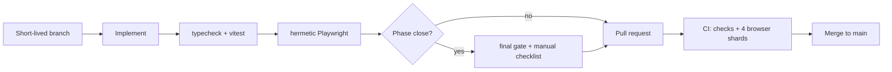

<!-- LOVABLE:BEGIN -->
> [!IMPORTANT]
> This project is no longer connected to [Lovable](https://lovable.dev). The
> disconnect is complete: nothing here is built, deployed or hosted by it, and
> no Lovable package is a dependency. `.lovable/` is gone.
>
> The block is kept only to record that, and can be deleted once the remaining
> Lovable references listed in the README are cleared. The history rule it used
> to carry is gone with the connection — though rewriting published history is
> still worth avoiding, for the ordinary reasons.
<!-- LOVABLE:END -->

# Working in this repository

Cursor is the primary development environment, and the repository is
self-contained: it builds and deploys without any external editor or platform.

## What this project is

Tournova — a badminton tournament operations console. TanStack Start + React +
TypeScript, Tailwind v4, Supabase (Postgres, RLS, RPCs), deployed on Cloudflare
Workers. It is operated live at a desk during a tournament, often on imperfect
wifi, by people who cannot reload a page mid-match.

Two audiences share the app and their needs differ:

- **Tournament organiser** — tournament-wide planning. Lives on the Schedule tab.
- **Moderator** — a single court, a single day, in real time. Lives on the Desk.

Keep those two apart. A moderator should not be shown tournament-wide forecasts, and
an organiser should not be shown desk-level operational noise.

## Before you start

1. Read [`docs/design-system.md`](docs/design-system.md) before any UI change.
2. Read [`docs/tournament-format.md`](docs/tournament-format.md) before any change to
   tournament rules, and [`docs/scheduling-decisions.md`](docs/scheduling-decisions.md)
   before touching the scheduler.
3. Check the repository state and do not discard existing work.

## Design system rules

The full system is in [`docs/design-system.md`](docs/design-system.md). The rules
that matter most when writing code:

- **No hardcoded colour.** Every colour utility must resolve to a `--color-*` key
  defined in [`src/styles.css`](src/styles.css). Use tokens, not hex, `rgb()`, or
  Tailwind's default palette.
- **No hardcoded font size.** Use the tier utilities (`text-t1` … `text-t4`). 12px
  is the floor; nothing may render below it.
- **Status is never colour alone.** Every state carries a colour, a distinct glyph
  and a text label.
- **Hue is reserved for state, brand action and destructive.** Do not use a state
  hue for decoration, and do not use `--accent` as a brand colour — it is the neutral
  hover surface.
- **A fill colour and its text twin are separate tokens.** If text sits on a new
  fill, it needs an ink token solved against it.
- **Theme takes no pathname and density does.** They answer different questions;
  do not merge them.
- **Tier-4 match states render as ink only**, with no chip.

The design system is the current, shipped system: a cool neutral slate chassis with
blue as the brand hue. Ignore any document describing a warm earth, terracotta, sage,
indigo or mint palette, or a different font pairing — those are superseded.

## Security rules

- **Never commit credentials, tokens or session files.** `.env` and `e2e/.auth/` are
  git-ignored; keep them that way.
- **Never expose a service-role key to the frontend.** `SUPABASE_SERVICE_ROLE_KEY` is
  server-side only ([`client.server.ts`](src/integrations/supabase/client.server.ts))
  and is used by operator scripts. It must never get a `VITE_` prefix, because a
  `VITE_` variable is compiled into the client bundle.
- **Do not point automated tests at the production Supabase project.** The Playwright
  suite is hermetic — it intercepts the network — and CI holds no credentials.
- A guard fails the test suite if a service-role key appears in `src/`, in a `VITE_`
  variable, or in a tracked file.

## Database

Migrations live in [`supabase/migrations`](supabase/migrations) and are applied in
filename order. Read
[`supabase/migrations/README.md`](supabase/migrations/README.md) before adding or
applying one; it documents how to apply and verify them. Do not modify an applied
migration — add a new one.

## Workflow

Short-lived branches and pull requests. Every CI job must be green before merge. The browser
job is **sharded across four runners** - the suite is CPU-bound, not worker-bound, so its wall
time comes from running fewer tests per machine rather than more workers on one.



### Gate order

Run these locally before pushing. The order matters: each is cheaper than the next.

```
npm run typecheck
npm run test
npm run test:e2e
npm run test:e2e:final    # phase close only, also runs assert-no-skips
npm run build
```

- `npm run test:e2e:final` sets `E2E_REQUIRE_STAFF=1`, which turns any skipped test
  into a failure, and then asserts that the run contained **zero** skips. A skipped
  test is never a passing test.
- CI shards that same suite across four runners. If you add or rename a spec file, run
  `npm run ci:shard-plan` — the split is by test count, so a new file reshuffles every
  shard boundary, and it reports the wall time and billed minutes for each shard count.
- **`npm run test:integration` is not part of that list.** It runs the real application
  against a real Supabase project — authentication, RLS and RPC authorization per role,
  realtime delivery, and the tournament lifecycle. Run it by hand whenever a change touches
  RLS policies, RPC guards or realtime publication membership; those are the surfaces the
  hermetic suite structurally cannot see.

  **It runs against the local stack, not staging.** The guard refuses any project a root
  environment file names, and `.env` names staging — deliberately, because the suite writes
  rows and flips the active-tournament pointer, so a shared project is a destructive
  mistake rather than a slow test. A dedicated cloud project is not an option on the free
  plan's two-project limit, so the target is `npx supabase start`:

  ```
  npx supabase start                       # needs a container runtime (colima or Docker)
  npm run integration:target -- local      # points integration/.env at it
  npm run test:integration
  npm run integration:target -- use staging # switches back when done
  ```

  `integration:target show` reports the current target, and pointing at `local` snapshots
  whatever the suite pointed at first, so switching is never one-way. A freshly started
  stack is not streaming yet, which is why `realtime.test.ts` warms the tenant before it
  asserts: without that, the first test to run fails on a cold stack and passes on every
  later run.
- **`npm run lint` is not a gate.** It reports a large pre-existing Prettier backlog
  that predates the current design work. Do not run a repo-wide format as part of an
  unrelated change; it buries the real diff.

### Review tiering

Match the review to the risk. **Lightweight** — one reviewer, gates green — for
docs, copy and token-only CSS changes.

**Stronger** — a second reviewer, and reasoning written into the PR — for:

| Area | Paths |
| --- | --- |
| Scheduling | `src/lib/scheduling/**`, `src/lib/tournament/scheduling/**` |
| Scoring | `src/lib/tournament/**` scoring paths |
| Authorization | [`src/hooks/useSession.ts`](src/hooks/useSession.ts), `staff_roles`, RLS policies |
| Database | `supabase/migrations/**` |

For those four areas, state in the PR what could break and what you checked. The
tests are the floor, not the argument.

### Commits

- One concern per commit, imperative subject.
- The `P<n>:` prefix convention in existing history is fine to continue for phased
  work.
- **Squash is not mandatory.** Preserve independent commits where they carry meaning.
- Never force-push or rewrite published commits — see the Lovable note at the top.
- Keep `main` working. Every commit on it should build and pass tests.

## When a change is user-visible

Run the manual checklist in
[`docs/ux-review-checklist.md`](docs/ux-review-checklist.md). It covers what no
automated gate can judge: focus order, visual hierarchy, status recognition at a
glance, truncation, density legibility, and empty and error states. Record the run
and state the skip count explicitly.
