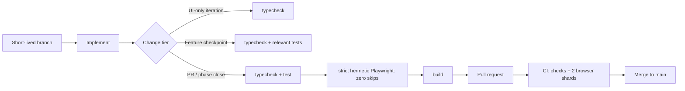

# Working in this repository

Cursor is the primary development environment, and the repository is
self-contained: it builds and deploys without any external editor or platform.

## What this project is

Tournova — a badminton tournament operations console. TanStack Start + React +
TypeScript, Tailwind v4, Supabase (Postgres, RLS, RPCs), deployed on Cloudflare
Workers. It is operated live at a desk during a tournament, often on imperfect
wifi, by people who cannot reload a page mid-match.

Three audiences share the app and their needs differ:

- **Tournament organiser** — tournament-wide planning. Lives on the Schedule tab.
- **Moderator** — every court in the hall, a single day, in real time. Lives on the Desk,
  which is the main place matches are called from and started.
- **Participant** — registers from a tournament's public page, and sees the state of
  their own request. Never an operator: being approved grants no operating right.

Keep the two operators apart. A moderator should not be shown tournament-wide forecasts,
and an organiser should not be shown desk-level operational noise. A participant is not an
operator at all, and no surface should present participation as authority.

## Before you start

1. Read [`docs/tournament-format.md`](docs/tournament-format.md) before any change to
   tournament rules, and [`docs/scheduling-decisions.md`](docs/scheduling-decisions.md)
   before touching the scheduler.
2. Read [`docs/authorization.md`](docs/authorization.md) before any change to access
   control: who may edit a tournament, who may manage its editors, or what a platform
   admin may override.
3. Read [`docs/information-architecture.md`](docs/information-architecture.md) before adding,
   moving or redirecting an address.
4. Read [`docs/roster-freeze.md`](docs/roster-freeze.md) before changing how a team withdraws or
   joins once matches exist.
5. Check the repository state and do not discard existing work.

## Design

The visual design is not settled. There is no design system to conform to and no UI rule
beyond the audience split above: layout, colour, type, spacing and components are yours to
choose, and existing styling is not a constraint. Keep the result accessible — the
accessibility specs (`e2e/a11y.spec.ts`, `criteria.spec.ts`, `route-sweep.spec.ts`,
`states.spec.ts`) still run. Current colour, type and size guidance is in
[`docs/design-principles.md`](docs/design-principles.md); it is guidance, not a gate.

**The landing page shows the real product.** What a signed-out visitor sees at `/` lives in
[`src/components/landing/`](src/components/landing). Its pictures of the Desk and the read-only
board are drawn from the app's own vocabulary (`court-state.ts`, the Desk's wording), and its
scheduling demo follows the live reflow's rules, which `schedule-demo-data.test.ts` pins. When
the Desk's wording or the reflow changes, change the landing with it: it must never promise
something the app does not do.

## Security rules

- **Never commit credentials, tokens or session files.** `.env` and `e2e/.auth/` are
  git-ignored; keep them that way.
- **Never expose a service-role key to the frontend.** `SUPABASE_SERVICE_ROLE_KEY` is
  server-side only ([`client.server.ts`](src/integrations/supabase/client.server.ts))
  and is used by operator scripts. It must never get a `VITE_` prefix, because a
  `VITE_` variable is compiled into the client bundle.
- **Do not point automated tests at the production Supabase project.** The Playwright
  suite is hermetic — it intercepts the network — and CI holds no credentials.
- A guard fails the test suite if a service-role key appears in `src/`, in a `VITE_`
  variable, or in a tracked file.

## Database

Migrations live in [`supabase/migrations`](supabase/migrations) and are applied in
filename order. Read
[`supabase/migrations/README.md`](supabase/migrations/README.md) before adding or
applying one; it documents how to apply and verify them. Do not modify an applied
migration — add a new one.

## Workflow

Short-lived branches and pull requests. Every CI job must be green before merge. The browser
job is **sharded across two runners** - the suite is CPU-bound, not worker-bound, so its wall
time comes from running fewer tests per machine rather than more workers on one.



### Verification tiers

Match the verification to the stage, not the size of the diff. Running the full bar after
every small change is wasted effort; reaching a PR without it is a broken branch.

| Tier | When | Required | Optional |
| --- | --- | --- | --- |
| **UI-only iteration** | Changing a screen's look — layout, copy, spacing, styling or markup changes that alter no behaviour | `npm run typecheck` | A local look (`npm run dev`), focused tests (`npx vitest run <path>`) |
| **Feature checkpoint** | The feature is finished and about to be reviewed or handed over | `npm run typecheck` + the relevant tests | — |
| **PR / phase close** | Pushing a branch, opening a PR, or closing a phase | `npm run verify` (typecheck + test + one strict Playwright run + build) | — |

**A high-risk change takes the PR / phase-close bar at every stage.** Scheduling, scoring,
authorization, the database and RPCs get the full verification regardless of how small the
change looks or which tier it is nominally in — there is no "run the e2e later" for those
paths. [Review tiering](#review-tiering) names the same areas and their review requirement.

### Gate order

The full bar, run locally. This is what a PR / phase close owes, and what any high-risk change
owes at every stage — not a per-edit ritual. The order matters: each is cheaper than the next.

```
npm run typecheck
npm run test
npm run test:e2e:final    # one full Playwright run, also runs assert-no-skips
npm run build
```

`npm run verify` runs this sequence. `npm run test:e2e` remains available for exploratory
or focused browser checks; do not run it again immediately before the strict final run
unless a separate before/after measurement is needed.

- `npm run test:e2e:final` sets `E2E_REQUIRE_STAFF=1`, which turns any skipped test
  into a failure, and then asserts that the run contained **zero** skips. A skipped
  test is never a passing test.
- CI shards that same suite across two runners. If you add or rename a spec file, run
  `npm run ci:shard-plan` — the split is by test count, so a new file reshuffles every
  shard boundary, and it reports the wall time and billed minutes for each shard count.
- **`npm run test:integration` is not part of that list.** It runs the real application
  against a real Supabase project — authentication, RLS and RPC authorization per role,
  realtime delivery, and the tournament lifecycle. Run it by hand whenever a change touches
  RLS policies, RPC guards/callers or realtime publication membership; those are the
  surfaces the hermetic suite structurally cannot see.

  **It runs against the local stack, not staging.** The guard refuses any project a root
  environment file names, and `.env` names staging — deliberately, because the suite writes
  rows and flips the active-tournament pointer, so a shared project is a destructive
  mistake rather than a slow test. A dedicated cloud project is not an option on the free
  plan's two-project limit, so the target is `npx supabase start`:

  ```
  npx supabase start                       # needs a container runtime (colima or Docker)
  npm run integration:target -- local      # points integration/.env at it
  npm run test:integration
  npm run integration:target -- use staging # switches back when done
  ```

  `integration:target show` reports the current target, and pointing at `local` snapshots
  whatever the suite pointed at first, so switching is never one-way. A freshly started
  stack is not streaming yet, which is why `realtime.test.ts` warms the tenant before it
  asserts: without that, the first test to run fails on a cold stack and passes on every
  later run.
- **There is a CI workflow for the same suite.** [`.github/workflows/integration.yml`](.github/workflows/integration.yml)
  starts its own local stack on `ubuntu-latest` and runs `npm run test:integration` there,
  by hand (`workflow_dispatch`) or on a pull request that touches `supabase/migrations/**`,
  `integration/**`, `scripts/integration-target.mjs`, `vitest.integration.config.ts`, or
  the application RPC/auth client paths listed in that workflow. It exists for a machine
  without a container runtime - the reason the reflow and conflict migrations were first written without ever being parsed by Postgres - and it holds no
  credentials, because the stack's keys are the CLI's demo values. For changes to RLS
  policies, RPC guards/callers or realtime publication membership, a successful integration run is required before merge (local when available, otherwise
  this workflow). Repository branch-protection settings are managed separately; this
  document does not configure them.
- **`npm run lint` is not a gate.** It reports a large pre-existing Prettier backlog
  that predates the current design work. Do not run a repo-wide format as part of an
  unrelated change; it buries the real diff.

### Review tiering

Match the review to the risk. **Lightweight** — one reviewer, gates green — for
docs, copy and UI styling changes.

**Stronger** — reasoning written into the PR — for:

| Area | Paths |
| --- | --- |
| Scheduling | `src/lib/scheduling/**`, `src/lib/tournament/scheduling/**` |
| Scoring | `src/lib/tournament/**` scoring paths |
| Authorization | [`src/lib/auth/authorization.ts`](src/lib/auth/authorization.ts), [`src/hooks/useSession.ts`](src/hooks/useSession.ts), `profiles` / `tournament_editors`, RLS policies |
| Database | `supabase/migrations/**` |
| RPC | SQL functions in `supabase/migrations/**`, called from `src/lib/tournament/**` |

For those areas, state in the PR what could break and what you checked. The
tests are the floor, not the argument.

### Commits

- One concern per commit, imperative subject.
- The `P<n>:` prefix convention in existing history is fine to continue for phased
  work.
- **Squash is not mandatory.** Preserve independent commits where they carry meaning.
- Never force-push or rewrite published commits; they are shared history.
- Keep `main` working. Every commit on it should build and pass tests.
