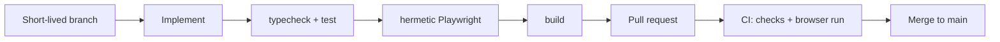

# Working in this repository

Cursor is the primary development environment, and the repository is
self-contained: it builds and deploys without any external editor or platform.

## What this project is

Tournova — a badminton tournament operations console. TanStack Start + React +
TypeScript, Tailwind v4, Supabase (Postgres, RLS, RPCs), deployed on Cloudflare
Workers. It is operated live at a desk during a tournament, often on imperfect
wifi, by people who cannot reload a page mid-match.

Three audiences share the app and their needs differ:

- **Tournament organiser** — tournament-wide planning. Lives on the Schedule tab.
- **Moderator** — a single court, a single day, in real time. Lives on the Desk.
- **Participant** — registers from a tournament's public page, and sees the state of
  their own request. Never an operator: being approved grants no operating right.

Keep the two operators apart. A moderator should not be shown tournament-wide forecasts,
and an organiser should not be shown desk-level operational noise. A participant is not an
operator at all, and no surface should present participation as authority.

## Before you start

1. Read [`docs/design-system.md`](docs/design-system.md) before any UI change.
2. Read [`docs/tournament-format.md`](docs/tournament-format.md) before any change to
   tournament rules, and [`docs/scheduling-decisions.md`](docs/scheduling-decisions.md)
   before touching the scheduler.
3. Read [`docs/authorization.md`](docs/authorization.md) before any change to access
   control: who may edit a tournament, who may manage its editors, or what a platform
   admin may override.
4. Read [`docs/information-architecture.md`](docs/information-architecture.md) before adding,
   moving or redirecting an address.
5. Check the repository state and do not discard existing work.

## Design system

Read [`docs/design-system.md`](docs/design-system.md) before changing anything that
renders. It is short: the token vocabulary, and the rule that the three audiences stay
apart.

## Security rules

- **Never commit credentials, tokens or session files.** `.env` and `e2e/.auth/` are
  git-ignored; keep them that way.
- **Never expose a service-role key to the frontend.** `SUPABASE_SERVICE_ROLE_KEY` is
  server-side only ([`client.server.ts`](src/integrations/supabase/client.server.ts))
  and is used by operator scripts. It must never get a `VITE_` prefix, because a
  `VITE_` variable is compiled into the client bundle.
- **Do not point automated tests at the production Supabase project.** The Playwright
  suite is hermetic — it intercepts the network — and CI holds no credentials.
- A guard fails the test suite if a service-role key appears in `src/`, in a `VITE_`
  variable, or in a tracked file.

## Database

Migrations live in [`supabase/migrations`](supabase/migrations) and are applied in
filename order. Read
[`supabase/migrations/README.md`](supabase/migrations/README.md) before adding or
applying one; it documents how to apply and verify them. Do not modify an applied
migration — add a new one.

## Workflow

Short-lived branches and pull requests. Every CI job must be green before merge. The browser
job is a single runner: the suite covers routing, access, hydration and the staff surfaces,
and it finishes well inside a runner's budget, so sharding would only add startup cost.



The full bar, run locally, is what a PR or phase close owes, and what any high-risk change
owes at every stage - not a per-edit ritual.

### Gate order

The order matters: each is cheaper than the next.

```
npm run typecheck
npm run test
npm run test:e2e
npm run build
```

- CI also asserts that the browser run contained **zero skips**. A skipped test is never a
  passing test.
- **`npm run test:integration` is not part of that list.** It runs the real application
  against a real Supabase project — authentication, RLS and RPC authorization per role,
  realtime delivery, and the tournament lifecycle. Run it by hand whenever a change touches
  RLS policies, RPC guards or realtime publication membership; those are the surfaces the
  hermetic suite structurally cannot see.

  **It runs against the local stack, not staging.** The guard refuses any project a root
  environment file names, and `.env` names staging — deliberately, because the suite writes
  rows and flips the active-tournament pointer, so a shared project is a destructive
  mistake rather than a slow test. A dedicated cloud project is not an option on the free
  plan's two-project limit, so the target is `npx supabase start`:

  ```
  npx supabase start                       # needs a container runtime (colima or Docker)
  npm run integration:target -- local      # points integration/.env at it
  npm run test:integration
  npm run integration:target -- use staging # switches back when done
  ```

  `integration:target show` reports the current target, and pointing at `local` snapshots
  whatever the suite pointed at first, so switching is never one-way. A freshly started
  stack is not streaming yet, which is why `realtime.test.ts` warms the tenant before it
  asserts: without that, the first test to run fails on a cold stack and passes on every
  later run.
- **`npm run lint` is not a gate.** It reports a large pre-existing Prettier backlog
  that predates the current design work. Do not run a repo-wide format as part of an
  unrelated change; it buries the real diff.

### Review tiering

Match the review to the risk. **Lightweight** — one reviewer, gates green — for
docs, copy and token-only CSS changes.

**Stronger** — a second reviewer, and reasoning written into the PR — for:

| Area | Paths |
| --- | --- |
| Scheduling | `src/lib/scheduling/**`, `src/lib/tournament/scheduling/**` |
| Scoring | `src/lib/tournament/**` scoring paths |
| Authorization | [`src/lib/auth/authorization.ts`](src/lib/auth/authorization.ts), [`src/hooks/useSession.ts`](src/hooks/useSession.ts), `profiles` / `tournament_editors`, RLS policies |
| Database | `supabase/migrations/**` |
| RPC | SQL functions in `supabase/migrations/**`, called from `src/lib/tournament/**` |

For those areas, state in the PR what could break and what you checked. The
tests are the floor, not the argument.

### Commits

- One concern per commit, imperative subject.
- The `P<n>:` prefix convention in existing history is fine to continue for phased
  work.
- **Squash is not mandatory.** Preserve independent commits where they carry meaning.
- Never force-push or rewrite published commits; they are shared history.
- Keep `main` working. Every commit on it should build and pass tests.
