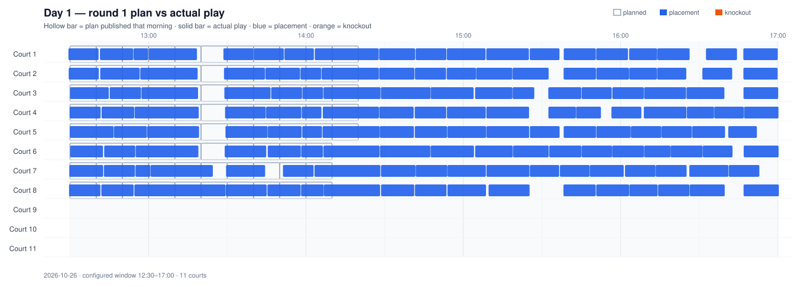
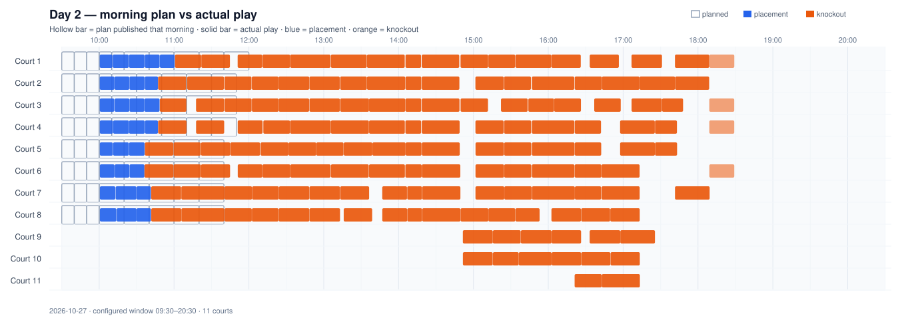
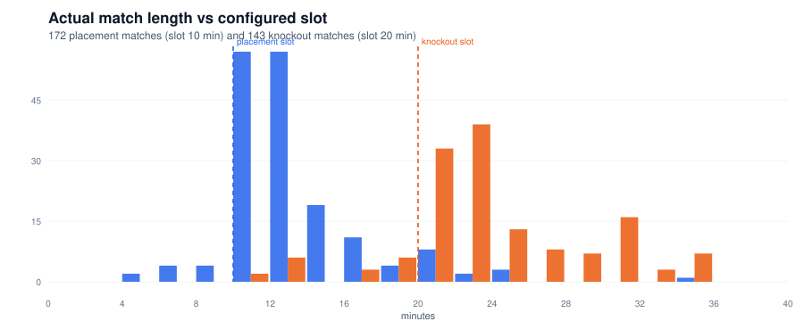

# Báo cáo hiệu quả thuật toán xếp lịch — Aloha 2026

**Giải:** Aloha · Iowa State · 26–27/10/2026 · 172 đội, 123 VĐV, 5 nội dung, 11 sân, 2 ngày
**Dữ liệu:** snapshot staging lúc 2026-10-28 15:17 UTC (`analysis/aloha-2026/`)
**Trạng thái:** chưa kết thúc — 315 trận hoàn tất, 4 trận đang đấu, 5 trận chưa bắt đầu, 12/20 nhánh có nhà vô địch
**Câu hỏi:** thuật toán xếp lịch (solver + live reflow) đã làm tốt đến đâu?

---

## 1. Tóm tắt điều hành

1. **Solver tạo ra lịch hợp lệ và đóng gói rất sát.** Bốn snapshot của lịch đã công bố (ngày 1 lúc 12:29 và 13:29, ngày 2 lúc 09:55 và 13:00) đều có **0 trùng sân, 0 trùng người, 0 vi phạm nghỉ, 0 vi phạm thứ tự vòng**. Lịch vòng 1 ngày 1 lấp **96,6%** công suất sân theo slot. Đây là điểm mạnh thật của solver, không phải may mắn.
2. **Sai số lớn nhất nằm ở đầu vào, không nằm ở solver: slot 10 phút cho placement và 20 phút cho knockout.** Thực tế trung bình **13,5 phút** và **24,0 phút**; **94,2%** trận placement và **88,1%** trận knockout vượt slot. Slot 10 phút chỉ đúng với **5,8%** trận placement.
3. **Hệ quả dây chuyền ngày 1:** vòng 1 dự kiến 12:30–14:20 nhưng kết thúc 15:27 (+67 phút). 87 trận vòng 2 chỉ còn 93 phút × 8 sân; **29 trận** phải dời sang ngày 2. Việc dời được xử lý gọn: toàn bộ 29 trận được công bố giờ ngày 2 ngay từ chiều ngày 1 (16 trận lúc 15:27, 13 trận lúc 16:52), tức VĐV biết trước ~17–18 giờ.
4. **Công suất bị bỏ phí ngày 1:** chỉ dùng **8 sân** dù 10 sân đã tồn tại (sân 9–10 từng nằm trong các bản build trước 12:27 rồi bị bỏ). 8 sân chạy **91,4%** công suất, nhưng 2 sân còn lại là **540 phút sân** — đủ chỗ cho 29 trận bị dời. Tổng sử dụng 2 ngày: **59,5%** (ngày 1: 81,2% của 9 sân được ghi; ngày 2: 52,2% của 11 sân).
5. **Vấn đề nghiêm trọng thứ hai là độ ổn định của lịch, không phải tính đúng đắn.** Có **1.888 lần đổi giờ** và **1.553 lần đổi sân** cho 323 trận; trung vị **6 lần đổi giờ + 5 lần đổi sân mỗi trận**. **88% số trận** bị đổi giờ trong 30 phút cuối trước khi bắt đầu; **66%** nhận giờ cuối cùng **dưới 5 phút** trước khi vào sân; chỉ **5,3%** trận không bị đổi giờ khi giải đang chạy.
6. **Trải nghiệm VĐV ở mức trung bình:** 742 lượt chuyển trận trong ngày, chờ trung vị **46 phút**, p95 **150 phút**, tối đa **286 phút**; **88%** lượt chuyển trận phải đổi sân. Bù lại: **0** trùng sân, **0** trùng người, chỉ **1** vi phạm nghỉ (9,5 phút thay vì 10 — thiếu 30 giây).
7. **Kết luận:** thuật toán **an toàn và đóng gói tốt**, nhưng **không dự báo đúng thời lượng** và **bị ép chạy lại quá nhiều**. Điểm tổng hợp: **5,9/10**. Nếu chỉ sửa slot và chính sách pin/reflow, phần lớn thiệt hại của giải này biến mất mà không cần đổi solver.

---

## 2. Phạm vi, dữ liệu và cách đọc

### 2.1. Snapshot

| Hạng mục | Giá trị |
| --- | --- |
| Trận có thể đấu | 324 (172 placement + 152 knockout; 68 bye không tốn sân) |
| Hoàn tất | 315 (172 placement + 143 knockout) |
| Đang đấu | 4 (MS B final, XD A final, XD B final, XD C bán kết), bắt đầu 18:09 ngày 2 |
| Chưa bắt đầu | 5 trận chung kết/bán kết (4 trận có giờ 18:19–18:40; XD C final chưa có giờ vì chờ bán kết) |
| Nhánh có vô địch | 12/20 |
| Tổng phút sân | 5.762,9 phút (96,0 giờ) trên 9.690 phút công suất (161,5 giờ) |

Bốn trận đang đấu bị loại khỏi mọi thống kê thời lượng (không có `ended_at`). Vì vậy phần đuôi ngày 2 bị cắt và các chỉ số "kết thúc" của giải chưa phải kết quả cuối.

### 2.2. Cảnh báo dữ liệu — đọc trước khi so sánh

- **Cửa sổ ngày 1** 12:30–17:00; **ngày 2** 09:30–20:30. Cửa sổ ngày 2 được tạo lúc **12:25 ngày 1**, tức chỉ 5 phút trước khi vào giải.
- **Danh sách sân theo ngày** (`tournament_day_courts`) được ghi lúc **16:03 ngày 2**, sau khi ngày 1 đã đấu xong; chỉ ngày 1 có 9 dòng, ngày 2 không có dòng nào. Không thể biết planner thực sự thấy bao nhiêu sân khi build.
- **Sân 11 được tạo lúc 16:03 ngày 2**; sân 1–10 tồn tại từ 12:14 ngày 1.
- **Bản build đầu tiên (12:15) đặt 85 trận vào 00:15–01:35**, ngoài cửa sổ 12:30–17:00. Sau đó có **4 lần rebuild toàn bộ** lúc 12:23, 12:24, 12:25, 12:27 mới đưa về 12:30–14:10. Vì vậy `drift_from_first_publish` của placement đọc ~12 giờ, nhưng đó là **khoảng cách giữa hai bản kế hoạch**, không phải VĐV bị dời 12 giờ.
- 85 trận placement có `first_published_time` nằm ở 00:15–01:35. Mọi phân tích "notice" trong báo cáo dùng thời điểm công bố **giờ thực sự được đấu**, không dùng mốc 00:15 này.

### 2.3. Cách đo

Các định nghĩa dưới đây được cài trong `analyze.mjs`; mọi số trong báo cáo lấy từ `metrics.json`.

| Chỉ số | Định nghĩa |
| --- | --- |
| **Sử dụng sân** | tổng phút sân có trận / (phút cửa sổ × số sân hiệu lực). "Sân hiệu lực" = sân được gán cho ngày, fallback toàn bộ sân. |
| **Sử dụng trong khoảng hoạt động** | mẫu số là từ trận đầu đến trận cuối, bỏ phần đuôi ngày. Dùng để tách "chạy không kín" khỏi "xong sớm". |
| **Snapshot lịch** | phát lại `desk_activity` (`court-moved`, `time-shifted`, `reset`) tại một thời điểm, chỉ giữ trận chưa bắt đầu. |
| **Hợp lệ** | đếm cặp trùng sân, cặp trùng người, cặp nghỉ dưới mức (5 phút placement / 10 phút knockout), và trận knockout bắt đầu trước khi feeder kết thúc. |
| **Churn** | số lần `time-shifted` / `court-moved` trên mỗi trận; tách "live" (sau trận đầu tiên) khỏi "build" (trước khi đấu). |
| **Notice** | `started_at −` thời điểm giờ đã đấu được công bố lần đầu. |
| **Đổi giờ sát giờ** | `time-shifted` xảy ra trong 30 phút trước `started_at`. |
| **Chờ của VĐV** | khoảng từ `ended_at` trận trước đến `started_at` trận sau, cùng ngày. Không tính qua đêm. |
| **Feeder wait** | với trận knockout có 2 feeder: `started_at − max(ended_at của 2 feeder)`. |

---

## 3. Kết quả

### 3.1. Công suất và sử dụng sân

| Ngày | Cửa sổ | Sân gán / dùng | Công suất (phút) | Đã dùng | Sử dụng | Trận | Đầu–cuối | Sử dụng trong khoảng hoạt động |
| --- | --- | ---: | ---: | ---: | ---: | ---: | --- | ---: |
| 26/10 | 12:30–17:00 (270') | 9 / **8** | 2.430 | 1.973,9 | **81,2%** | 143 | 12:29–17:00 | 66,2%¹ |
| 27/10 | 09:30–20:30 (660') | 11 / 11 | 7.260 | 3.789,0 | **52,2%** | 172 (+4 đang đấu) | 10:00–18:09 | 70,4% |
| **Tổng** | — | — | **9.690** | **5.762,9** | **59,5%** | **315** | — | — |

¹ Con số 66,2% của ngày 1 bị kéo xuống bởi sân thứ 9 không dùng; trên 8 sân thực đấu, mức sử dụng là **91,4%** (1.973,9 / 2.160).

Đọc bảng này đúng cách:

- **Ngày 1 gần như kín trên 8 sân.** Tổng khoảng trống giữa các trận trên cả 8 sân chỉ **149 phút**, khoảng lớn nhất **12,9 phút**. Solver không để lỗ hổng; nó xếp sát đến mức không còn chỗ thở.
- **Ngày 1 thiếu sân, không thiếu thuật toán.** 172 trận placement cần 172 × 13,5 = **2.322 phút sân**; 8 sân × 270 phút = **2.160 phút** → thiếu **162 phút**. Dùng 9 sân = 2.430 phút (95,6% — quá sát), 10 sân = 2.700 phút (86% — khả thi). Giải có 10 sân từ đầu ngày 1 nhưng bản build cuối 12:27 chỉ dùng 8.
- **Ngày 2 xong sớm hơn cửa sổ 2 giờ 21 phút.** Đuôi trống 1.890 phút sân là do kết thúc sớm, không phải lãng phí. Nhưng 3 sân cuối chỉ vào việc lúc **14:51, 14:51, 16:21**, trong khi từ 10:00 đến 14:51 chỉ có 8 sân chạy: đó là hệ quả của việc các nhánh knockout được dựng dần, không phải solver kém.




### 3.2. Chất lượng lịch tĩnh: hợp lệ và đóng gói

Bốn snapshot, mỗi snapshot là lịch đã công bố tại thời điểm đó (chỉ các trận chưa bắt đầu):

| Snapshot | Trận | Sân | Khoảng | Trùng sân | Trùng người | Vi phạm nghỉ | Vi phạm feeder | Đóng gói theo slot |
| --- | ---: | ---: | --- | ---: | ---: | ---: | ---: | ---: |
| Ngày 1, 12:29 (vòng 1) | 85 | 8 | 12:30–14:20 | 0 | 0 | 0 | 0 | **96,6%** |
| Ngày 1, 13:29 (chèn vòng 2) | 62 | 8 | 13:05–14:59 | 0 | 0 | 0 | 0 | 68,0%² |
| Ngày 2, 09:55 | 69 | 8 | 09:30–12:00 | 0 | 0 | 0 | 0 | **90,8%** |
| Ngày 2, 13:00 | 44 | 8 | 12:53–15:34 | 0 | 0 | 0 | 0 | 68,3%² |

² Hai snapshot giữa ngày chỉ chứa phần còn lại chưa đấu; mẫu số "đóng gói" vì thế thấp hơn và không so sánh trực tiếp với hai snapshot đầu ngày.

Kết luận: **solver làm đúng phần khó nhất** — giữ ràng buộc cứng, cân bằng sân, không để lỗ hổng. Cùng lúc, nó chỉ giải quyết các trận **đã biết**; lịch vòng 1 ngày 1 không hề biết 87 trận vòng 2 sẽ xuất hiện sau khi có kết quả. Đây là giới hạn thiết kế, không phải lỗi tính toán.

### 3.3. Sai lệch thời lượng — nguyên nhân gốc

| Stage | Slot cấu hình | Trung bình | Trung vị | p90 | p95 | % trận vượt slot | Vượt TB | Thiếu hụt theo p90 |
| --- | ---: | ---: | ---: | ---: | ---: | ---: | ---: | --- |
| Placement (1 ván tới 21) | **10'** | **13,5'** | 12,4' | 18,4' | 21,8' | **94,2%** | +3,5' | +8,4' |
| Knockout (best of 3) | **20'** | **24,0'** | 23,1' | 30,6' | 32,5' | **88,1%** | +4,0' | +10,6' |

Độ phủ của từng slot (tỷ lệ trận thực tế kết thúc trong slot):

| Slot placement | 10' | 11' | 12' | 13' | 14' | 15' | 16' | 18' | 20' |
| --- | ---: | ---: | ---: | ---: | ---: | ---: | ---: | ---: | ---: |
| % trận vừa | **5,8%** | 12,8% | 39,0% | 61,0% | 72,1% | **78,5%** | 83,1% | 89,5% | 91,9% |

| Slot knockout | 20' | 22' | 24' | 25' | 26' | 28' | 30' | 32' |
| --- | ---: | ---: | ---: | ---: | ---: | ---: | ---: | ---: |
| % trận vừa | **11,9%** | 35,0% | 62,2% | 71,3% | 71,3% | 76,9% | 81,8% | 93,0% |

Điểm quan trọng: **10 phút không phải giá trị mặc định của hệ thống**. Schema mặc định 20 phút placement / 25 phút knockout; giải này bị đặt 10/20 — một nửa — để nhồi vừa ngày. Solver tin vào con số đó và lập một kế hoạch chỉ đúng nếu mỗi trận placement kéo dài 10 phút.

Hệ quả lên bản dự báo công suất của app: với 10/20, app ước lượng cần **79,3 giờ sân**; thực tế cần **96,0 giờ** cho các trận đã đấu, và **99,5 giờ** nếu tính đủ 324 trận theo thời lượng trung bình thật. Ước lượng thấp hơn **20–25%**, và vì nó dùng chính slot sai nên nó vẫn báo "fits".



### 3.4. Ngày 1: chuỗi domino

| Mốc | Kế hoạch | Thực tế | Lệch |
| --- | --- | --- | ---: |
| Vòng 1 bắt đầu | 12:30 | 12:29 | −1' |
| Vòng 1 kết thúc | 14:20 | **15:27** | **+67'** |
| Vòng 2 bắt đầu | (chưa có trong plan 12:29) | 14:27 | — |
| Vòng 2 trên ngày 1 | 87 trận dự kiến | 58 trận | **−29 trận** |
| Ngày 1 kết thúc | 17:00 | 17:00 | 0 |

Số học:

- Vòng 1 có 85 trận, thực tế chiếm **1.257,6 phút sân** (trung bình 14,8 phút/trận) trong khi kế hoạch 10 phút × 85 = 850 phút trên 8 sân × 110 phút = 880 phút. Kế hoạch đã lấp **96,6%** — không có chỗ đệm nào cho việc trận dài hơn.
- Khi vòng 1 kết thúc lúc 15:27, ngày 1 còn 93 phút × 8 sân = **744 phút**; 87 trận vòng 2 cần **1.067 phút** (trung bình 12,3 phút/trận). Thiếu **323 phút**, tương đương ~26 trận theo trung bình; thực tế **29 trận** bị dời, phần chênh do ràng buộc nghỉ và người chơi.
- 29 trận bị dời **không** bị đẩy đột ngột: 16 trận được công bố giờ ngày 2 lúc **15:27**, 13 trận lúc **16:52** ngày 1. VĐV có ~17–18 giờ thông báo. Đây là điểm cộng vận hành.

Nguyên nhân gốc không phải solver: nó không thể biết 87 trận vòng 2 sẽ có bao nhiêu phút, và nó chỉ được giao 85 trận vòng 1. Nhưng **bản kế hoạch ngày 1 đáng lẽ phải dự phòng chỗ cho vòng 2**, hoặc cảnh báo rằng "sau vòng 1 còn 87 trận, ngày 1 chỉ còn X phút". Hiện tại không có cảnh báo đó.

### 3.5. Ngày 2 và knockout

- 172 trận trong 489 phút hoạt động (10:00–18:09), 11 sân, **70,4%** công suất trong khoảng hoạt động.
- 20 nhánh, **68 bye / 220 dòng (31%)**. Bye không tốn phút sân nhưng làm nhánh sâu thêm và tăng số vòng.
- **42 trận knockout có feeder**: chờ trung vị **59 phút**, p90 **156 phút**, tối đa **219 phút** sau khi cả hai feeder kết thúc. Chờ công bố ≈ chờ thực tế (lệch < 2 phút), nghĩa là **kế hoạch chủ động hẹn trận sau muộn**, không phải reflow đẩy.
- 12/20 nhánh có vô địch. 8 nhánh dở: 3 trận chung kết và 1 bán kết đang đấu, 5 trận chưa bắt đầu.

### 3.6. Độ ổn định của lịch (churn)

| Chỉ số | Giá trị |
| --- | ---: |
| `time-shifted` tổng | 1.888 (1.754 sau khi giải bắt đầu = **93%**) |
| `court-moved` tổng | 1.553 (788 trong lúc đấu) |
| Đổi giờ / trận | trung vị **6**, p90 10, tối đa 14 |
| Đổi sân / trận | trung vị **5**, p90 9, tối đa 9 |
| Tổng phút bị dời (live) | 7.731 phút; trung vị 22'/trận, p95 54', tối đa 69' |
| Trận bị đổi giờ trong 30' cuối | **551 lần / 283 trận (88% số trận)** |
| Độ lớn lần đổi sát giờ | trung vị 3', p95 14', tối đa 722' |
| Trận nhận giờ cuối < 5' trước khi đấu | **210 / 319 (66%)** |
| Trận nhận giờ cuối < 15' trước khi đấu | 287 / 319 (90%) |
| Trận không bị đổi giờ khi đang chạy | **17 / 319 (5,3%)** |
| Đợt re-solve ≥ 20 trận | **27** (7 đợt trước khi đấu — trong đó 4 lần rebuild toàn bộ 85 trận — và 20 đợt trong lúc đấu) |

Các đợt lớn đáng chú ý:

| Thời điểm | Loại | Số trận | Ghi chú |
| --- | --- | ---: | --- |
| 26/10 12:15 | build đầu | 85 | đặt 00:15–01:35, ngoài cửa sổ |
| 26/10 12:23–12:27 | 4 × rebuild | 85 mỗi lần | đưa về 12:25 → 12:30 |
| 26/10 15:04 | reflow | 38 | sau khi vòng 1 gần xong |
| 27/10 11:41 | rebuild | 56 | đổi sân hàng loạt |
| 27/10 14:51 | rebuild | 40 | mở sân 9–10 |
| 27/10 16:42 | reflow | 31 | đổi sân cuối ngày |

So sánh kế hoạch đầu ngày với giờ cuối cùng (154 trận có mặt trong cả hai):

- **134 trận bị đẩy muộn**, 24 trận muộn hơn **60 phút**, 38 trận **đổi sân**, trung vị **+35 phút**, tối đa **+187 phút**.

Cách đọc: các chỉ số "đúng giờ" của hệ thống (`published_start_delay` trung bình ≈ 0) **không có ý nghĩa** ở giải này, vì thời điểm công bố được viết lại ngay trước khi trận bắt đầu. Trận không hề bắt đầu muộn so với giờ đã công bố — nhưng giờ đã công bố thay đổi liên tục. Đây chính là "churn" mà `docs/scheduling-strategy-evaluation.md` mô tả: giải pháp `rebuild`/reflow liên tục làm lịch mất giá trị dự báo.

### 3.7. Trải nghiệm VĐV

| Chỉ số | Giá trị |
| --- | ---: |
| VĐV | 123 |
| Trận / VĐV | trung bình **8**, trung vị 8, p90 12, tối đa 14 |
| VĐV đánh cả 3 nội dung | **47** |
| Lượt chuyển trận cùng ngày | **742** |
| Chờ giữa hai trận | trung bình 58', **trung vị 46'**, p90 117', **p95 150'**, tối đa 286' |
| Chờ < 10 phút | 39 lượt (nhưng chỉ **1** vi phạm mức nghỉ bắt buộc) |
| Đổi sân khi chuyển trận | **656 / 742 (88%)** |
| Trùng người / trùng sân | **0 / 0** |
| Vi phạm nghỉ | **1** (Owen Sterling, 9,5' thay vì 10' — thiếu ~30 giây) |

So với Viet Nam Open 2026 (82 trận, 8 sân, 100 VĐV): trung vị chờ **17 phút** so với **46 phút** của Aloha. Không so sánh trực tiếp được vì Aloha có 315 trận và mỗi VĐV đánh 8 trận (gấp ~3 lần), nhưng khoảng cách đủ lớn để nói rằng **mật độ 5 nội dung × 2 vòng placement trên 8 sân tạo ra thời gian chờ cao**, và việc đổi sân 88% làm trải nghiệm nặng hơn.

### 3.8. Bye và hình dạng nhánh

| Nhánh | Số đội | Cỡ nhánh | Bye | % bye | Trận đấu |
| --- | ---: | ---: | ---: | ---: | ---: |
| WD A–D | 5 mỗi nhánh | 8 | 3 | **42,9%** | 4 |
| MD B, C | 9 | 16 | 7 | **46,7%** | 8 |
| MS B | 11 | 16 | 5 | 33,3% | 10 |
| XD A–D | 11 | 16 | 5 | 33,3% | 9–10 |
| MD A, D | 8 | 8 | 0 | 0% | 6–7 |

68 bye không tốn phút sân, nhưng nhánh 5 đội trong bracket 8 nghĩa là hơn 40% chỗ trống; một nhánh round-robin 5–6 đội sẽ cho nhiều trận hơn và ít "vé đi tiếp miễn phí" hơn. Đây là lựa chọn format, không phải lỗi xếp lịch.

---

## 4. Vậy đâu là lỗi của thuật toán?

Tách rõ ba lớp:

**Lớp solver (tốt).**
- Giữ đúng ràng buộc cứng ở mọi snapshot, kể cả khi bị chèn 87 trận mới giữa ngày.
- Đóng gói 96,6% / 90,8% theo slot; không để lỗ hổng (ngày 1 chỉ 149 phút trống giữa các trận trên 8 sân).
- Cân bằng sân tốt: ngày 1 mỗi sân 17–19 trận, 242–253 phút; ngày 2 các sân 1–8 mỗi sân 18–21 trận.

**Lớp đầu vào (kém).**
- Slot 10/20 do người dùng đặt, thấp hơn thực tế 35%/20%. Đây là nguyên nhân số một.
- Kiểm tra công suất của app dùng chính slot đó và tính trên toàn giải, không theo ngày/stage, nên vẫn báo "fits" cho một ngày 1 thực tế cần 38,7 giờ sân trong khi chỉ có 40,5 giờ (95,6% — "tight" nếu tính đúng ngày).
- Bản build cuối 12:27 chỉ dùng 8/10 sân dù 2 sân còn lại đủ sức chứa 29 trận bị dời.

**Lớp vận hành (kém).**
- Reflow viết lại giờ liên tục: 1.754 lần đổi giờ khi đang đấu, 88% trận bị đổi trong 30' cuối, 66% nhận giờ cuối <5' trước khi đấu.
- Không có "pin" cho vùng gần: mọi trận trên sân đều có thể bị dời khi có kết quả.
- Các nhánh knockout được dựng lần lượt, nên 3 sân cuối của ngày 2 chỉ hoạt động từ 14:51/16:21.

Nói cách khác: **solver không tạo ra vấn đề; nó chỉ là người thi hành một kế hoạch được mô tả sai và bị sửa liên tục.**

---

## 5. Khuyến nghị

### P0 — sửa ngay, tác động lớn nhất

1. **Hiệu chuẩn slot theo dữ liệu thật.** Đặt placement **15'** và knockout **26–28'** (không phải 10/20). Với dữ liệu Aloha, 15' phủ 78,5% trận placement (thay vì 5,8%) và 28' phủ 76,9% trận knockout (thay vì 11,9%); tổng thời gian vượt slot giảm từ 628' xuống ~157' (placement) và 647' xuống ~102' (knockout). Nếu có lịch sử, cho phép auto-đề xuất slot từ p75–p90 của giải trước và **cảnh báo khi slot cấu hình thấp hơn trung vị quan sát**.
2. **Kiểm tra công suất theo ngày và theo stage, không chỉ toàn giải.** Trước khi publish ngày 1, hiển thị: "placement cần 38,7 giờ sân, ngày 1 có 40,5 giờ (95,6%) — không còn chỗ cho vòng 2". Với 8 sân, câu này phải là "over", không phải "fits".
3. **Pin vùng gần.** Không tái công bố giờ cho trận bắt đầu trong **30–60 phút** tới trừ khi bất khả kháng; gom reflow thành một lượt mỗi sân thay vì quét toàn giải. Mục tiêu: đưa 66% trận "nhận giờ <5' trước khi đấu" xuống dưới 10%, và cắt 551 lần đổi giờ sát giờ.

### P1 — nên làm trong giải tiếp theo

4. **Dùng hết sân khi ngày thiếu.** Ngày 1 có 10 sân, chỉ dùng 8. Hai sân còn lại = 540 phút, đủ cho 29 trận bị dời (391 phút). Trước khi publish, kiểm tra "sân được gán = sân có sẵn" và cảnh báo nếu bỏ sân.
5. **Dựng đủ 4 nhánh của một nội dung trong một lần**, ngay khi placement của nội dung đó xong, thay vì dựng lần lượt. Ngày 2 có 11 sân nhưng 3 sân cuối chỉ chạy từ 14:51/16:21; dựng sớm hơn sẽ san tải và giảm chờ feeder.
6. **Ưu tiên giữ sân cho VĐV.** 88% lượt chuyển trận phải đổi sân. Thêm ràng buộc mềm "cùng sân nếu cùng ngày và cách nhau <60 phút" (disruption hiện tại chỉ tính 30' cho đổi sân, nhưng chỉ trong bài toán re-solve, không trong lần xếp đầu).

### P2 — cải thiện trải nghiệm và khả năng kiểm chứng

7. **Bảng "trận kế tiếp trên sân X" thay vì giờ tuyệt đối.** Nếu giờ sẽ được viết lại liên tục, công bố "trận kế tiếp, dự kiến ±10 phút" trung thực hơn một con số đổi 6 lần.
8. **Chọn cỡ nhánh theo số đội.** WD 5 đội trong bracket 8 (43% bye), MD B/C 9 đội trong 16 (47% bye). Round-robin 5–6 đội hoặc bracket 8 đúng cỡ sẽ cho nhiều trận thực hơn.
9. **Lưu snapshot lịch phía server** (mỗi lần publish) thay vì phải phát lại 4.095 dòng audit. Việc này làm báo cáo kiểu này rẻ hơn nhiều và cho phép so sánh "kế hoạch vs thực tế" theo thời gian thực.

---

## 6. Bảng điểm tổng hợp

| Tiêu chí | Điểm | Căn cứ |
| --- | ---: | --- |
| Tuân thủ ràng buộc cứng | **10/10** | 0 trùng sân/người, 0 vi phạm feeder, 1 vi phạm nghỉ 30 giây |
| Đóng gói theo slot | **9/10** | 96,6% ngày 1, 90,8% ngày 2; 149' trống trên 8 sân ngày 1 |
| Khớp thời lượng thực tế | **3/10** | Slot thấp hơn 35%/20%; 94%/88% trận vượt slot |
| Ổn định lịch | **2/10** | 6 lần đổi giờ/trận; 88% đổi trong 30' cuối; 66% <5' notice |
| Hiệu suất công suất | **6/10** | 81,2% ngày 1 (8/9 sân), 52,2% ngày 2; 29 trận dời |
| Trải nghiệm VĐV | **5/10** | Chờ trung vị 46', p95 150'; 88% đổi sân; 0 trùng người |
| Kiểm soát / giải thích được | **6/10** | Có ước lượng công suất nhưng dùng slot sai, không theo ngày |
| **Tổng** | **5,9/10** | An toàn, đóng gói tốt, nhưng dự báo sai và quá bất ổn |

---

## 7. Phụ lục

### A. Theo nội dung

| Nội dung | Đội | Placement (trận) | Placement TB | Knockout (trận) | Knockout TB | Tổng phút sân |
| --- | ---: | ---: | ---: | ---: | ---: | ---: |
| MS | 49 | 49 | 13,1' | 42 | 25,3' | 1.707,1 |
| XD | 44 | 44 | 14,8' | 36 | 23,9' | 1.510,3 |
| MD | 34 | 34 | 12,6' | 29 | 22,6' | 1.084,9 |
| WS | 25 | 25 | 12,8' | 20 | 25,2' | 822,4 |
| WD | 20 | 20 | 14,2' | 16 | 22,2' | 638,1 |

### B. Theo sân (ngày 1)

| Sân | Trận | Phút sân | Bắt đầu | Kết thúc | Khoảng trống | Tổng trống | Trống lớn nhất |
| ---: | ---: | ---: | --- | --- | ---: | ---: | ---: |
| 1 | 19 | 246,8 | 12:29 | 16:59 | 4 | 20,3 | 10,1 |
| 2 | 18 | 242,0 | 12:29 | 16:59 | 4 | 26,1 | 10,0 |
| 3 | 17 | 244,8 | 12:30 | 17:00 | 3 | 22,6 | 10,0 |
| 4 | 18 | 245,3 | 12:29 | 17:00 | 3 | 21,4 | 10,0 |
| 5 | 18 | 247,3 | 12:29 | 16:51 | 3 | 12,8 | 10,1 |
| 6 | 18 | 253,1 | 12:30 | 17:00 | 2 | 14,3 | 10,0 |
| 7 | 18 | 247,6 | 12:29 | 16:52 | 2 | 11,8 | 6,8 |
| 8 | 17 | 246,9 | 12:29 | 17:00 | 2 | 20,1 | 12,9 |
| 9–10 | 0 | 0 | — | — | — | 540 | — |

### C. Đóng/mở stage

| Stage | Trận | Bắt đầu | Kết thúc | Court-min |
| --- | ---: | --- | --- | ---: |
| WD round 1 | 10 | 26/10 12:29 | 26/10 14:53 | 144,7 |
| MD round 1 | 17 | 26/10 12:29 | 26/10 14:41 | 221,9 |
| WS round 1 | 12 | 26/10 12:29 | 26/10 15:04 | 161,7 |
| MS round 1 | 24 | 26/10 12:41 | 26/10 15:27 | 338,9 |
| XD round 1 | 22 | 26/10 12:41 | 26/10 15:03 | 390,4 |
| WD round 2 | 10 | 26/10 14:27 | 26/10 16:41 | 138,8 |
| XD round 2 | 22 | 26/10 15:25 | 26/10 16:59 | 260,3 |
| MD round 2 | 17 | 26/10 15:48 | 26/10 16:27 | 206,3 |
| WS round 2 | 13 | 26/10 16:27 | 27/10 10:24 | 157,4 |
| MS round 2 | 25 | 26/10 16:31 | 27/10 11:00 | 304,7 |

### D. Cách tái lập

```sh
node analysis/aloha-2026/export.mjs     # chỉ SELECT, cần SUPABASE_ACCESS_TOKEN
node analysis/aloha-2026/analyze.mjs    # -> metrics.json + các CSV đã có
node analysis/aloha-2026/charts.mjs     # -> 3 file SVG
```

Mọi số trong báo cáo lấy từ `metrics.json`; các bảng chưa có trong file đó (ví dụ độ phủ slot) là phép tính số học trên `tournament.json` và được ghi rõ công thức trong phần 2.3.

### E. Giới hạn của báo cáo

- Giải **chưa kết thúc**: 4 trận đang đấu bị loại khỏi thời lượng; 5 trận chưa đấu không có kết quả. Các chỉ số đuôi ngày 2 sẽ thay đổi khi đấu xong.
- Danh sách sân theo ngày được ghi sau khi đấu, nên "8/9 sân" có thể là 8/10 hoặc 8/11 tùy thời điểm planner nhìn thấy. Báo cáo dùng 9 (bản ghi duy nhất) và nêu rõ.
- Bản build 12:15 sai múi giờ/neo ngày là **quan sát cần kiểm tra ở code**, chưa đủ dữ liệu để kết luận nguyên nhân. 85 trận bị đặt 00:15–01:35 dù cửa sổ 12:30–17:00 đã tồn tại 27 giây trước đó; 4 lần rebuild sau đó sửa lại.
- Các ước tính tác động ở phần 5 là **số học trên phân bố thời lượng**, không phải chạy lại solver. Muốn xác nhận, cần replay giải với slot mới và chính sách pin — việc này dùng được `strategy-replay` sẵn có.
