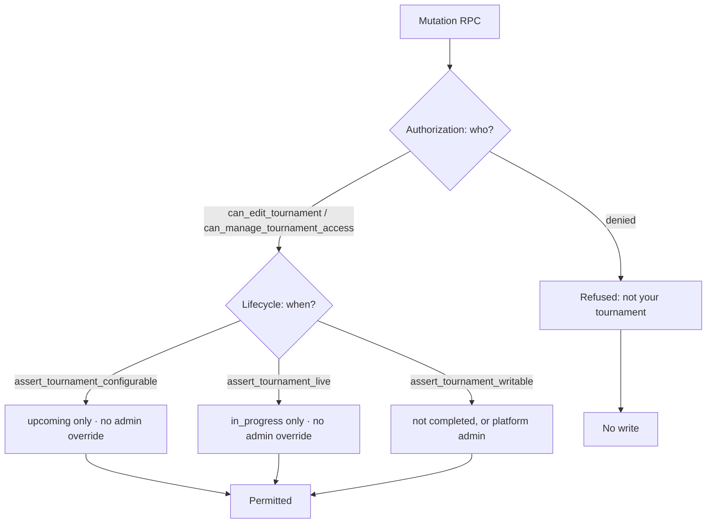

# Authorization

The single reference for *who may do what*. It covers the two axes (platform role and
per-tournament access), the lifecycle guards that decide *when* a write is valid, the
registration window, and the operational consequences — credential creation, recovery and
the column privileges that keep the lifecycle out of reach of a direct client write.

Read this before changing access control. The rules here are enforced in
[`20260927000000_tournova_role_redesign.sql`](../supabase/migrations/20260927000000_tournova_role_redesign.sql),
in the RLS policies, and in the RPC guards. The browser mirror is
[`src/lib/auth/authorization.ts`](../src/lib/auth/authorization.ts), and it renders only; it
decides nothing.

## 1. The two axes

Authorization is two independent questions. Conflating them is the defect this model exists
to fix, so they are stated separately everywhere, including in the database.

| Axis | Question | Stored as | Values |
| --- | --- | --- | --- |
| Platform role | *Who is this person?* | `profiles.system_role` | `admin`, `user` |
| Tournament access | *What may they do to this tournament?* | ownership, or a `tournament_editors` row | owner, editor, or neither |

A **viewer** is not a role and is never stored: it is the absence of both ownership and an
editor row. That is deliberate, because "everyone else" is the state that has to be correct
by default, and a stored row is one more thing that can be left behind.

### Platform role is override, not membership

`admin` is a platform-wide maintenance identity. It is **never** an implicit owner or editor
of any tournament. An admin can *act* on a tournament, because the predicates admit them, but
no tournament lists them as a member, and removing their override changes nothing about who
owns what.

Two `system_role` values only. There is no registrar, scorer, scheduler or manager: those
were tournament-specific jobs being stored per person, and per-tournament access is the
correct home for them.

### Tournament access

| Level | Granted by | May |
| --- | --- | --- |
| **Owner** | `tournaments.owner_profile_id` | Everything an editor may, **plus** manage who else may edit, and delete the tournament |
| **Editor** | a row in `tournament_editors` | Normal operation: configure, seed, generate, start, score, reschedule, and the operational resets |
| **Viewer** | nothing — the default | Read only. Anonymous visitors read public tournament data too |

Ownership is a single column, not a membership row, so a tournament can never be unattributable
and there is exactly one owner. Transfer is not implemented in Phase 1.

Membership is **RPC-only**. No client holds `INSERT`, `UPDATE` or `DELETE` on
`tournament_editors`, so an editor cannot widen the set it belongs to, or re-add itself after
the owner removes it. If you are adding a membership path, it goes through
`add_tournament_editor` / `remove_tournament_editor`, and both are gated on
`can_manage_tournament_access`.

### Registration never confers management

Approval of a registration request is a decision about *participation*, not a grant of
authority. An approved participant is still a viewer for every mutation. There is
deliberately no participation predicate anywhere in the authorization surface — being
approved is never an authorization input.

## 2. The predicates

These are the only names the application layer should reference. All are `SECURITY DEFINER`,
`STABLE`, and pinned to `search_path = public`.

| Predicate | Means |
| --- | --- |
| `current_system_role()` | `admin` \| `user` for the caller, or `NULL` when signed out |
| `is_platform_admin()` | The caller is a platform admin |
| `is_tournament_owner(uuid)` | `owner_profile_id` is the caller's profile |
| `is_tournament_editor(uuid)` | The caller has an editor row for this tournament |
| `can_edit_tournament(uuid)` | admin **or** owner **or** editor. Also the registration-review predicate |
| `can_manage_tournament_access(uuid)` | admin **or** owner. Access management, and delete |
| `has_any_tournament_edit()` | The caller owns or edits *something* |
| `can_manage_player(uuid)` | The caller is this player, or owns or edits a tournament they entered, or is a platform admin |

`has_any_tournament_edit()` is deliberately awkward, and its only use is the `players` write
policy. `players` is a global table with no `tournament_id`, so "may this person create a
player identity" cannot be answered per tournament. The name keeps that debt visible rather
than dressing it up as a rule — see [Known debt](#10-known-debt).

### Internal helpers are not callable

These are the same class of implementation detail as a private function, and they are revoked
from `anon` and `authenticated`:

- `tournament_lifecycle_state(uuid)` — reads `status` once for the guards.
- The three lifecycle guards (Section 4).
- `tournament_starts_at(uuid)`, `tournament_ends_at(uuid)` — the derived timing readers.
- `tournament_is_ready(uuid)`, `assert_registration_window(uuid)`,
  `assert_registration_not_shut(uuid, timestamptz)`.
- The id-less resolvers: `tournament_of_category`, `match_tournament`,
  `tournament_of_registration`, and the placement/tier variants.
- `link_profile()` / `unlink_profile()` — the `auth.users` trigger bodies.

A `SECURITY DEFINER` function that a client can call directly is a hole in the shape
described by its name; the triggers still fire, because `EXECUTE` on a trigger function is
checked when the trigger is created, not on every fire.

### The two-axis contract

**Every mutation calls one authorization predicate _and_ one lifecycle guard.** They are
independent and neither may absorb the other:

- An authorization predicate asks *who may act*, and **never** reads `status`.
- A lifecycle guard asks *when the action is valid*, and **never** reads role — the single
  exception being the platform-admin override inside `assert_tournament_writable`.



A refusal always names the state it refused on, so an operator reading a toast knows whether
the problem is authority or timing.

## 3. Lifecycle

Three states, one direction, and no reverse edge.


- **`upcoming`** — created, publicly readable, still configurable. Includes draw generation
  and match scheduling, which are preparation rather than play.
- **`in_progress`** — being played. Registration is shut and the desk is live.
- **`completed`** — finished, operationally read-only for normal paths.

**No reverse transition exists.** `in_progress → upcoming` and `completed → in_progress` are
both refused, and neither is reachable by a direct client write (Section 9). A mis-completion
is corrected by a platform admin through the named repair paths in Section 4, which is the
same surface a completed tournament is edited through anyway. A real reopen is Phase 2 work,
if it is still wanted after someone has used this.

**Both lifecycle RPCs are owner-capable.** A normal owner takes their own tournament from
`upcoming` to `completed` with no platform admin involvement. Neither transition is
admin-only, and neither is automatic:

| RPC | Transition | Authority | Gates |
| --- | --- | --- | --- |
| `start_tournament(uuid)` | `upcoming → in_progress` | `can_edit_tournament` | `tournament_is_ready()` **and** `now() >= tournament_starts_at()` |
| `complete_tournament(uuid)` | `in_progress → completed` | `can_edit_tournament` | Current state is `in_progress` |

**Nothing starts on its own.** There is no scheduled job, no trigger on `tournament_days` and
no time-based transition. A tournament whose start time has passed simply remains `upcoming`
until a human calls `start_tournament`; the start-time check is a floor, not a trigger. The
trade is real and deliberate: an unattended tournament never starts, and its matches are
unplayable until someone presses Start.

**Many tournaments may be `upcoming` or `in_progress` at once.** This is a requirement, not an
optimisation. `is_active` is a separate presentation pointer — the single public default an
unpointed visitor resolves to — and it is not lifecycle state. It is Phase-1-only legacy
infrastructure: it **must not constrain how many tournaments may be `upcoming` or
`in_progress`**, and no new product behaviour may depend on it. It is platform-admin-only
(`set_active_tournament`), and Phase 2 removes both the column and its unique index once
Explore replaces the default pointer.

### Derived timing

**Start and end are derived, never stored.** The authoritative definition is
`tournament_days`: start is the earliest `date + start_time` and end is the latest
`date + end_time`, both interpreted in `tournaments.venue_timezone`. Moving or adding a day
therefore keeps them correct with no synchronisation step.

The timezone is mandatory rather than cosmetic. `date + start_time` is a wall clock;
comparing it against a `timestamptz` without `AT TIME ZONE venue_timezone` casts it in the
*session* zone — UTC on Supabase — which puts every boundary five or six hours wrong for a US
venue. `venue_timezone` is applied on every read of a day window.

Both readers return `NULL` when a tournament has no days, which is a legitimate `upcoming`
state. A tournament with no days cannot be started.

## 4. Lifecycle guards, and the classified mutation list

Authorization answers *who*; these guards answer *when*. Each operation's rule is declared
once, here, rather than re-derived as an ad-hoc `status` comparison in each RPC.

| Guard | Permits | Consults the platform role? |
| --- | --- | --- |
| `assert_tournament_configurable(uuid)` | `upcoming` only | **No** |
| `assert_tournament_live(uuid)` | `in_progress` only | **No** |
| `assert_tournament_writable(uuid)` | Any state except `completed`, **or** any state at all for a platform admin | **Yes** — the only one |

**The admin override is scoped to the third class alone.** Because a `completed` tournament is
neither `upcoming` nor `in_progress`, the configurable-guarded and live-guarded sets are
refused for admins too. **A completed tournament never becomes scoreable, playable or
initial-generatable because the caller is a platform admin**, and `db-invariants.test.ts`
pins this by asserting the classified list.

### `upcoming` only — `assert_tournament_configurable`

- `save_tournament_config`, `save_tournament_days`, `save_tournament_categories`,
  `discard_tournament`
- `sync_placement_entrants`, `set_placement_skill` (which keeps its own `seed_locked_at` data
  gate), `lock_placement_seeds`
- `apply_placement_generation` — the initial bracket, built from the seed order
- legacy `apply_pool_generation`, `apply_draw_generation`

### `in_progress` only — `assert_tournament_live`

- Match start: `start_placement_match`, `start_tier_draw_match`, legacy `start_match_safe`
- Scoring and results: `report_placement_result`, `report_tier_draw_result`, legacy
  `report_draw_result`, `report_pool_result`
- Live rescheduling: `reschedule_placement_match`, legacy `reschedule_live_match`
- Result-derived generation: `apply_placement_round_two`, `apply_tier_draws`
- Single-result resets: `reset_placement_result`, `reset_tier_draw_result`, legacy
  `reset_match_with_note`, `reset_and_repair_match`
- Desk: `record_desk_match_activity` (the trigger behind the match tables), legacy
  `resolve_match_exception`

`advance_draw_locked`, `advance_tier_draw_locked` and `shift_live_schedule_after_match` need
no separate guard: they are only ever called from a guarded RPC in the same transaction.

### Any state except `completed` — `assert_tournament_writable`

- Structural repair: `reset_placement_schedule`, `reset_placement_stage`,
  `apply_placement_day_schedule`, legacy `apply_day_schedule`
- Incremental configuration a running event legitimately needs: `add_tournament_day`,
  `remove_tournament_day`, `set_tournament_courts`

These are the repair and support paths, and each already carries a stronger, data-based gate
of its own — `reset_placement_stage` refuses while any match or draw still exists,
`remove_tournament_day` refuses while anything is scheduled on that day, and
`set_tournament_courts` refuses to shrink below a court in use. The lifecycle guard is the
outer boundary, not the whole rule.

### Two asymmetries that look like mistakes and are not

- **`save_tournament_days` is `upcoming`-only, but `add_tournament_day` and
  `remove_tournament_day` are not.** The first is the wizard's bulk rewrite of *every* day, so
  running it mid-event would discard the schedule wholesale. The other two are the Schedule
  page's incremental writers, and they exist precisely for the case where a tournament runs
  long and the host needs one more day on the end.
- **`apply_placement_day_schedule` and `set_tournament_courts` take `assert_tournament_writable`
  rather than the stricter guard.** Each serves both initial setup *and* mid-event replanning,
  and the RPC cannot distinguish the two intents. The finer split the product model implies is
  not expressible at this granularity; do not add a second RPC for it in Phase 1.

### Deliberately unguarded by lifecycle

These are not omissions:

- `delete_tournament` — an owner or admin must be able to delete in *any* state.
- `set_active_tournament` (platform admin) and `set_current_tournament` (self) —
  presentation pointers, not operations.
- Read and inspection paths: `tournament_readiness`, `tournament_starts_at` /
  `tournament_ends_at`, `placement_occupied_matches`, `placement_required_matches`,
  `placement_decided_matches`.
- Integrity triggers (`enforce_team_shape`, `enforce_two_category_cap`,
  `enforce_pool_entry_membership`, `enforce_match_sides`, `tournament_days_guard_order`) —
  they enforce data shape, never lifecycle.

## 5. Readiness, and why it must not depend on participation

Readiness answers "is this tournament configured enough to run". It is **not** lifecycle, and
it is **not** registration. Six blockers, all read from configuration alone:

`basics` · `timezone` · `days` · `day_dates` · `categories` · `category_caps`

| Predicate | Answers | Gates |
| --- | --- | --- |
| `tournament_is_ready(uuid)` | Are the six configuration checks satisfied? | `start_tournament` |
| `assert_registration_not_shut(uuid, now)` | `upcoming` **and** a window is configured **and** `now()` is inside it | `submit_tournament_registration` |

**These stay separate. Do not merge them.** A merged "ready for registration" predicate is
what would let a registration concern leak into the start gate, and a start-side check leak
back in.

**Readiness must stay satisfiable before anyone registers**, or registration could never open.
None of the six checks reads `teams`, `placement_entrants`, `placement_matches`, `tier_draws`
or `tier_draw_matches` — and `category_caps` compares a cap against a constant, not against an
entry count. This is load-bearing for Phase 2, where approval will create `teams` rows: if a
future check counted entries — "every event has at least two entrants", the natural next check
to write — readiness would depend on approvals, approvals need registration open, and
registration needs readiness. `db-invariants.test.ts` asserts the `tournament_is_ready` body
references none of those five tables, so that mistake fails the suite instead of silently
making registration circular. A check that needs entries belongs in a separately named
*start*-side predicate.

The checklist the Setup page renders is `tournament_readiness(uuid)`, still all-or-nothing
over the same six blockers, now guarded by `can_edit_tournament` rather than a global role.

## 6. Registration

Registering is optional, and that is product behaviour rather than a gap: a tournament may
exist, become ready and run with no registration window at all. The only effect of a missing
window is that requests cannot be submitted.

**The window** is `registration_opens_at` / `registration_closes_at`, both `timestamptz` —
absolute and independent of the venue zone. Both may be `NULL`.

When a window *is* configured, two invariants hold:

1. `registration_opens_at < registration_closes_at`
2. `registration_closes_at` is at or before `tournament_starts_at`

They are re-validated on **every** writer — `save_tournament_config`, `save_tournament_days`
and the day add/remove RPCs — because days and the window can be written in either order, so
moving the event earlier has to re-check. A partially configured window is refused, so a
stored window is always coherent and nothing downstream re-derives the invariant.

**The window is not a readiness check.** Do not add it to `tournament_is_ready` and do not
require one in `start_tournament`. Readiness answers "configured enough to run"; whether
people may register is a separate question with a separate predicate. A tournament with no
window is ready and startable while `submit_tournament_registration` is refused for it; both
halves are asserted.

`submit_tournament_registration` requires `upcoming` **and** ready **and** `now()` inside a
configured window — all three at the moment that matters, even if validation was bypassed
earlier. It never reads `current_tournament_id`: registering for B while working in A is
valid.

**A request cannot arrive already decided.** It is enforced twice, on purpose: a `CHECK`
cannot tell an `INSERT` from an `UPDATE`, and a trigger cannot be reasoned about from the
table definition alone, so both hold one half. The INSERT half is a trigger rather than a
`DEFAULT`, because a client that sends `status: 'approved'` would otherwise be trusted.

**A direct `INSERT` into `tournament_registrations` is refused for every client**, including
the owner, because the table is `SELECT`-only. Submission goes through the RPC, which forces
`user_id` to `auth.uid()`.

Who may act on a request:

| Action | Who | Refused |
| --- | --- | --- |
| Submit | Any `upcoming`, inside the window | Anonymous, `in_progress`/`completed`, no window, not ready |
| Read own | The requester | Everyone else, and anonymous |
| Review the queue | `can_edit_tournament` | Viewers, unrelated users |
| Approve / reject | `can_edit_tournament` | Viewers, unrelated users |

Registration is writable rather than configurable-guarded on the decision path, because a
window may close at the derived start and the last requests can legitimately be decided after
it. Approval changes no working context and grants no management right. The bridge it will
acquire in this phase (Section 7) links the requester's player row and creates their entry, and
it never makes the requester an editor — being approved is never an authorization input.

## 7. Players, contact data, and the request entries

`players` is the one global table in the schema: it has no `tournament_id`, and every
tournament draws from the same roster. That is why it is the one table whose "who may see this
row" needed a rule of its own, and why it carried the longest debt in Phase 1.

### The link, and the two mechanisms that keep it

`players.profile_id` is the person a player row belongs to.

- **`NULL` is the ordinary value**, not a defect. A walk-in typed in at the desk and a partner
  supplied by name have no account to link to, and a plain unique index would allow exactly
  one of them — so the unique index is partial: `where profile_id is not null`.
- The foreign key is `ON DELETE SET NULL`. Deleting a person must not delete the rows that
  record what they played, and must not fail either.

One code path links a player: the requester branch of `decide_tournament_registration`
(Section 6). Two mechanisms keep it that way, and they are deliberately redundant — each one
alone has a way round it that the other closes:

| Layer | What it closes | How it can be lost |
| --- | --- | --- |
| Column privilege | `INSERT` and `UPDATE` on `profile_id` for `anon` and `authenticated` | A later migration re-issues a table-wide `GRANT` |
| Trigger `players_profile_link_guard` | Any write that would set a link without the sanctioned flag, from any role | Nothing. This is the durable half |

The grant withholds `profile_id`, `id` and `created_at`, and re-grants the four columns a
person legitimately types: `name`, `email`, `phone`, `gender`. `DELETE` is deliberately **not**
withdrawn — the policy restricts deletion to a platform admin, and taking the privilege away
as well would make that path unreachable rather than restricted.

The trigger decides by **state transition, not by actor**, and that choice is what makes the
FK's `ON DELETE SET NULL` expressible: the cascade arrives as an ordinary
`UPDATE ... SET profile_id = NULL`, with nothing about the session to distinguish it from a
client doing the same thing.

| Transition | Rule |
| --- | --- |
| `INSERT`, null | Allowed. Walk-in, unlinked partner |
| `INSERT`, non-null | The flag only |
| `UPDATE`, unchanged | Allowed. A name or contact edit carries no transition |
| `UPDATE`, non-null → null | Allowed unconditionally. The de-link, and what the FK needs |
| `UPDATE`, a → b (both non-null) | Refused **even under the flag** |
| `UPDATE`, null → non-null | The flag only |

A de-link is legal for everyone because it is not a *claim*: it removes contact access, grants
nothing, and the only way back is the flagged arm.

The flag is the transaction-local setting `tournova.allow_profile_link`. It is set by exactly
one function — the approval — and it is read as a setting rather than as a role name, so the
sanctioned writer is recognisable without any part of the rule depending on who is connected.

**The consequence that surprises people.** `INSERT ... RETURNING` is checked against the
`SELECT` policy, and `players read` does not admit a row that was just created, so a client
cannot read back the player it wrote: the write succeeds and the read-back is refused.
`createPlayer` therefore inserts without representation and the screens refetch the roster.

### Who may do what to a player row

| Verb | Rule |
| --- | --- |
| `SELECT` | The person themselves, or `can_manage_player(id)` |
| `INSERT` | `profile_id is null` **and** the caller's own JWT email, or `has_any_tournament_edit()` |
| `UPDATE` | The person themselves, or a platform admin |
| `DELETE` | A platform admin |

This replaces a single `FOR ALL` policy that admitted any tournament editor to all four verbs
while this document described `UPDATE` and `DELETE` as admin-only.

`can_manage_player(id)` is true for the player, for the owner or an editor of a tournament the
player has **entered**, or for a platform admin. Membership is read from the entry —
`teams.player_1_id` / `teams.player_2_id` → `teams.tournament_id` → owner or editor — and
**never** from `placement_entrants`. That projection is built by the placement stage and
cleared by `reset_placement_stage`, so membership read from it would appear and disappear with
the placement stage — and be refused for exactly the entrants who have not been placed yet.

Creation stays broader than reading, on purpose: an operator may create a walk-in they cannot
read back, because contact data is readable only through an entry and a fresh walk-in has none.
The roster those screens render is `public_players`, which carries no email address and no link.

### The request entries

`tournament_registration_entries` is what a request is *for*: one row per category, carrying the
named partner. The partner is a **name and an email, never a `players.id`** — they have claimed
nothing, may not be an account holder, and resolving them at submission time would either
invent a person or claim one. `UNIQUE (registration_id, category_id)` makes a resubmit replace a
set rather than duplicate it.

The table is readable by its requester and by nobody else through a policy — reviewers read it
through the definer RPC, because a policy's subquery is evaluated as the calling role. It is a
member of the realtime publication, which is what makes the requester's own panel react; a
reviewer's queue needs the reviewer arm that the queue itself adds.

### One live request, and re-application

`tournament_registrations` is unique on `(tournament_id, profile_id)` **where
`status <> 'rejected'`**. Phase 1's unconditional key made a rejection permanent: the row
stayed, the key kept it, and a person turned down once could never apply again. That is what an
unconditional unique key means rather than a rule anybody chose. A rejected row now leaves the
index, so re-applying is a new request with a new decision rather than a reopened one.

## 8. Column privileges, and how `status` is kept out of reach

Direct `PostgREST` mutation of `status`, `is_active` or `owner_profile_id` must be impossible for
every client — owner, editor, unrelated user and platform admin alike — while the lifecycle
RPCs must be able to write them.

**No column-protection trigger exists.** A generic `BEFORE UPDATE` guard cannot both forbid
direct client writes and permit the lifecycle RPCs without either making lifecycle changes
platform-admin-only or accepting `auth.uid() IS NULL` as a signal. Column-level `UPDATE`
privileges separate the two paths structurally instead:

- `REVOKE UPDATE ON public.tournaments FROM anon, authenticated;`
- `GRANT UPDATE (…) ON public.tournaments TO authenticated;` — only the columns a client may
  legitimately write: the ones the two existing direct writers touch
  (`updateTournamentTimings`, `updateTournamentMatchSettings`), plus the owner-editable
  configuration and the two registration-window fields.
- `status`, `is_active` and `owner_profile_id` are **omitted from the list**, so a write touching
  them fails at the privilege layer before RLS is consulted.
- `SECURITY DEFINER` runs as the table owner, so `start_tournament`, `complete_tournament` and
  `set_active_tournament` write those columns freely. The bypass is a property of function
  ownership, not of a caller-supplied signal.

**The cost is maintenance.** A newly added editable column on `tournaments` is silently
read-only until it is granted, and the symptom is a write that appears to succeed and changes
nothing. `db-invariants.test.ts` asserts the grant list covers every editable column and
excludes the three protected ones, which is what turns that into a loud failure.

## 9. Profile identity, and the recovery seam

`profiles` is a rename of `staff_roles`, not a new table, because the email-durability seam
the recovery runbook depends on had to survive. Email is the durable key:

- `on_auth_user_created_link_profile` — an `AFTER INSERT` trigger on `auth.users` that sets
  `profiles.user_id` from a matching email. Creating the identity *is* the linking step.
- `on_auth_user_deleted_unlink_profile` — its delete twin, which clears `profiles.user_id` and
  `current_tournament_id` and leaves the row in place.
- `current_system_role()` matches on `user_id = auth.uid()` OR the JWT email, so it resolves
  even before the trigger has run.

**Ownership points at the profile, not at the identity.** `tournaments.owner_profile_id`
references `profiles(id)`, which is what lets the recovery runbook delete and recreate the
admin's login without orphaning a tournament. The delete-and-recreate sequence is asserted in
`integration/profile-identity.test.ts`, including the part that used to fail quietly: because
the link is cleared rather than left holding a dead uuid, a new identity at the same address
re-links to the same profile and keeps its role.

The linking `UPDATE` carries a guard on `user_id`. Drop it and anyone signing up with a
colleague's verified email inherits that colleague's row — and, for the admin address, the
platform role with it.

**What this means in practice:** after a recovery, nobody can sign in until their login is
recreated with
[`scripts/create-staff-login.mjs`](../scripts/create-staff-login.mjs). Their role is already
correct — the restored `profiles` row carries it — but there is no account to authenticate as.
See [`recovery-runbook.md`](recovery-runbook.md).

`profiles.current_tournament_id` is the caller's own working context, not lifecycle state and
not a tournament-wide fact. `set_current_tournament` writes only the caller's row, every read
resolves it per user, and switching it affects nobody else. It is `NULL` for a user who has
not chosen one, and clears itself if the tournament is deleted.

## 10. Known debt

Carried out of Phase 1 on purpose, with the reasoning, so it is not rediscovered as a bug.
Where the current work closes one, the entry stays and says so — the list is a record of what
was deferred and why, not a to-do list.

1. **The user↔player bridge is schema-only so far.** `players.profile_id`, the guard that keeps
   it to one writer and the entry shape all exist, and nothing yet sets the link: the approval
   is the next step. What will stay open after it is the *partner* half — a named partner is
   matched to an unlinked row or created then, and is never linked to an account by that act.
2. **Global player identity retains cross-tournament creation** by any editor, and this is now
   the only part of the `players` surface still keyed on a platform-wide right. Additive only:
   `UPDATE` and `DELETE` on `players` are closed to non-admins, and the link column cannot be
   set by a client at all. `has_any_tournament_edit()` is the named, awkward half of this.
3. **Player contacts are readable by anyone who owns or edits a tournament the player entered**
   — a tournament scope, read from an entry rather than from a placement projection
   (Section 7). The residual is that `tournament_editors` is per tournament rather than per
   team, so an editor can read the contact data of every entrant in their tournament, which is
   the same set of people the desk is calling about. `public_players` remains the anonymous-safe
   projection (`id, name, gender, created_at`), and `anon` still has no `SELECT` on `players`
   itself.
4. **`desk_activity` has no tournament scope.** The policy resolves a tournament from the
   match, so the debt is bounded per match rather than per tournament.
5. **Re-application is open, re-decision is not.** The unique key is now partial on
   `status <> 'rejected'`, so a rejected person may submit again as a new request (Section 7).
   A decided request still cannot be reopened — `pending → approved | rejected` has no reverse,
   which is asserted by the guard trigger rather than by this document.
6. **Pending requests do not reserve capacity**, so a tournament could approve more requests
   than it can seat. The category cap is enforced on the entry, and that is where it fails.
7. **No participant self-service** (cancel/withdraw), and no registration window per category.
8. **`is_active` is Phase-1-only legacy presentation infrastructure** — see Section 3.
9. **The column-level `UPDATE` grant list is a maintenance surface** — see Section 8.
10. **`completed` is enforced by shared RPC guards, not by RLS.** A future write path that
    bypasses the guarded RPCs is not covered unless it calls a guard. The invariants assertion
    keeps the classified list explicit and pins `assert_tournament_writable` to its enumerated
    call sites, so a widened override fails the suite.
11. **`start_tournament` is manual**, so an unattended tournament never starts.
12. **Registration closes at the derived start, not at a decision.** Because
    `start_tournament` cannot run before the derived start and the window must close at or
    before it, a tournament that starts late still closes registration on time. Intended, and
    recorded because it is easy to mistake for an off-by-one.
13. **Single owner, with no transfer.** Delete and recreate is the Phase 1 answer.
14. **The production backfill is intentionally minimal** — one admin, no staff — so legacy
    role conversion, where it exists at all, is staging/test scaffolding rather than a
    production path.

## 11. Changing any of this

A change to authorization, the lifecycle guards, the column privileges or the RLS policies is
a **high-risk change** and takes the full PR/phase-close gate at every stage — typecheck,
unit, e2e, the final e2e gate, build — plus `npm run test:integration` against the local
stack, because RLS and RPC guards are structurally invisible to the hermetic suite:

```sh
npx supabase start                      # needs a container runtime
npm run integration:target -- local
npm run test:integration
npm run integration:target -- use staging
```

The integration suite writes rows and flips the active-tournament pointer, and the guard
refuses any project a root environment file names. That is why it targets the local stack
rather than staging, and why a dedicated cloud project is not an option on the free plan's
two-project limit.

State in the PR what could break and what you checked. The tests are the floor, not the
argument.
