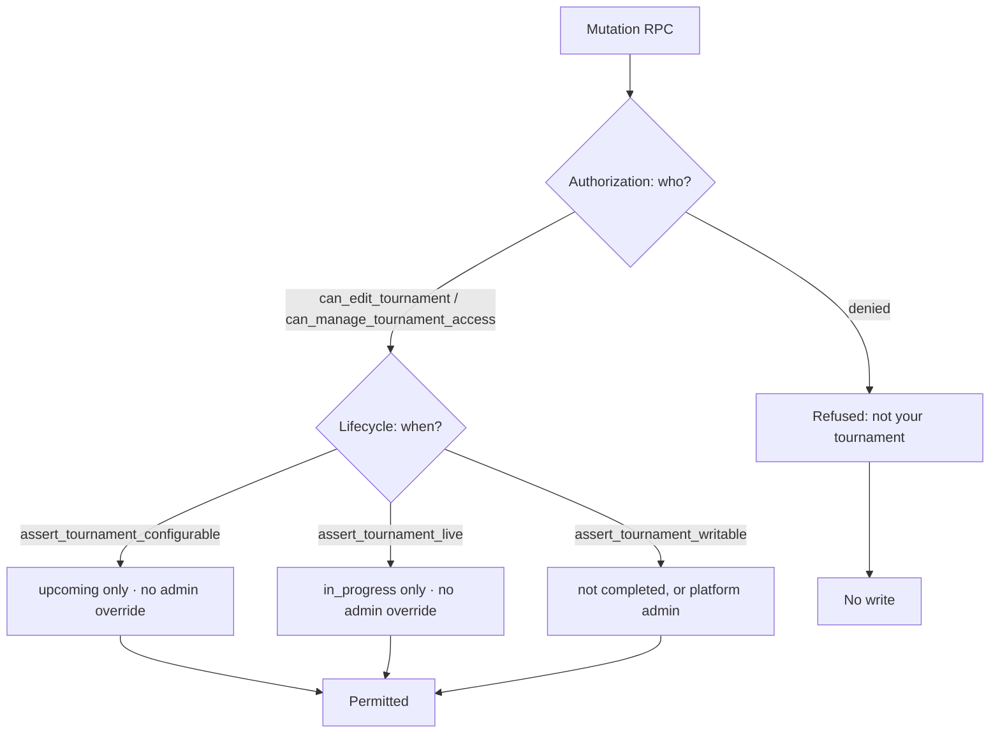

# Authorization

The single reference for *who may do what*. It covers the two axes (platform role and
per-tournament access), the lifecycle guards that decide *when* a write is valid, the
registration window, the player-and-contact rules, and the operational consequences —
credential creation, recovery and the column privileges that keep the lifecycle out of reach
of a direct client write.

Read this before changing access control. The rules here are enforced in the migrations in
[`supabase/migrations`](../supabase/migrations) — Phase 1's
[`20260927000000_tournova_role_redesign.sql`](../supabase/migrations/20260927000000_tournova_role_redesign.sql),
and Phase 2's
[`20260929000000_identity_canon.sql`](../supabase/migrations/20260929000000_identity_canon.sql),
[`20260929001000_tournament_summary.sql`](../supabase/migrations/20260929001000_tournament_summary.sql),
[`20260929010000_retire_is_active.sql`](../supabase/migrations/20260929010000_retire_is_active.sql),
[`20260929020000_registration_entries_and_identity.sql`](../supabase/migrations/20260929020000_registration_entries_and_identity.sql)
and [`20260929030000_walk_in_player_predicate.sql`](../supabase/migrations/20260929030000_walk_in_player_predicate.sql)
— in the RLS policies, and in the RPC guards. The browser mirror is
[`src/lib/auth/authorization.ts`](../src/lib/auth/authorization.ts), and it renders only; it
decides nothing.

## 1. The two axes

Authorization is two independent questions. Conflating them is the defect this model exists
to fix, so they are stated separately everywhere, including in the database.

| Axis | Question | Stored as | Values |
| --- | --- | --- | --- |
| Platform role | *Who is this person?* | `profiles.system_role` | `admin`, `user` |
| Tournament access | *What may they do to this tournament?* | ownership, or a `tournament_editors` row | owner, editor, or neither |

A **viewer** is not a role and is never stored: it is the absence of both ownership and an
editor row. That is deliberate, because "everyone else" is the state that has to be correct
by default, and a stored row is one more thing that can be left behind.

A **participant** is not a role either. Registering, being approved and becoming an entrant
are all facts about *participation*, and none of them is an authorization input (Section 6).

### Platform role is override, not membership

`admin` is a platform-wide maintenance identity. It is **never** an implicit owner or editor
of any tournament. An admin can *act* on a tournament, because the predicates admit them, but
no tournament lists them as a member, and removing their override changes nothing about who
owns what.

Two `system_role` values only. There is no registrar, scorer, scheduler or manager: those
were tournament-specific jobs being stored per person, and per-tournament access is the
correct home for them.

### Tournament access

| Level | Granted by | May |
| --- | --- | --- |
| **Owner** | `tournaments.owner_profile_id` | Everything an editor may, **plus** manage who else may edit, and delete the tournament |
| **Editor** | a row in `tournament_editors` | Normal operation: configure, seed, generate, start, score, reschedule, review registrations, and the operational resets |
| **Viewer** | nothing — the default | Read only. Anonymous visitors read public tournament data too |

Ownership is a single column, not a membership row, so a tournament can never be
unattributable and there is exactly one owner. Transfer is not implemented (Section 10).

Both domain relationships key on the **profile**, not the identity: `owner_profile_id` and
`tournament_editors.profile_id` reference `profiles(id)`. A profile outlives the auth
identity it is linked to, which is what lets the recovery runbook recreate a login without
orphaning a tournament or dropping an editor grant (Section 9).

Membership is **RPC-only**. No client holds `INSERT`, `UPDATE` or `DELETE` on
`tournament_editors`, so an editor cannot widen the set it belongs to, or re-add itself after
the owner removes it. If you are adding a membership path, it goes through
`add_tournament_editor` / `remove_tournament_editor`, and both are gated on
`can_manage_tournament_access`.

### Registration never confers management

Approval of a registration request is a decision about *participation*, not a grant of
authority. An approved participant is still a viewer for every mutation. There is
deliberately no participation predicate anywhere in the authorization surface — being
approved is never an authorization input.

## 2. The predicates

These are the only names the application layer should reference. All are `SECURITY DEFINER`,
`STABLE`, and pinned to `search_path = public`.

| Predicate | Means |
| --- | --- |
| `current_system_role()` | `admin` \| `user` for the caller, or `NULL` when signed out |
| `is_platform_admin()` | The caller is a platform admin |
| `is_tournament_owner(uuid)` | `owner_profile_id` is the caller's profile |
| `is_tournament_editor(uuid)` | The caller has an editor row for this tournament |
| `can_edit_tournament(uuid)` | admin **or** owner **or** editor. Also the registration-review predicate |
| `can_manage_tournament_access(uuid)` | admin **or** owner. Access management, and delete |
| `can_manage_player(uuid)` | The caller is this player, or owns or edits a tournament they entered, or is a platform admin |
| `can_add_walk_in_player()` | The caller owns or edits *something*, or is a platform admin |

Two resolvers sit behind them and are granted to `authenticated` because RLS policies are
evaluated as the querying role: `current_profile_id()` — the caller's `profiles.id`, resolved
through the auth link or, before the trigger has linked the row, the normalised JWT email —
and `current_tournament_id()` — the caller's own working-tournament pointer (Section 3).

### The player pair: one read, one create

`players` is the one global table in the schema, so it is the one table whose rules could not
be written per tournament. Phase 2 split its two questions:

- **`can_manage_player(id)` is the read question, asked per player.** Membership comes from
  the *entry* — a `teams` row for a tournament the caller owns or edits — never from a
  placement projection (Section 7).
- **`can_add_walk_in_player()` is the create question, and it stays platform-wide.** It
  answers "may this caller add an unlinked person to the global roster", and it cannot be
  narrowed: a player row has no tournament scope, and the entry that would scope it does not
  exist until the player has been created.

Both names now say exactly which question they answer. Phase 1 called the second one
`has_any_tournament_edit()`, which read as a capability over tournaments and invited a writer
to reach for it where the per-tournament `can_edit_tournament(uuid)` was the right answer.
The rename is the whole change; the three arms are unchanged, and
[`20260929030000_walk_in_player_predicate.sql`](../supabase/migrations/20260929030000_walk_in_player_predicate.sql)
asserts that against its own catalogue. The remaining debt is that the *create* arm is still
keyed on a platform-wide right — see [Known debt](#10-known-debt).

### Internal helpers are not callable

These are the same class of implementation detail as a private function, and they are revoked
from `anon` and `authenticated`:

- `tournament_lifecycle_state(uuid)` — reads `status` once for the guards.
- The three lifecycle guards (Section 4).
- `tournament_starts_at(uuid)`, `tournament_ends_at(uuid)` — the derived timing readers.
- `tournament_is_ready(uuid)`, `assert_registration_window(uuid)`,
  `assert_registration_not_shut(uuid, timestamptz)`.
- The id-less resolvers: `tournament_of_category`, `tournament_of_registration`,
  `match_tournament`, and the placement/tier variants.
- `link_profile()` / `unlink_profile()` — the `auth.users` trigger bodies.

The data-carrying reads the pages call — `tournament_summary(...)`,
`explore_tournaments(...)`, `explore_tournament_counts(...)`, `tournament_registration_state(uuid)`, `tournament_readiness(uuid)`,
`tournament_access(uuid)`, `my_tournament_registration(uuid)`,
`review_tournament_registrations(uuid)` — are the opposite case: they exist to be called, and
each closes its implicit `PUBLIC` grant and re-grants explicitly to the roles that need it
(`anon` where the surface is public, otherwise `authenticated`).

A `SECURITY DEFINER` function that a client can call directly is a hole in the shape described
by its name; the triggers still fire, because `EXECUTE` on a trigger function is checked when
the trigger is created, not on every fire.

### The two-axis contract

**Every mutation calls one authorization predicate _and_ one lifecycle guard.** They are
independent and neither may absorb the other:

- An authorization predicate asks *who may act*, and **never** reads `status`.
- A lifecycle guard asks *when the action is valid*, and **never** reads role — the single
  exception being the platform-admin override inside `assert_tournament_writable`.



A refusal always names the state it refused on, so an operator reading a toast knows whether
the problem is authority or timing.

## 3. Lifecycle

Three states, one direction, and no reverse edge.


- **`upcoming`** — created complete, publicly readable, still configurable. Includes draw
  generation and match scheduling, which are preparation rather than play. Registration is
  offered here or not at all. There is no draft: a tournament is created whole or not at all.
- **`in_progress`** — being played. Registration is shut and the desk is live. Entered by the
  first match being started, never by a button.
- **`completed`** — finished, operationally read-only for normal paths.

**No reverse transition exists.** `in_progress → upcoming` and `completed → in_progress` are
both refused, and neither is reachable by a direct client write (Section 8). A mis-completion
is corrected by a platform admin through the named repair paths in Section 4, which is the
same surface a completed tournament is edited through anyway. A real reopen is not built.

**Starting is a consequence, completing is an act.** A normal owner takes their own tournament
from `upcoming` to `completed` with no platform admin involvement:

| Where | Transition | Authority | Gates |
| --- | --- | --- | --- |
| `start_placement_match`, `start_tier_draw_match`, `start_match_safe` | `upcoming → in_progress`, in the same transaction as the match starting | `can_edit_tournament` | `assert_tournament_can_start_match`: not `completed`, and `now() >= tournament_starts_at()` |
| `complete_tournament(uuid)` | `in_progress → completed` | `can_edit_tournament` | Current state is `in_progress`, and **no match is on court** |

There is no `start_tournament`. It was a button that could be pressed with no match anywhere
near ready, or forgotten on a tournament already being played. The transition is
`mark_tournament_started`, which only ever moves an `upcoming` row forward and so is idempotent
under two simultaneous first matches.

**Completing and starting do not interleave.** Every match start takes a *shared* advisory lock
on the tournament (`lifecycle:<id>`) and `complete_tournament` takes it *exclusively*, so a
Complete that saw nothing on court cannot commit after a match has started. A row lock was
rejected: two first matches would each hold it shared and then both try to upgrade it to flip
the status, which deadlocks.

**Nothing completes on its own.** There is no scheduled job and no time-based transition. A
tournament past its last day simply stays `in_progress` until its host completes it, and one
that never had a match started stays `upcoming`. The app *reminds* — a tournament whose first
playing day has begun with no match started is shown as "Not started", and one past its last
playing day as "Past its last day" — but a reminder is a label, never a transition.

**Many tournaments may be `upcoming` or `in_progress` at once.** This is a requirement, not an
optimisation, and there is no global active tournament. The only "where am I working" state is
the caller's own pointer, `profiles.current_tournament_id`, written by
`set_current_tournament`, resolved per user by `current_tournament_id()`, and `NULL` for a
caller who has not chosen one — who then browses `/explore`. Phase 1's global `is_active`
column, its partial unique index and `set_active_tournament` were retired by
[`20260929010000_retire_is_active.sql`](../supabase/migrations/20260929010000_retire_is_active.sql);
nothing may reintroduce a tournament-wide default.

### The window, and the playing days inside it

A tournament has two sets of dates, and they are different things.

- **The window** (`starts_on`, `ends_on`) is what the tournament promises. It is chosen when the
  tournament is created, is what the public sees, and has no maximum length. Only
  `create_tournament` and `update_tournament_window` write it.
- **Playing days** (`tournament_days`) are the days actually played, chosen later when the
  schedule is built. Each must lie inside the window, they need not be consecutive, and there
  is no maximum. A tournament may have none yet.

**The derived instants are the window.** `tournament_starts_at` is 00:00 of `starts_on` and
`tournament_ends_at` is 00:00 of the day after `ends_on`, both in `tournaments.venue_timezone`.
That one instant is the registration deadline's bound *and* the earliest a match may start,
so registering and playing never overlap. `tournament_play_starts_at` / `tournament_play_ends_at`
are the old derivation from the playing days (NULL with none), used only for reminders.

The timezone is mandatory rather than cosmetic. A date or `date + start_time` is a wall clock;
comparing it against a `timestamptz` without `AT TIME ZONE venue_timezone` casts it in the
*session* zone — UTC on Supabase — which puts every boundary five or six hours wrong for a US
venue. The timezone cannot change once any match has a time (`tournaments_guard_timezone`).

**The window rule is a trigger.** `tournament_days_guard_window` refuses a day outside the window
for every writer, because an editor can write `tournament_days` directly; an RPC-only check
would be walked around by the table update.

**What may move after the first match.** The last date can still be extended; the first date is
locked (the gate and the deadline have been measured from it). A playing day can be added inside
the window, and removed only if no match falls on it. Events, entry caps and format are fixed.
Name, note, venue, address and organiser contact stay editable until completion
(`update_tournament_details`).

## 4. Lifecycle guards, and the classified mutation list

Authorization answers *who*; these guards answer *when*. Each operation's rule is declared
once, here, rather than re-derived as an ad-hoc `status` comparison in each RPC.

| Guard | Permits | Consults the platform role? |
| --- | --- | --- |
| `assert_tournament_configurable(uuid)` | `upcoming` only | **No** |
| `assert_tournament_live(uuid)` | `in_progress` only | **No** |
| `assert_tournament_writable(uuid)` | Any state except `completed`, **or** any state at all for a platform admin | **Yes** — the only one |

**The admin override is scoped to the third class alone.** Because a `completed` tournament is
neither `upcoming` nor `in_progress`, the configurable-guarded and live-guarded sets are
refused for admins too. **A completed tournament never becomes scoreable, playable or
initial-generatable because the caller is a platform admin**, and `db-invariants.test.ts`
pins this by asserting the classified list.

### `upcoming` only — `assert_tournament_configurable`

- `save_tournament_config`, `save_tournament_days` (and only while nothing is scheduled),
  `save_tournament_categories`, `set_registration_window`, `discard_tournament`
- `sync_placement_entrants`, `set_placement_skill` (which keeps its own `seed_locked_at` data
  gate), `lock_placement_seeds`
- `apply_placement_generation` — the initial bracket, built from the seed order
- legacy `apply_pool_generation`, `apply_draw_generation`

### `in_progress` only — `assert_tournament_live`

- Scoring and results: `report_placement_result`, `report_tier_draw_result`, legacy
  `report_draw_result`, `report_pool_result`
- Live rescheduling: `reschedule_placement_match`, legacy `reschedule_live_match`
- Result-derived generation: `apply_placement_round_two`, `apply_tier_draws`
- Single-result resets: `reset_placement_result`, `reset_tier_draw_result`, legacy
  `reset_match_with_note`, `reset_and_repair_match`
- Desk: `record_desk_match_activity` (the trigger behind the match tables), legacy
  `resolve_match_exception`

`advance_draw_locked`, `advance_tier_draw_locked` and `shift_live_schedule_after_match` need
no separate guard: they are only ever called from a guarded RPC in the same transaction.

### Starting a match — `assert_tournament_can_start_match`

`start_placement_match`, `start_tier_draw_match` and legacy `start_match_safe` accept an
`upcoming` or `in_progress` tournament, from 00:00 of the window's first date, and flip an
`upcoming` one to `in_progress`. A `completed` one is refused for **everyone**; the guard does
not consult the platform role, and `db-invariants.test.ts` pins that.

### Any state except `completed` — `assert_tournament_writable`

- Structural repair: `reset_placement_schedule`, `reset_placement_stage`,
  `apply_placement_day_schedule`, legacy `apply_day_schedule`
- Incremental configuration a running event legitimately needs: `add_tournament_day`,
  `remove_tournament_day`, `set_tournament_courts`, `update_tournament_window`,
  `update_tournament_details`
- The registration decision: `decide_tournament_registration` (Section 6)

These are the repair and support paths, and each already carries a stronger, data-based gate
of its own — `reset_placement_stage` refuses while any match or draw still exists,
`remove_tournament_day` refuses while anything is scheduled on that day, and
`set_tournament_courts` refuses to shrink below a court in use. The lifecycle guard is the
outer boundary, not the whole rule.

### Two asymmetries that look like mistakes and are not

- **`save_tournament_days` is `upcoming`-only, but `add_tournament_day` and
  `remove_tournament_day` are not.** The first is a bulk rewrite of *every* day, so running it
  once anything is scheduled would silently re-attribute the matches; it refuses then. The
  other two are the Schedule page's incremental writers, and they exist precisely for the case
  where a tournament runs long and the host needs one more day on the end.
- **`apply_placement_day_schedule` and `set_tournament_courts` take `assert_tournament_writable`
  rather than the stricter guard.** Each serves both initial setup *and* mid-event replanning,
  and the RPC cannot distinguish the two intents. The finer split the product model implies is
  not expressible at this granularity.

### Deliberately unguarded by lifecycle

These are not omissions:

- `delete_tournament` — an owner or admin must be able to delete in *any* state.
- `create_tournament` — a new row has no state to guard. It is the only way a tournament
  comes into being, and it is atomic: the window, the timezone and at least one event are
  written together or not at all.
- `set_current_tournament` — a presentation pointer on the caller's own row, not an operation.
- `submit_tournament_registration` — carries `assert_registration_not_shut`, which is a
  window-and-lifecycle rule of its own (Section 6) rather than one of the three above.
- `withdraw_tournament_registration` — the caller deleting their own unanswered request.
  Allowed in any state, because it destroys no competition data.
- Read and inspection paths: `tournament_summary(...)`, `explore_tournaments(...)`,
  `explore_tournament_counts(...)`, `tournament_registration_state(uuid)`,
  `tournament_readiness(uuid)`, `my_tournament_registration(uuid)`,
  `review_tournament_registrations(uuid)`, `list_tournament_editors(uuid)`,
  `tournament_starts_at` / `tournament_ends_at`, `tournament_completion_check(uuid)`,
  `placement_occupied_matches`,
  `placement_required_matches`, `placement_decided_matches`.
- Integrity triggers (`enforce_team_shape`, `enforce_two_category_cap`,
  `enforce_pool_entry_membership`, `enforce_match_sides`, `tournament_days_guard_order`,
  `tournament_days_guard_window`) — they enforce data shape, never lifecycle. Two triggers on
  `tournaments` are the exception, and say so: `tournaments_guard_timezone` (not under a
  schedule) and `tournaments_guard_registration` (Section 6).

## 5. Readiness, and why it must not depend on participation

Readiness answers "is this tournament configured enough to run". It is **not** lifecycle, and
it is **not** registration. Four blockers, all read from configuration alone:

`basics` (a name) · `timezone` · `categories` · `category_caps`

Playing days are not a check: they are chosen when the schedule is built, so a tournament with
none is complete. The window is always present and ordered (`NOT NULL` plus a `CHECK`), so it
needs no check of its own. A venue is optional, so `basics` no longer asks for one.

| Predicate | Answers | Gates |
| --- | --- | --- |
| `tournament_is_ready(uuid)` | Are the configuration checks satisfied? | `submit_tournament_registration`, and the `create_tournament` it ends with |
| `assert_registration_not_shut(uuid, now)` | `upcoming` **and** a window is configured **and** `now()` is inside it | `submit_tournament_registration` |
| `tournament_registration_state(uuid)` | The window as one word (§6) — a *read*, never a gate | The Register button and the window copy |

**These stay separate. Do not merge them.** A merged "ready for registration" predicate is
what would let a registration concern leak into the start gate, and a start-side check leak
back in.

**Readiness must stay satisfiable before anyone registers**, or registration could never open.
None of the checks reads `teams`, `placement_entrants`, `placement_matches`, `tier_draws`,
`tier_draw_matches` or `tournament_registration_entries` — and `category_caps` compares a cap
against a constant, not against an entry count. This is load-bearing now that approval
*creates* `players` and `teams` rows: if a future check counted entries — "every event has at
least two entrants", the natural next check to write — readiness would depend on approvals,
approvals need registration open, and registration needs readiness.
`db-invariants.test.ts` asserts the `tournament_is_ready` body references none of those five
tables, so that mistake fails the suite instead of silently making registration circular. A
check that needs entries belongs in a separately named *start*-side predicate.

The checklist the Setup page renders is `tournament_readiness(uuid)`, still all-or-nothing
over the same blockers, now guarded by `can_edit_tournament` rather than a global role.

## 6. Registration

Registering is optional, and that is product behaviour rather than a gap: a tournament may
exist, become ready and run with no registration window at all. The only effect of a missing
window is that requests cannot be submitted.

**The window** is `registration_opens_at` / `registration_closes_at`, both `timestamptz` —
absolute and independent of the venue zone. Both may be `NULL`.

When a window *is* configured, two invariants hold:

1. `registration_opens_at < registration_closes_at`
2. `registration_closes_at` is at or before `tournament_starts_at` — that is, 00:00 of the
   tournament window's first date at the venue. The registration window and the tournament
   window never overlap.

They are re-validated on **every** writer — `create_tournament`, `save_tournament_config`,
`save_tournament_days`, `set_registration_window` and `update_tournament_window` — because the
two windows can be written in either order, so moving the tournament earlier has to re-check. A
partially configured window is refused, so a stored window is always coherent and nothing
downstream re-derives the invariant.

**Who may move it, and when** (`tournaments_guard_registration`, a trigger, because the editor
UPDATE grant lets a client write the columns directly): once the tournament has started it
cannot change at all; once it has opened its opening time cannot change; and it cannot be
*extended* — or switched on — once a schedule exists (`tournament_has_schedule`), because the
entrants the schedule was built for must not change under it. It can always be shortened, which
is how "close registration now" works. `set_registration_window` is the one call that does this.

**The window is not a readiness check.** Do not add it to `tournament_is_ready`. A tournament
with no window is ready while `submit_tournament_registration` is refused for it; both halves
are asserted.

### The window as one word

`tournament_registration_state(uuid)` returns `not_offered` · `not_ready` · `opens_soon` ·
`open` · `closed` · `started` · `completed`, computed from the same predicates the RPC
consults, in the same order. The Register button and the copy around it read this rather than
comparing two timestamps in the browser, so the button and the RPC cannot disagree about
whether a request would be accepted. It is a read: the RPC still re-checks everything.

### Submitting

`submit_tournament_registration(p_tournament_id uuid, p_entries jsonb)` files or replaces the
caller's pending request. It requires, in one transaction:

1. A resolved profile — an identity with no profile has no person to file as, and the column
   is `NOT NULL`.
2. `upcoming` **and** a configured window **and** `now()` inside it, re-checked at the moment
   that matters even if validation was bypassed earlier.
3. Ready.
4. At least one entry; every event the tournament's own and still active; no event twice.
5. At most `max_categories_per_player` events, the tournament's own cap.
6. A pair entry names a partner (name and email) who is not the caller.

**A resubmit replaces the entries rather than accumulating them**, and a retry returns the
same request instead of failing — that is what makes a second tap on bad wifi safe. A request
that has already been decided cannot be rewritten: an approved entrant's entries are what
they were approved for.

**A request cannot arrive already decided.** It is enforced twice, on purpose: a `CHECK`
cannot tell an `INSERT` from an `UPDATE`, and a trigger cannot be reasoned about from the
table definition alone, so both hold one half. The INSERT half is a trigger rather than a
`DEFAULT`, because a client that sends `status: 'approved'` would otherwise be trusted.

**A direct `INSERT` into `tournament_registrations` is refused for every client**, including
the owner, because the table is `SELECT`-only. Submission goes through the RPC, which stamps
`profile_id` from `current_profile_id()` — never from the payload.

Who may act on a request:

| Action | Who | Refused |
| --- | --- | --- |
| Submit | Any caller with a profile, `upcoming`, inside the window, ready | Anonymous, no profile, `in_progress`/`completed`, no window, not ready, an inactive event, a partner who is the caller |
| Withdraw | The requester, while the request is pending | Anonymous, another person's request, a decided request |
| Read own | The requester | Everyone else, and anonymous |
| Review the queue | `can_edit_tournament` | Viewers, unrelated users |
| Approve / reject | `can_edit_tournament`, in any state except `completed` — or any state for a platform admin | Viewers, unrelated users |

Registration is writable rather than configurable-guarded on the decision path, because a
window may close at the derived start and the last requests can legitimately be decided after
it. Being approved grants no management right.

### Deciding, and the identity bridge

`decide_tournament_registration(p_registration_id, p_decision, p_note)` is editor-gated,
terminal (`pending → approved | rejected`, no reverse), and runs the whole approval in one
transaction:

1. **The requester's player row** is found by `profile_id` and reused, or created with the
   local part of their profile email as a starting name. This is the *only* code path that
   sets `players.profile_id` (Section 7).
2. **Each entry's partner** is resolved by the **normalised** address and only among *unlinked*
   rows. Exactly one candidate is reused; zero is nobody to reuse, and more than one would be
   a guess — which is the claim this rule exists to prevent, so a fresh unlinked row is
   created. A linked row is never a candidate and never touched. Email here deduplicates and
   never identifies.
3. **The caps are turned into a sentence**: the category's `max_entries` and the tournament's
   `max_categories_per_player` are checked before the insert, so the refusal names the event
   rather than a bare trigger violation. `enforce_category_cap`, `enforce_two_category_cap`
   and the unique keys remain the final word; the RPC's checks deliberately take no lock,
   because the triggers already serialise and a second lock in a different order is how two
   approvals deadlock.
4. **The `teams` rows are written** — which is what makes the requester an entrant.

Rejection creates nothing and grants nothing.

### One live request, and re-application

`tournament_registrations` is unique on `(tournament_id, profile_id)` **where
`status <> 'rejected'`**. Phase 1's unconditional key made a rejection permanent: the row
stayed, the key kept it, and a person turned down once could never apply again. That is what an
unconditional unique key means rather than a rule anybody chose. A rejected row now leaves the
index, so re-applying is a new request with a new decision rather than a reopened one.

## 7. Players, contact data, and the request entries

`players` is the one global table in the schema: it has no `tournament_id`, and every
tournament draws from the same roster. That is why it is the one table whose "who may see this
row" needed a rule of its own.

### The link, and the three mechanisms that keep it

`players.profile_id` is the person a player row belongs to.

- **`NULL` is the ordinary value**, not a defect. A walk-in typed in at the desk and a partner
  supplied by name have no account to link to, and a plain unique index would allow exactly
  one of them — so the unique index is partial: `where profile_id is not null`.
- The foreign key is `ON DELETE SET NULL`. Deleting a person must not delete the rows that
  record what they played, and must not fail either.

One code path links a player: the approval bridge of `decide_tournament_registration`
(Section 6). Three mechanisms keep it that way, and they are deliberately redundant — each one
alone has a way round it that the others close:

| Layer | What it closes | How it can be lost |
| --- | --- | --- |
| Column privilege | `INSERT` and `UPDATE` on `profile_id` for `anon` and `authenticated` | A later migration re-issues a table-wide `GRANT` |
| Trigger `players_profile_link_guard` | Any write that would set a link without the sanctioned flag, from any role | Nothing. This is the durable half |
| `can_manage_player` reading from the entry | A read that reaches contact data without a competition relationship | Nothing, as long as membership is read from `teams` |

The grant withholds `profile_id`, `id` and `created_at`, and re-grants the four columns a
person legitimately types: `name`, `email`, `phone`, `gender`. `DELETE` is deliberately **not**
withdrawn — the policy restricts deletion to a platform admin, and taking the privilege away
as well would make that path unreachable rather than restricted.

The trigger decides by **state transition, not by actor**, and that choice is what makes the
FK's `ON DELETE SET NULL` expressible: the cascade arrives as an ordinary
`UPDATE ... SET profile_id = NULL`, with nothing about the session to distinguish it from a
client doing the same thing.

| Transition | Rule |
| --- | --- |
| `INSERT`, null | Allowed. Walk-in, unlinked partner |
| `INSERT`, non-null | The flag only |
| `UPDATE`, unchanged | Allowed. A name or contact edit carries no transition |
| `UPDATE`, non-null → null | Allowed unconditionally. The de-link, and what the FK needs |
| `UPDATE`, a → b (both non-null) | Refused **even under the flag** |
| `UPDATE`, null → non-null | The flag only |

A de-link is legal for everyone because it is not a *claim*: it removes contact access, grants
nothing, and the only way back is the flagged arm.

The flag is the transaction-local setting `tournova.allow_profile_link`. It is set by exactly
one function — the approval — and it is read as a setting rather than as a role name, so the
sanctioned writer is recognisable without any part of the rule depending on who is connected.

**The consequence that surprises people.** `INSERT ... RETURNING` is checked against the
`SELECT` policy, and `players read` does not admit a row that was just created, so a client
cannot read back the player it wrote: the write succeeds and the read-back is refused.
`createPlayer` therefore inserts without representation and the screens refetch the roster.

### Who may do what to a player row

| Verb | Rule |
| --- | --- |
| `SELECT` | The person themselves, or `can_manage_player(id)` |
| `INSERT` | `profile_id is null` **and** the caller's own JWT email, or `can_add_walk_in_player()` |
| `UPDATE` | The person themselves, or a platform admin |
| `DELETE` | A platform admin |

This replaces a single `FOR ALL` policy that admitted any tournament editor to all four verbs
while this document described `UPDATE` and `DELETE` as admin-only.

`can_manage_player(id)` is true for the player, for the owner or an editor of a tournament the
player has **entered**, or for a platform admin. Membership is read from the entry —
`teams.player_1_id` / `teams.player_2_id` → `teams.tournament_id` → owner or editor — and
**never** from `placement_entrants`. That projection is built by the placement stage and
cleared by `reset_placement_stage`, so membership read from it would appear and disappear with
the placement stage — and be refused for exactly the entrants who have not been placed yet.

Creation stays broader than reading, on purpose: an operator may create a walk-in they cannot
read back, because contact data is readable only through an entry and a fresh walk-in has none.
The people those screens render come from `tournament_players(tournament)` - id, name and gender of
everyone with an entry in that tournament, no email and no link - and the desk finds someone new through
`search_players(tournament, text)`, which only an editor of that tournament may call. The roster as a whole
is not readable by anyone: `public_players` is no longer granted to `anon` or `authenticated`
([`20261009000000`](../supabase/migrations/20261009000000_scoped_player_reads.sql)). A walk-in is created with
`add_walk_in_player`, which returns the id the table insert cannot.

### The request entries

`tournament_registration_entries` is what a request is *for*: one row per category, carrying the
named partner. The partner is a **name and an email, never a `players.id`** — they have claimed
nothing, may not be an account holder, and resolving them at submission time would either
invent a person or claim one. `UNIQUE (registration_id, category_id)` makes a resubmit replace a
set rather than duplicate it.

The table is readable by its requester and by nobody else through a policy — reviewers read it
through the definer RPC, because a policy's subquery is evaluated as the calling role. It is a
member of the realtime publication, which is what makes the requester's own panel react; a
reviewer's queue needs the reviewer arm that the queue itself adds.

## 8. Column privileges, and how `status` is kept out of reach

Direct `PostgREST` mutation of `status` or `owner_profile_id` must be impossible for every
client — owner, editor, unrelated user and platform admin alike — while the lifecycle RPCs must
be able to write them.

**No column-protection trigger exists.** A generic `BEFORE UPDATE` guard cannot both forbid
direct client writes and permit the lifecycle RPCs without either making lifecycle changes
platform-admin-only or accepting `auth.uid() IS NULL` as a signal. Column-level `UPDATE`
privileges separate the two paths structurally instead:

- `REVOKE UPDATE ON public.tournaments FROM anon, authenticated;`
- `GRANT UPDATE (…) ON public.tournaments TO authenticated;` — only the columns a client may
  legitimately write: the ones the two existing direct writers touch
  (`updateTournamentTimings`, `updateTournamentMatchSettings`), plus the owner-editable
  configuration and the two registration-window fields.
- `status` and `owner_profile_id` are **omitted from the list**, so a write touching them fails
  at the privilege layer before RLS is consulted. `day_count`, `court_count`,
  `rest_gap_minutes`, `id` and `created_at` are withheld for their own reasons — derived,
  legacy, or immutable.
- `SECURITY DEFINER` runs as the table owner, so `start_tournament` and `complete_tournament`
  write those columns freely. The bypass is a property of function ownership, not of a
  caller-supplied signal.

The identity migration re-issues the grant because it renames the column; the lifetime
migration that dropped `is_active` did not need to, because Phase 1 had already withheld it.

**The cost is maintenance.** A newly added editable column on `tournaments` is silently
read-only until it is granted, and the symptom is a write that appears to succeed and changes
nothing. `db-invariants.test.ts` asserts the grant list covers every editable column and
excludes the protected ones, which is what turns that into a loud failure.

## 9. Profile identity, and the recovery seam

`profiles` is a rename of `staff_roles`, not a new table, because the email-durability seam
the recovery runbook depends on had to survive. Email is the durable key:

- `on_auth_user_created_link_profile` — an `AFTER INSERT` trigger on `auth.users` that sets
  `profiles.user_id` from a matching email. Creating the identity *is* the linking step.
- `on_auth_user_deleted_unlink_profile` — its delete twin, which clears `profiles.user_id` and
  `current_tournament_id` and leaves the row in place.
- `current_system_role()` and `current_profile_id()` match on `user_id = auth.uid()` OR the JWT
  email, so they resolve even before the trigger has run.

**Ownership and membership point at the profile, not at the identity.** `tournaments.owner_profile_id`
references `profiles(id)`, and so do `tournament_editors.profile_id`,
`tournament_editors.added_by_profile_id`, `tournament_registrations.profile_id` and
`tournament_registrations.decided_by_profile_id`. That is what lets the recovery runbook delete
and recreate the admin's login without orphaning a tournament — or a registration request —
and it is why Phase 2 converted those four columns at all. The delete-and-recreate sequence is
asserted in `integration/profile-identity.test.ts`, including the part that used to fail
quietly: because the link is cleared rather than left holding a dead uuid, a new identity at
the same address re-links to the same profile and keeps its role, its editor grants and its
requests.

The only columns left in the schema that name an auth user are `profiles.user_id` (the link
itself) and `desk_activity.actor_id` (an audit attribution, deliberately an identity: it records
who was signed in, not who they durably are).

The linking `UPDATE` carries a guard on `user_id`. Drop it and anyone signing up with a
colleague's verified email inherits that colleague's row — and, for the admin address, the
platform role with it.

**What this means in practice:** after a recovery, nobody can sign in until their login is
recreated with [`scripts/create-staff-login.mjs`](../scripts/create-staff-login.mjs). Their role
is already correct — the restored `profiles` row carries it — but there is no account to
authenticate as. See [`recovery-runbook.md`](recovery-runbook.md).

`profiles.current_tournament_id` is the caller's own working context, not lifecycle state and
not a tournament-wide fact. `set_current_tournament` writes only the caller's row, every read
resolves it per user, and switching it affects nobody else. It is `NULL` for a user who has not
chosen one, and clears itself if the tournament is deleted.

## 10. Known debt

Carried forward with the reasoning, so it is not rediscovered as a bug. Where Phase 2 closed an
entry, the entry says so — the list is a record of what was deferred and why, not a to-do list.

1. **A partner is never claimed.** The approval matches a partner to an unlinked row by
   normalised email, or creates one, and never links it — including to the partner's own
   account if they have one. Partner confirmation is not built, so the same person can exist as
   several unlinked partner rows across tournaments, and a partner who registers themselves
   later gets a *second*, linked row.
2. **Global player identity retains cross-tournament creation.** Any owner or editor of any
   tournament may add an unlinked person to the global roster, and this is the only part of the
   `players` surface still keyed on a platform-wide right. Additive only: `UPDATE` and `DELETE`
   on `players` are closed to non-admins, and the link column cannot be set by a client at all.
   `can_add_walk_in_player()` is the named half of this — the name now states exactly what it
   authorises, which is the narrowing Phase 2 could do without inventing a tournament scope the
   table does not have.
3. **Player contacts are readable by anyone who owns or edits a tournament the player entered**
   — a tournament scope, read from an entry rather than from a placement projection
   (Section 7). The residual is that `tournament_editors` is per tournament rather than per
   team, so an editor can read the contact data of every entrant in their tournament, which is
   the same set of people the desk is calling about. The roster
   projection `public_players` is no longer granted to either client role; the names on a tournament are
   read through `tournament_players`, and `anon` still has no `SELECT` on `players` itself.
4. **`desk_activity` has no tournament scope.** The policy resolves a tournament from the
   match, so the debt is bounded per match rather than per tournament.
5. **Re-application is open, re-decision is not.** The unique key is partial on
   `status <> 'rejected'`, so a rejected person may submit again as a new request (Section 6).
   A decided request still cannot be reopened — `pending → approved | rejected` has no
   reverse, which is asserted by the guard trigger rather than by this document.
6. **Pending requests do not reserve capacity**, so a tournament could approve more requests
   than it can seat. The category cap is enforced when the entry is created, at approval, and
   that is where it fails rather than at submission.
7. **Only a pending request can be withdrawn.** There is no participant-side cancellation of an
   approved entry, and the registration window is per tournament rather than per category, so
   one event cannot close before another.
8. **The column-level `UPDATE` grant list is a maintenance surface** — see Section 8.
9. **`completed` is enforced by shared RPC guards, not by RLS.** A future write path that
   bypasses the guarded RPCs is not covered unless it calls a guard. The invariants assertion
   keeps the classified list explicit and pins `assert_tournament_writable` to its enumerated
   call sites, so a widened override fails the suite.
10. **`start_tournament` is manual**, so an unattended tournament never starts.
11. **Registration closes at the derived start, not at a decision.** Because `start_tournament`
    cannot run before the derived start and the window must close at or before it, a tournament
    that starts late still closes registration on time. Intended, and recorded because it is
    easy to mistake for an off-by-one.
12. **Single owner, with no transfer.** Delete and recreate is the answer; ownership transfer is
    not built.
13. **The production backfill is intentionally minimal** — one admin, no staff — so legacy role
    conversion, where it exists at all, is staging/test scaffolding rather than a production
    path.

Closed during Phase 2, recorded so the reasoning survives: the user↔player bridge (now the
approval, Section 6), the `is_active` global pointer (Section 3), and participant withdrawal of
a pending request (Section 6).

## 11. Changing any of this

A change to authorization, the lifecycle guards, the column privileges or the RLS policies is
a **high-risk change** and takes the full PR/phase-close gate at every stage — typecheck, unit,
e2e, the final e2e gate, build — plus `npm run test:integration` against the local stack,
because RLS and RPC guards are structurally invisible to the hermetic suite:

```sh
npx supabase start                      # needs a container runtime
npm run integration:target -- local
npm run test:integration
npm run integration:target -- use staging
```

Without a container runtime, `.github/workflows/integration.yml` runs the same suite on GitHub
Actions - by hand, or on a pull request that touches the migrations. It is not a required check.

The integration suite writes rows and flips the working-tournament pointer, and the guard
refuses any project a root environment file names. That is why it targets the local stack
rather than staging, and why a dedicated cloud project is not an option on the free plan's
two-project limit.

State in the PR what could break and what you checked. The tests are the floor, not the
argument.
