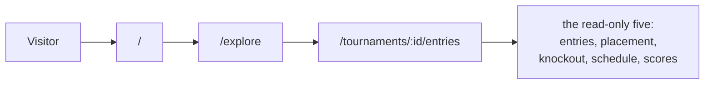
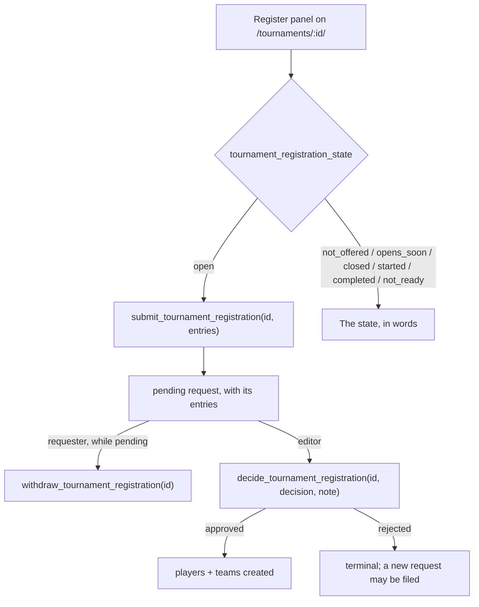

# Information architecture

The URL scheme, the shells, and the flows between them. Phase 2 gave every operational
surface its final, tournament-scoped address and added the public and participant surfaces
around it; this is the map of that shape, so a link, a redirect or a nav entry is written
against the scheme rather than against a path somebody remembered.

Authorization is a separate question and lives in [`authorization.md`](authorization.md).
This document is about *where* a thing is, not *who* may see it — although the two meet at one
point, so that point is stated below.

## 1. Who the addresses are for

Three audiences, and the address says which one it belongs to:

- **Anyone** (visitor or signed in) — the front door, Explore, a tournament's public page.
- **An operator** (owner or editor of one tournament) — the Desk and the other scoped
  surfaces, all under that tournament's id.
- **A participant** (any signed-in person) — the Register panel on a tournament's page, and
  their own request's status. Participation grants nothing else.

## 2. The address scheme

### Public, non-scoped

| Address | Surface |
| --- | --- |
| `/` | **Placeholder** Landing for a visitor (a bare "browse or sign in", not yet designed); Home for a signed-in caller (their tournaments, a Continue card for their working pointer, a discover strip) |
| `/explore` | Every tournament, searchable over name, venue and event, with a status filter |
| `/me/tournaments` | The caller's own: **Owned by me** and **Shared with me** |
| `/tournaments/new` | The create flow — the same four-step wizard Setup hosts, against a new row |
| `/auth` | Sign in / sign up. Accepts a validated `redirect` search param and returns there |
| `/tournaments/$tournamentId/` | One tournament's participant page: the card, and the Register panel. **Currently unlinked** — Explore opens a tournament on its read-only workspace (`…/entries`) instead, so this address is reachable only by URL while the read-only experience is being designed |

These are the only addresses that can be reached without naming a tournament. Each draws
`PublicShell`, because there is no tournament for a header to describe. `/tournaments/new` is a
sibling of `$tournamentId`, not a child, precisely because creating a tournament happens before
there is one to be inside.

`…/entries` is where reading a tournament begins: a card in `/explore` links there, and it is
the first of the five sections the read-only workspace offers (see [The shells](#3-the-shells)).

### Tournament-scoped

Everything below lives under `/tournaments/$tournamentId/`, and the layout route
(`route.tsx`) resolves the id once, 404s an unknown one, resolves the caller's access, and
mounts `WorkspaceShell` around the child page.

| Address | Surface | Audience |
| --- | --- | --- |
| `…/desk` | The Desk: one day, one court at a time, live | Operator |
| `…/entries` | Who is in the tournament, and the walk-in roster | Operator |
| `…/registrations` | The queue of requests awaiting a decision, with a nav badge when work is waiting | Editor |
| `…/placement` | Seeding and the placement stage | Operator |
| `…/knockout` | The tier-draw brackets | Operator |
| `…/schedule` | Tournament-wide planning. One address for both engines: the route reads `tournament.format` and renders the placement scheduler or the day planner | Organiser |
| `…/scores` | Result entry | Operator |
| `…/settings` | Configuration and the lifecycle, hosted in the shared wizard | Editor |
| `…/access` | Who else may operate this tournament | Editor |
| `…/pools`, `…/draws` | The legacy round-robin brackets, reachable by URL while a legacy tournament is read | Viewer |

The split between the Desk and the Schedule tab is a product rule, not a layout preference
(see [`../AGENTS.md`](../AGENTS.md)): the Desk is day-scoped and shows no tournament-wide
forecast, and the Schedule tab owns tournament-wide planning and is never rendered on the Desk.

### The flat legacy paths

Eight addresses shipped in Phase 1 without a tournament in them. They are bookmarks, so they
are kept — but each is a redirect rather than a page, and each resolves *on the caller's own
pointer* rather than on a fixed tournament:

| Legacy | Resolves to |
| --- | --- |
| `/setup` | `…/settings` |
| `/staff` | `…/access` |
| `/registration` | `…/entries` |
| `/placement` | `…/placement` |
| `/knockout` | `…/knockout` |
| `/schedule`, `/placement-schedule` | `…/schedule` |
| `/matches` | `…/scores` |

Each names a *section* from `lib/routing/workspace-redirect.ts` rather than a path, so the
workspace URL shape is written in one place. A redirect is a client-side component, not a
`beforeLoad`: a load-time redirect would run during server rendering, where there is no session
to read the pointer from, and would send a bookmark to whichever tournament the server's
request happened to resolve.

### No pointer

A caller with no working tournament — anonymous, or signed in and not yet choosing — resolves
every flat path to `/explore` through the one constant `NO_POINTER_FALLBACK`. It shipped as
`/auth` and flipped to `/explore` in the commit that created the route, which is why no caller
was edited when the destination changed. Someone with nothing to resume is better shown what
there is to work on than a sign-in form.

`/` is not a reader of that constant: it is a surface, and it renders its own two readings.

## 3. The shells

Two shells, and which one a page draws is decided by whether it is about one tournament.

- **`WorkspaceShell`** — mounted once, by the layout route. It draws the tournament header
  (name, lifecycle status, the section nav, the workspace switcher) and the caller's
  access-aware actions. No page below it renders a shell of its own; a page composes `Page`,
  which puts a title row over the page's own content.
- **`PublicShell`** — drawn by each of the five public routes above, since no layout knows what
  to put in a header outside a tournament. It carries the public nav, which is one entry
  (**Browse tournaments**, at `/explore`): a bar a signed-out visitor reads should not be a
  list of the caller's own work, and what is left does not change with the session, so the row
  does not move once the session settles. `/me/tournaments` and `/tournaments/new` stay
  reachable from the pages that link them.

The workspace nav is split by the edit right, not by the session. A caller who may edit gets
the operational six (`desk`, `entries`, `placement`, `knockout`, `schedule`, `scores`) plus the
three editor entries (`registrations`, `settings`, `access`). The editor entries are gated on
`can_edit`, because a nav entry that leads to a page saying no is a worse answer than not
offering the trip; the pages themselves still refuse, since the nav is presentation.

A read-only reader — a signed-in viewer or an anonymous visitor — gets five of them: the
operational sections **without the Desk**. The Desk is a live console for one court rather than
a page about the tournament, so it is the one operational entry that is not part of reading an
event. The list is derived from the operational one minus the Desk rather than restated, so a
section added later is offered to everyone reading the tournament by default. A read-only
workspace therefore opens on `entries` (the logo points at the first offered section, not at
the Desk), and the tournament's participant page at `/tournaments/$tournamentId/` is not part of
that experience.

## 4. The flows

### Finding a tournament

The participant page at `/tournaments/:id/` — the card and the Register panel — is no longer one
of the linked steps. Explore sends a card to the read-only workspace so the browse surface opens
on the event's state rather than on a form, and registration is out of the read-only experience
while it is redesigned. The address still resolves for anyone who has it.

Explore is the only search surface, and it renders one shape per row — `tournament_summary`,
which computes the status, the derived start and end, the registration state, the entry counts
and the caller's access level in the database rather than in the browser. The tournament card
on `/` and the create flow's list read the same function, so the three cannot disagree about
what a tournament is.

### Creating one

`/tournaments/new` hosts the same four-step wizard that Setup hosts
([`src/components/tournament-setup`](../src/components/tournament-setup)), against a tournament
that does not exist yet. The step that writes the row creates it, points the caller's working
pointer at it, and moves the address to `/tournaments/:id/settings` — which is what makes a
refresh resume the wizard rather than start a second tournament. There is one wizard with two
hosts, and neither host owns the steps.

### Working in one

The working tournament is per user: `profiles.current_tournament_id`, written by
`set_current_tournament`, and the workspace switcher moves it. There are exactly three acts
that write it — creating a tournament, choosing one from My Tournaments, and the switcher — and
they all go through the one action module.

There is no global active tournament. Phase 1's `is_active` pointer and its
`set_active_tournament` verb were retired, and many tournaments may be `upcoming` or
`in_progress` at once.

### Signing in

`/auth` accepts a `redirect` search param, validated to a local path, and returns there after
sign-in or sign-up. Every sign-in affordance on a page that needs a session carries the page's
own address as that param, so a person who signs in from a Register button lands on the
tournament they were reading rather than on the front door.

### Registering as a participant

A request names one or more categories, and a pair entry names a partner by name and email. The
Register button and its copy read `tournament_registration_state`, which computes the window in
the same order and from the same predicates the RPC uses, so the button and the RPC cannot
disagree. The RPC re-checks everything anyway — the read is a read.

### Deciding a request

`/tournaments/:id/registrations` is the editor's queue: the pending requests with their entries,
approve or reject with a note, and the capacity shown as it will be at approval. Approving runs
the identity bridge in one transaction — the requester's player row is linked (or created), each
named partner is matched to an unlinked row or created, the caps are turned into a sentence, and
the `teams` rows are written. Being approved grants no management right.

The operator surface that lists who is *already* in the tournament is `/tournaments/:id/entries`,
which is a different page. The two names are deliberate: "Registrations" is the queue of
requests, "Entries" is the roster.

## 5. The rules that hold across the scheme

- **One definition per address.** The Desk exists in exactly one file; `/` is defined by
  `routes/index.tsx` alone; the two scheduling views share one format-aware route rather than
  two nav targets.
- **A shipped link resolves.** Every literal `to=` target is checked against the router's own
  generated route ids, so a link to an address with no route fails the unit suite rather than a
  click.
- **Nothing global decides where you are.** No default tournament, no server-side pointer read,
  no redirect that happens before the session is known.

## 6. Changing any of this

The URL scheme is asserted in [`src/routes/-surfaces.test.ts`](../src/routes/-surfaces.test.ts)
— the shells each page draws, the flat paths' redirects, the single definition of the Desk and
of `/`, and the `NO_POINTER_FALLBACK` constant. A new address means that file, the workspace nav
in [`src/components/app-shell.tsx`](../src/components/app-shell.tsx), and this document, in the
same change.
